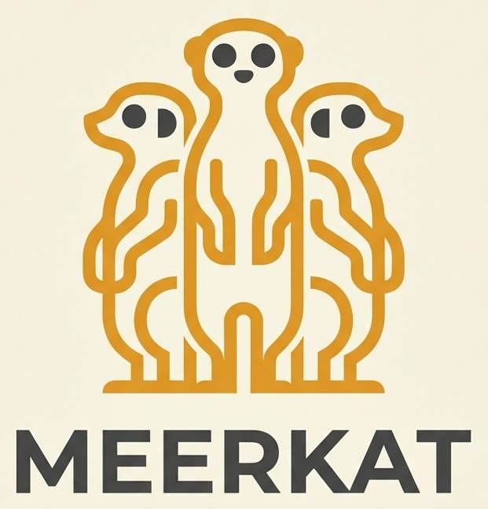
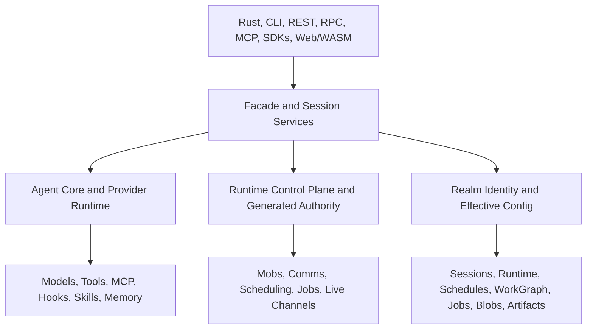
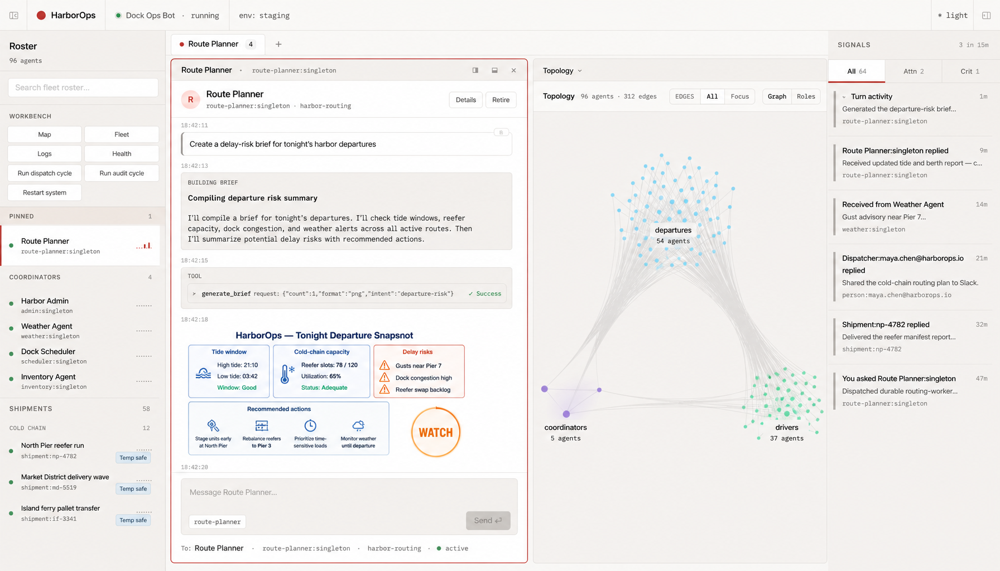

<p align="center">
  
</p>

<h1 align="center">Meerkat</h1>

<p align="center">
<strong>A library-first Rust platform for building, hosting, and operating agents.</strong>
</p>

<p align="center">
  <a href="#products">Products</a> &bull;
  <a href="#meerkat-core">Core</a> &bull;
  <a href="#meerkat-meta">Meta</a> &bull;
  <a href="#meerkat-connect">Connect</a> &bull;
  <a href="#meta-forge">Forge</a> &bull;
  <a href="https://docs.rkat.ai">Documentation</a>
</p>

<p align="center">
  <a href="https://github.com/lukacf/meerkat/releases/latest"></a>
  
  
</p>

Meerkat is an open-source, provider-agnostic platform for AI agents. Run an
agent from the command line, embed agents in your application, or operate a
coordinated system of agents that works over time. One Rust runtime owns agent
execution, typed events, providers, tools, persistence, runtime control and
multi-agent orchestration, and every surface and product builds on its
contracts.

This repository holds the whole platform in one Cargo workspace: the Core
runtime and the products built around it. Core, Meta and Connect release
together under one Meerkat version, each through its own release path. Meta
Forge keeps a version line of its own. See [Releases](#releases).

## Products

| Product | Directory | What it does | Get started | Docs | Release tag |
|---------|-----------|--------------|-------------|------|-------------|
| **Meerkat Core** | [`crates/`](crates), [`sdks/`](sdks) | The agent runtime, with the `rkat` CLI, the REST, JSON-RPC and MCP servers, and the Rust, Python, TypeScript and Web SDKs | [Quick start](#quick-start) | [Core docs](https://docs.rkat.ai/introduction) | [`v<version>`](https://github.com/lukacf/meerkat/releases/latest) |
| **Meerkat Meta** | [`meta/`](meta) | Applications around agents: lasting identities, memory, routing, access policy, approvals and a console | [Start a runtime](#meerkat-meta) | [Meta docs](https://docs.rkat.ai/meta/introduction) | [`meta-v<version>`](#releases) |
| **Meerkat Connect** | [`connect/`](connect) | Agent-led discovery, installation and setup of integrations | [Install](#meerkat-connect) | [Connect docs](https://docs.rkat.ai/connect/introduction) | [`connect-v<version>`](#releases) |
| **Meta Forge** | [`meta/installer/`](meta/installer) | A guided conversation that designs, builds and packages an agent application (developer alpha) | [Open Forge](#meta-forge) | [Forge guide](meta/installer/README.md) | [`meta-installer-v<version>`](#releases) |

Core runs agents and mobs on its own. Meta composes Core agents into
applications. Connect adds agent-led integration setup for Core agents and Meta
applications; neither requires it. Forge, part of Meta, guides the design and
packaging of agent applications built on Meta.

## Releases

Meerkat has one version number. Core, Meta and Connect release together with
matched versions (Meerkat 0.9.9 means Core 0.9.9, Meta 0.9.9 and Connect
0.9.9), and each product publishes through its own release workflow, tag and
packages:

| Product | Tag | Publishes |
|---------|-----|-----------|
| Core | `v<version>` | `rkat`, `rkat-rpc`, `rkat-rest` and `rkat-mcp` archives with `checksums.sha256`, the Homebrew formula, the Core crates on crates.io, `meerkat-sdk` on PyPI, and `@rkat/sdk` and `@rkat/web` on npm |
| Meta | `meta-v<version>` | `meta-gateway`, `meta-rpc-gateway` and `meta-repair` archives, `meerkat-meta` and `meta-extension-state` on crates.io, `meerkat-meta` on PyPI and `@rkat/meta-sdk` on npm |
| Connect | `connect-v<version>` | Release assets only: the Connect CLI and gateway archives and the Connect SDK packages |
| Meta Forge | `meta-installer-v<version>` | A prepared package per platform, published as a prerelease on Forge's own version line |

Each product publishes on this repository's
[Releases](https://github.com/lukacf/meerkat/releases) page, where Core's
release is the one marked latest. The changelogs are
[`CHANGELOG.md`](CHANGELOG.md) (Core), [`meta/CHANGELOG.md`](meta/CHANGELOG.md)
and [`connect/CHANGELOG.md`](connect/CHANGELOG.md). Releases made before the
products moved into this repository remain in
[lukacf/meerkat-meta](https://github.com/lukacf/meerkat-meta/releases) (Meta,
and Forge under `forge-v<version>` tags) and
[lukacf/meerkat-connect](https://github.com/lukacf/meerkat-connect/releases)
(Connect).

## Meerkat Core

Core is the composable agent runtime: a shared runtime, not a fixed agent user
experience. Its crates in [`crates/`](crates) own agent execution, typed
events, providers, tools, persistence, runtime control and multi-agent
orchestration. The CLI, REST, JSON-RPC, MCP, Python, TypeScript and
browser/WASM surfaces use those same contracts.

### Quick start

```bash
brew install lukacf/meerkat/rkat
export RKAT_OPENAI_API_KEY="sk-..."
rkat run "What is the capital of France? Answer in one sentence."
```

The Homebrew tap supports macOS and Linux and installs `rkat`, `rkat-rpc`,
`rkat-rest` and `rkat-mcp`. Other installation paths:

```bash
cargo install rkat
pip install meerkat-sdk
npm install @rkat/sdk
npm install @rkat/web
```

Each Core release also carries one archive per binary per target
(`rkat-<version>-<target>.tar.gz`, a `.zip` on Windows, and the same for
`rkat-rpc`, `rkat-rest` and `rkat-mcp`) with `checksums.sha256`. The
[quickstart](https://docs.rkat.ai/quickstart#linux-without-homebrew) shows a
Linux install without Homebrew. `cargo install rkat` builds from source and
installs `rkat` only; see [Building and
deploying](https://docs.rkat.ai/guides/deploying). The Python and TypeScript
SDKs resolve a compatible `rkat-rpc` and can download one automatically. To
move to a new release, see [Upgrading](https://docs.rkat.ai/guides/upgrading).

<details>
<summary>Provider environment variables</summary>

| Provider | Resolution order |
|----------|------------------|
| Anthropic | `RKAT_ANTHROPIC_API_KEY`, `ANTHROPIC_API_KEY` |
| Public OpenAI | `RKAT_OPENAI_API_KEY`, `OPENAI_API_KEY` |
| Gemini | `RKAT_GEMINI_API_KEY`, `GEMINI_API_KEY`, `RKAT_GOOGLE_API_KEY`, `GOOGLE_API_KEY` |
| Azure OpenAI | Prefixed key + endpoint pair, then `AZURE_OPENAI_API_KEY` + `AZURE_OPENAI_ENDPOINT` |

If both public OpenAI and only unprefixed Azure variables are present, public
OpenAI wins. Setting either prefixed Azure selector makes a complete prefixed
or fallback Azure key/endpoint pair the OpenAI environment default.

</details>

The catalog defaults are `gpt-6-astra` (OpenAI, and the global default),
`claude-opus-5-5` (Anthropic) and `gemini-4-argon` (Gemini, on paid Gemini API
tiers; select `gemini-3.8-flash` on the free tier). Catalog support does not
guarantee access for an API organization or through Azure, Copilot or custom
backends, so select an available model explicitly when needed:

```bash
rkat run --model gpt-5.5 "Explain async/await"
rkat run --model claude-sonnet-4-6 "Explain async/await"
rkat run --model gemini-3.8-flash "Explain async/await"
rkat models

# Render a requested HTML artifact in the browser
rkat run --browser \
  "Create a one-page comparison of the REST, JSON-RPC, and MCP surfaces"
```

### Realms and credentials

The CLI derives a stable workspace realm by default; bare server and SDK
launches use fresh isolated realms. Pass one explicit realm when several
surfaces should share sessions and config. The processes must also resolve the
same physical storage root:

```bash
rkat --state-root /srv/meerkat/realms --realm team-alpha run "Draft a release note"
rkat-rpc --state-root /srv/meerkat/realms --realm team-alpha
```

`rkat auth login` stores credentials in the home-rooted `global` realm, which
workspace realms inherit. `rkat auth login openai` signs in through the
ChatGPT OAuth backend, a separate account surface from `openai_api` keys that
can expose a different model set. `rkat auth login copilot` uses GitHub device
authorization to create OpenAI-, Anthropic- and Gemini-family Copilot routes:

```bash
rkat auth login openai
rkat auth profiles
rkat run --model gpt-5.6-sol \
  --auth-binding global:openai_oauth \
  "Summarize this pull request"
```

See the [quickstart](https://docs.rkat.ai/quickstart), [auth
guide](https://docs.rkat.ai/guides/auth) and [realm
guide](https://docs.rkat.ai/guides/realms) for the full setup path.

### What Core provides

- **Agent execution.** Streaming model calls, parallel tool batches,
  structured output, retries, budgets, compaction, interrupts and typed
  terminal outcomes. A session runs at most one turn at a time and exposes
  committed history separately from in-flight events. Critical lifecycles come
  from shared state-machine definitions that generate both TLA+ specifications
  and the runtime's Rust kernels ([machine
  authority](https://docs.rkat.ai/reference/machine-authority)).
- **Realms, config and storage.** A realm scopes sessions, config, auth
  bindings, runtime state, schedules, WorkGraph, jobs, blobs, artifacts and
  mob state. Built-in SQLite persists every realm storage domain, JSONL
  persists sessions but disables scheduling, and memory storage is ephemeral.
  Config inherits through realm parent chains; state never inherits.
- **Providers and models.** Anthropic, OpenAI, Gemini, Azure and other cloud
  variants, GitHub Copilot routes and configured OpenAI-compatible self-hosted
  models share one model catalog and provider runtime. Exact catalog ownership
  selects the provider, capability profiles govern limits, reasoning,
  multimodal input and provider-native tools, and runtime model fallback is
  bounded and capability-aware.
- **Auth and bindings.** Backend profiles describe where requests go, auth
  profiles describe how credentials are obtained, and a binding joins a
  compatible pair. Sessions persist only the binding reference, never API keys
  or access tokens.
- **Tools, MCP, hooks and skills.** Compose custom dispatchers with builtins,
  shell policy, MCP servers, skills, semantic memory, schedules, WorkGraph,
  comms and mob tools. Tools can be discovered lazily and scoped per session,
  turn or profile. Typed hook points cover run, model, tool and turn
  boundaries with observe and guardrail semantics, and observe-only points
  follow committed runtime input, peer messages and interactions.
- **Scheduling, WorkGraph, jobs and approvals.** Durable schedules target
  sessions, identities, mobs or trusted host runnables from once, interval or
  calendar triggers. WorkGraph is a realm-scoped graph of goals, work items,
  claims, links, evidence and status. Durable jobs detach accepted work from
  one client connection. The JSON-RPC `approval/*` methods keep request and
  decision audit records; they do not gate tool execution by themselves.
- **Mobs and comms.** Mobs are reusable teams of session-backed members with
  stable identity, role profiles, budgets, tool and auth scope, signed peer
  communication, topology and flows. Mobpacks package mob definitions and
  assets into portable artifacts with optional Ed25519 signing.
- **Live channels.** `gpt-realtime-2` sessions can open low-latency audio and
  text channels over WebSocket (`rkat-rpc --live-ws <addr>`) or WebRTC
  (`rkat-rpc --live-webrtc` in a build with the `live-webrtc` feature).
- **Images, blobs and artifacts.** `generate_image` routes through OpenAI or
  Gemini image profiles independently of the chat model. Generated bytes live
  in realm blob storage, and artifact records add typed metadata and download
  identity.
- **Web/WASM.** `@rkat/web` runs sessions and mobs in the browser, with
  JavaScript tools, provider proxies and host-page auth resolvers.

The [capability matrix](https://docs.rkat.ai/reference/capability-matrix)
describes build profiles and runtime capabilities.

### Surfaces

| Surface | Use case | Documentation |
|---------|----------|---------------|
| Rust facade | Embed agents and runtime services | [Rust SDK](https://docs.rkat.ai/rust/overview) |
| Python SDK | Drive `rkat-rpc` from Python | [Python SDK](https://docs.rkat.ai/sdks/python/overview) |
| TypeScript SDK | Drive `rkat-rpc` from Node.js | [TypeScript SDK](https://docs.rkat.ai/sdks/typescript/overview) |
| Web SDK | Browser/WASM sessions, mobs, JS tools, provider proxy | [Web/WASM](https://docs.rkat.ai/examples/wasm) |
| `rkat` | Terminal, CI, and shell automation | [CLI](https://docs.rkat.ai/cli/commands) |
| `rkat-rest` | HTTP integration and streams | [REST](https://docs.rkat.ai/api/rest) |
| `rkat-rpc` | Stateful stdio/TCP, SDK backend, live signaling | [JSON-RPC](https://docs.rkat.ai/api/rpc) |
| `rkat-mcp` | Expose Meerkat capabilities to MCP clients | [MCP](https://docs.rkat.ai/api/mcp) |

### Self-hosted models

Register an OpenAI-compatible server and one or more model aliases:

```toml
[self_hosted]
default_model = "gemma-4-31b"

[self_hosted.servers.local]
transport = "openai_compatible"
base_url = "http://127.0.0.1:11434"
api_style = "chat_completions"

[self_hosted.models.gemma-4-31b]
server = "local"
remote_model = "gemma4:31b"
display_name = "Gemma 4 31B"
family = "gemma-4"
context_window = 256000
max_output_tokens = 8192
vision = true
supports_reasoning = true
```

Server entries contain connection facts only; credentials belong to a realm
binding for `provider = "self_hosted"`. [Self-hosting
models](https://docs.rkat.ai/guides/self-hosting-models) covers the binding,
the full set of capability fields, and authless, API-key and bearer setups.

### Embedded Rust

The public `meerkat::AgentBuilder` routes through `AgentFactory` while allowing
explicit client, tool and store overrides. It defaults to the
`StandaloneEphemeral` runtime mode, which suits a single embedded component:

```rust
let mut agent = AgentBuilder::new()
    .model("claude-opus-5-5")
    .system_prompt("You are an incident triage component.")
    .output_schema(OutputSchema::new(triage_schema)?)
    .budget(BudgetLimits::default().with_max_tokens(2_000))
    .build(llm, tools, store)
    .await?;

let result = agent.run(raw_alert_text.into()).await?;
let triage: TriageReport =
    serde_json::from_value(result.structured_output.ok_or("missing output")?)?;
```

For durable products, use a runtime-backed `SessionService` and
`FactoryAgentBuilder`; a default standalone builder does not acquire recovery,
auth-lease, scheduling, wake or multi-agent runtime capabilities. The `meerkat`
facade enables the Anthropic, OpenAI, Gemini and Copilot providers by default.
Embedded consumers can disable defaults and select provider, store, MCP, comms,
skills, live, memory, ATIF and session capabilities individually; the
schedule, WorkGraph and durable-job substrates are always linked, and hosts
choose whether to expose their services and tools.

Meerkat is pre-1.0 and patch releases can contain declared public API breaks.
Exactly pin the Meerkat crate family and bump deliberately:

```toml
meerkat = { version = "=0.9.13", features = ["sqlite-store", "session-store"] }
```

### Architecture



`meerkat-core` owns the agent and public lifecycle contracts. The `meerkat`
facade and its `AgentFactory` compose product capabilities. `meerkat-runtime`
owns the control plane and machine integration. `meerkat-session` implements
service profiles, and store crates own physical persistence. Surface crates are
skins over this composition rather than separate agent engines. The
[architecture reference](https://docs.rkat.ai/reference/architecture) covers
crate ownership, construction paths and failure domains.

## Meerkat Meta

<p align="center">
  
</p>

Meerkat Meta composes Core agents into applications with lasting identities,
memory, routing, access policy, approvals and a console. Use it for a personal
assistant, a team of specialists or a system of agents that operates over time.
Core still owns the agent loop, sessions, stable agent identity, spawning, mob
lifecycle and communication; Meta composes them for the application, and its
console and timeline reflect the underlying runtime.

To start a local runtime from this checkout, with Rust 1.97+ and Python 3.10+:

```bash
cd meta
python3 -m venv .venv
.venv/bin/python -m pip install -e ./sdk/python
./scripts/repo-cargo build -p meerkat-meta --bin rpc_gateway --locked
./scripts/repo-cargo --print-env
```

The last command prints `CARGO_TARGET_DIR`; the gateway is its
`debug/rpc_gateway` executable. [`meta/README.md`](meta/README.md#start-a-local-runtime)
continues with a short Python program that starts a runtime, reads its status
and shuts it down. The [Meta quickstart](https://docs.rkat.ai/meta/quickstart)
then adds a mob configuration, an agent roster, provider access and console
authentication.

Meta releases ship the `meerkat-meta` Python package, the `@rkat/meta-sdk`
TypeScript package, the `meerkat-meta` crate for Rust hosts, and the gateway
executables in release archives such as `meta-rpc-gateway-<version>-<target>`.
The Python and TypeScript SDKs control a gateway and do not bundle it; use a
gateway and an SDK from the same release. The [example
packs](meta/examples/README.md) show complete applications, and the [Meta
documentation](https://docs.rkat.ai/meta/introduction) covers memory, access
control, the console and the runtime architecture.

## Meerkat Connect

Meerkat Connect gives agents the integrations they need. It combines a library
of more than 100 integrations with agent-led discovery and installation beyond
it: describe a task, review the proposed software and access, and let Connect
guide the setup. Core and `rkat` do not depend on Connect.

Connect is published as a complete CLI archive for Apple silicon macOS and for
Linux x86_64. To set up a first integration:

1. Download the archive for your platform
   (`meerkat-connect-<version>-<platform>.tar.gz`) and its `.sha256` file from
   a Connect release, verify the checksum, extract it and put its `bin`
   directory on your `PATH`. Keep the extracted directory together.
2. From the project directory where you want the integration, start Connect in
   a realm, complete model setup if prompted, and describe what you need, for
   example: *Add an integration that reads Hacker News and give the normal
   agent read-only access.*

   ```sh
   meerkat-connect --realm work
   ```

3. Review the selected software and access, and complete any sign-in or key
   entry in the protected controls. Enter `/quit`, then use the integration
   from an ordinary agent in the same realm and project directory:

   ```sh
   rkat --realm work run --wait-for-mcp --mcp-auth stored \
     "Read the three leading Hacker News stories and summarize them."
   ```

[`connect/README.md`](connect/README.md#install-and-use) lists the platform
requirements and exact download commands, and the [Connect
quickstart](https://docs.rkat.ai/connect/quickstart) also covers setup inside
an application's integrated Console.

## Meta Forge

Meta Forge turns an idea into an agent application through a guided
conversation: answer one focused question at a time, inspect the proposed team
and behavior, and build a deployment package you can review and install. Forge
is the setup and application authoring tool in Meerkat Meta. It is a developer
alpha and keeps its own version line.

Forge opens from a prepared package, not from a source checkout. Download the
package for your platform (Apple silicon macOS or Linux x86_64) from a Forge
release, unpack it into a new folder you will keep, open a terminal there and
run:

```bash
bash start.sh
```

Open the address it prints, normally `http://127.0.0.1:8787`, and keep the
terminal open. Forge needs Python 3.11 or later with `venv` and `ensurepip`,
and internet access for its initial pinned dependencies. Applications install
into Forge's own Python, and the [Forge guide](meta/installer/README.md#open-the-wizard)
names the CPython version they need and how to select it. Continue with [your
first setup](meta/installer/GETTING_STARTED.md); the [Forge
guide](meta/installer/README.md) is the full reference, including platform
prerequisites.

## Repository layout

| Path | Contents |
|------|----------|
| [`crates/`](crates) | Core's Rust crates: the `meerkat` facade, `meerkat-core`, providers, runtime, stores, tools, mobs, the `rkat` CLI (`meerkat-cli`), the REST, JSON-RPC and MCP servers, the browser runtime and the `xtask` repository tooling |
| [`sdks/`](sdks) | Core's Python, TypeScript and Web SDKs |
| [`meta/`](meta) | Meerkat Meta: its crates, Python and TypeScript SDKs, console, flow editor, docs and example packs, with Meta Forge in [`meta/installer/`](meta/installer) |
| [`connect/`](connect) | Meerkat Connect: its crates, SDKs, setup agent instructions, docs and release inputs |
| [`docs/`](docs) | Source of [docs.rkat.ai](https://docs.rkat.ai) |
| [`examples/`](examples) | Core examples across the CLI, Rust, Python, TypeScript and browser surfaces |
| [`tests/`](tests) | Core's workspace integration tests, live smoke lanes and fixtures |
| [`specs/`](specs) | TLA+ machine and composition specifications behind the generated runtime authority |
| [`artifacts/`](artifacts) | Generated wire schemas that feed SDK code generation |
| [`scripts/`](scripts), [`tools/`](tools), [`ci/`](ci) | Build, release and CI tooling: the `repo-cargo` wrapper, SDK code generation, optional Bazel/BuildBuddy support and the product registry `ci/products.json` |
| [`.github/`](.github) | CI and the release workflows of each product |

## Documentation

[docs.rkat.ai](https://docs.rkat.ai) documents
[Core](https://docs.rkat.ai/introduction),
[Meta](https://docs.rkat.ai/meta/introduction) and
[Connect](https://docs.rkat.ai/connect/introduction), and also
[Recall](https://docs.rkat.ai/recall/introduction), shared evidence-backed
knowledge for applications and agents, which is developed in its own
repository. The site is built from [`docs/`](docs); its Meta pages are
generated from [`meta/docs`](meta/docs). Forge's documentation is in
[`meta/installer/`](meta/installer/README.md).

## SDKs

| Product | Language | Package | Source | Docs |
|---------|----------|---------|--------|------|
| Core | Rust | `meerkat` on crates.io | [`crates/meerkat`](crates/meerkat) | [Rust SDK](https://docs.rkat.ai/rust/overview) |
| Core | Python | `pip install meerkat-sdk` | [`sdks/python`](sdks/python) | [Python SDK](https://docs.rkat.ai/sdks/python/overview) |
| Core | TypeScript | `npm install @rkat/sdk` | [`sdks/typescript`](sdks/typescript) | [TypeScript SDK](https://docs.rkat.ai/sdks/typescript/overview) |
| Core | Web/WASM | `npm install @rkat/web` | [`sdks/web`](sdks/web) | [Web/WASM](https://docs.rkat.ai/examples/wasm) |
| Meta | Rust | `meerkat-meta` on crates.io | [`meta/crates/meerkat-meta`](meta/crates/meerkat-meta) | [Rust](https://docs.rkat.ai/meta/sdks/rust) |
| Meta | Python | `pip install meerkat-meta` | [`meta/sdk/python`](meta/sdk/python) | [Python](https://docs.rkat.ai/meta/sdks/python) |
| Meta | TypeScript | `npm install @rkat/meta-sdk` | [`meta/sdk/typescript`](meta/sdk/typescript) | [TypeScript](https://docs.rkat.ai/meta/sdks/typescript) |
| Connect | Python, TypeScript | Connect release assets | [`connect/sdk`](connect/sdk) | [Connect SDKs](https://docs.rkat.ai/connect/sdks/python) |

Core's Python and TypeScript SDKs drive `rkat-rpc`; Meta's drive Meta's
`rpc_gateway`.

## Development

The repository is one Cargo workspace: the root [`Cargo.toml`](Cargo.toml)
lists Core's crates, `meta/crates/*` and `connect/crates/*`. Its default
members are Core's, so a bare Cargo command builds Core only. Cargo unifies
features across the packages of one invocation, so Core's Make targets select
Core's packages only and Meta's Makefile selects Meta's. The toolchain is
pinned to Rust 1.97.0 in [`rust-toolchain.toml`](rust-toolchain.toml).

Complete the [onboarding prerequisites](docs/internal/onboarding.md#prerequisites),
including Node.js and `cargo-nextest`, before running contributor validation.
`make install-build-deps` installs the pinned Rust toolchain and components,
not every validation tool. Make is the command surface:

```bash
make install-build-deps
./scripts/repo-cargo install cargo-nextest --locked
make build
make check
make lint
make test
node scripts/affected-tests.mjs --run   # the tests your change affects
```

Use the repository wrapper instead of bare `cargo` for targeted work. It keeps
a separate build cache per worktree. Test commands pass the crate's test
features, which `node scripts/core-workspace-args.mjs --tests -p <crate>`
prints:

```bash
./scripts/repo-cargo test $(node scripts/core-workspace-args.mjs --tests -p meerkat-core) session
```

Documentation and generated contract gates:

```bash
make docs-check
make verify-version-parity
make verify-schema-freshness
make verify-sdk-codegen-freshness
make machine-check-drift
```

Deterministic end-to-end lanes are `make e2e-fast` and `make e2e-system`;
the live-provider lanes `make e2e-live` and `make e2e-smoke` are opt-in.
`make ci` runs the local CI aggregate and `make help` lists the targets.

Meta and Connect have their own commands:

```bash
make -C meta check          # compile-check Meta's crates
make -C meta test           # Meta's Rust tests
make -C meta test-python    # Meta's Python SDK against a freshly built gateway
./scripts/repo-cargo check $(node scripts/core-workspace-args.mjs --product connect)
```

`node scripts/core-workspace-args.mjs --product <name>` prints a product's
packages as `-p` arguments, from [`ci/products.json`](ci/products.json).

## Contributing

New contributors should start with [the onboarding
guide](docs/internal/onboarding.md) and [AGENTS.md](AGENTS.md).
[`meta/CONTRIBUTING.md`](meta/CONTRIBUTING.md) describes Meta's repository
checks. Install the repository Git hooks with `make install-hooks`.

## License

Licensed under either of:

- Apache License, Version 2.0 ([LICENSE-APACHE](LICENSE-APACHE))
- MIT License ([LICENSE-MIT](LICENSE-MIT))

at your option. Third-party material keeps its own license and attribution,
recorded beside it.
