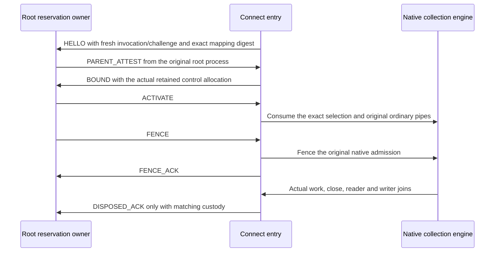

<Note>
This describes development source. The protected entry and its controls have
not yet been compiled or run on Linux. An application executable, root launcher,
installed resources and real provider/collection acceptance still require
composition and validation. This is not a released launcher command.
</Note>

The Linux `protected_parent` module receives a root broker's original login
reservation over a separate private channel. It verifies the actual sender,
selects a native caller from the sealed mapping, and retains that observation
through the existing [service collection engine](/connect/guides/service-collections).
The application owns its compiled programs and executable. The root broker
owns the original login, process launch, namespaces and reservation release.

## Adopt before starting threads

Transfer the original parent socket, sealed mapping, read-only input FIFO and
write-only output FIFO into `ProtectedServiceInputs::adopt`. Call it from the
single-threaded application entry, before creating a Tokio runtime, starting
background loggers or launching helpers. Every descriptor becomes close-on-exec.
Connect does not duplicate them or convert unowned integer FD arguments. The
application must implement its own reviewed, one-time descriptor acquisition.

```rust
use std::{os::fd::OwnedFd, sync::Arc};
use meerkat_connect::protected_parent::{
    ProtectedCollectionCatalog, ProtectedServiceInputs,
};

fn serve(
    parent: OwnedFd,
    mapping: OwnedFd,
    input: OwnedFd,
    output: OwnedFd,
    catalog: Arc<dyn ProtectedCollectionCatalog>,
) -> Result<(), Box<dyn std::error::Error>> {
    let inputs = ProtectedServiceInputs::adopt(parent, mapping, input, output)?;
    let runtime = tokio::runtime::Builder::new_multi_thread()
        .enable_all()
        .build()?;
    runtime.block_on(async { inputs.start(catalog)?.join().await })?;
    Ok(())
}
```

Adoption checks the actual nonroot real, effective, saved and filesystem user
and group identities, exact supplementary groups, and absence of inherited,
permitted, effective and ambient capabilities. It sets and verifies
`no_new_privs` and nondumpability before threads start. These checks do not
establish isolation from a hostile process using the same UID. The launcher
must prevent same-UID process and filesystem access before exec, during native
entry and across helper execs, while preserving the original workspace's
mount/network isolation. Exec can reset dumpability. The root launcher must
also supply a controlled environment before the dynamic loader runs.

## Supply the closed mapping

The root launcher supplies a root-owned regular memfd, mode `0400`, opened
read-only and sealed against writes, growth, shrinkage and further seal changes.
All four objects must be distinct. Connect hashes the original bytes without
reserializing them. The broker must compare that digest to its exact original
reservation before attesting.

The mapping is one JSON object with schema
`meerkat.connect.protected-service.v1` and `protocol_version: 7`. Every listed
field is required. Unknown fields and duplicate keys are refused at every
depth, including free-form resources. Input is bounded to 65,536 bytes, depth
32 and 16,384 values/object keys.

| Field | Required contents |
| --- | --- |
| `application` | `application_id`, `origin` |
| `source_selection` | Exact installed application selection ID checked by the compiled catalog |
| `principal_mappings` | Nonempty exact rows of `issuer`, `subject`, `workspace`, `origin`, `caller` |
| `authentication_evidence_domain` | Explicit qualified `authority` principal and `namespace` |
| `realm` | `realm_id`, `state_root`, `context_root`, `user_config_root` |
| `ingress` | Explicit qualified native principal, different from every mapped caller |
| `installation` | `executable`, `resource_root`, `resource_manifest_sha256` |
| `execution` | Nonzero `uid`, nonzero `gid`, sorted unique nonzero `supplementary_gids` |
| `provider_store` | One explicit selection described below |
| `catalog_id` | Exact compiled application catalog ID |
| `collections` | Source, requirement and limit rows described below |

For multiple services under this same original parent, select schema
`meerkat.connect.protected-service.v2`, retaining `protocol_version: 7` and all
other fields. Replace `collections` with `services`, a nonempty ordered array
of objects containing exactly `service_id` and `collections`. Service IDs must
be unique. Each group's collections keep one family/profile/agent; source IDs
and total budgets are checked across groups. Schema v1 keeps its existing
single-service rule. Neither schema accepts both fields.

The compiled catalog must explicitly approve this composition. It can inspect
`CatalogSelection::service_ids()` and `CatalogSource::service_id()`; the JSON
cannot supply programs or authority. See the [multi-service collection
flow](/connect/guides/service-collections#select-multiple-services-in-one-protected-invocation)
for the original-pipe transition and remaining native validation.

Each principal has exactly `kind`, `id` and
`qualification: {"kind":"qualified","trust_domain_id":"..."}`. Use the actual
native principal kind and owner-selected domain. No role, realm name, URL or UID
is converted into a principal. Each workspace is exactly 64 lowercase hex
characters. Every allowlist origin must equal the application origin. The
actual attested issuer/subject/workspace/origin must match exactly one row.

Mapping paths must be absolute with no dot, parent or repeated-separator
aliases. Connect checks the used installation, realm and provider-store paths
against their canonical filesystem paths, refusing symlink aliases. A HOME
value bypassed by an explicit XDG_CONFIG_HOME is checked as an exact environment
value, not independently traversed. The current executable must match
`installation.executable`. Its
ancestors and the entire resource closure must be root-owned and protected
against group/world writes. Internal pinned resource symlinks are permitted.
The resource root must also match the existing `bin/../libexec/meerkat-connect`
layout, and the manifest digest must equal the compiled resource pin. A mutable
workspace bind at an installed-looking path does not satisfy these checks.

The launcher must precreate the selected UID-owned `0700` state, user-config
and provider-store directories, including an empty store before first sign-in.
Their ancestors must be root-owned or owned by that selected UID and protected
against group/world writes. These metadata checks require the launcher's
lifetime isolation; they do not prevent another process with the same UID from
changing path-based native storage.

### Bind provider storage explicitly

For an explicitly selected file store:

```json
{"kind":"file","root":"/selected/private/provider-store"}
```

For the pinned Linux native default, include all three fields:

```json
{
  "kind":"native_default",
  "home":"/selected/private/home",
  "xdg_config_home":null,
  "root":"/selected/private/home/.config/meerkat/credentials"
}
```

`null` requires XDG_CONFIG_HOME to be absent. A nonnull value must be the exact
absolute environment path. HOME must also match exactly. Connect resolves
Core's native default and requires its actual `File` root to equal the mapping,
then passes that validated path explicitly into the existing session startup.
Session startup replaces the factory's default persistence with this explicit
store before provider resolution. An omitted root does not establish per-user
isolation. The root launcher must preserve the application's intended
provider-to-guide store binding when choosing its execution identity.

## Resolve only compiled programs

Each collection contains `source_id`, `family`, `profile`, `agent`,
`requirements` and `limits`. Each requirement contains `id`, `program_id`,
`resource` and `raw_operation_ceiling`. Limits contain `calls`,
`argument_bytes` and `result_bytes`, using the native collection bounds.
All collections in one child must share the installed family/profile/agent.

Implement `ProtectedCollectionCatalog::accepts` to check the application,
source selection and catalog against the compiled application policy. Implement
`requirement` to resolve the exact program and resource schema into a
`RequiredCollectionOperation`. The returned ID, resource and operation ceiling
must match the mapping exactly. The callback receives borrowed
`CatalogSelection`, `CatalogSource` and `CatalogRequirement` views. It must not
launch helpers, admit native work or deserialize executable code.

The catalog runs before the installed native connection exists. Retain a
compiled `CollectionProgram` factory in the requirement and bind its cursor to
the actual `CollectionTarget::installed_connection()` supplied at collection
start. Validate the target's source, requirement, resource, operation ceiling
and endpoint/account selection before starting. Retain that exact installed
configuration for the attempt and compare each committed result's target
against it. Do not construct a connection from mapping prose or cache one
across attempts.

The mapping supplies intent. Actual checked installation, commissioning,
native finalization and joined close still create the private installed owner
and `Ready`. No mapping field or compiled catalog callback can supply a Ready
receipt. Collection results retain their existing historical meaning.

Retain the final source report from the matching SDK-validated collection
event: TypeScript `ServiceCollectionClient.collectionReport(event)` or Python
`event.report`. `ProtectedServiceRun::join` observes owner closure; it does not
return that source report or confirm durable storage. The native error path
can retain reports in `ServiceCollectionFailure`. See
[service collection reports](/connect/guides/service-collections#interpret-reports-and-close-the-owner)
for partial observations and the separate credential-continuity limitation.

## Retain the original lifecycle

### Adopt the root-launched pipes in Python

Use `ServiceCollectionClient.adopt(transport, binding)` when the trusted root
launcher has already authenticated and activated the original child. The
normal `ServiceCollectionClient(launcher, binding)` constructor creates a child itself; adoption
transfers just the existing ordinary pipes to the SDK. It preserves the same
protocol 7 initialization, prompt handling, collection reports and close path.

```python
from meerkat_toolkit.service_collection import (
    ServiceCollectionClient, ServiceCollectionTransport,
)
from meerkat_toolkit.service_setup import ServiceSetupLaunchError

# These are the root launcher's original unbuffered io.FileIO endpoints.
# root_request_retirement and root_wait_process are trusted host callbacks
# with the contracts below, bound to this exact original process.
transport = ServiceCollectionTransport(
    input=original_child_stdin,
    output=original_child_stdout,
    request_retirement=root_request_retirement,
    wait_process=root_wait_process,
    credential_scope=binding.credential_scope,
)
try:
    client = ServiceCollectionClient.adopt(transport, binding)
except ServiceSetupLaunchError as error:
    client = error.owner
    # Keep this owner and the root reservation; observe close on this client.
    raise
```

Each endpoint must be a distinct blocking FIFO with the correct access mode,
represented by an exact `io.FileIO` with `closefd=True`. Adoption sets and
verifies close-on-exec and atomically claims the pair once. The launcher must
provide the sole original endpoints without duplicate aliases, then stop
reading, writing or closing them after transfer. Descriptor checks cannot
establish that no other process or alias owns a copy. Identical reported FIFO
identities are refused, but some systems give separate identities to the two
ends of an anonymous pipe. The launcher must ensure the endpoints belong to
the correct, distinct child pipe pairs. Invalid binding or pipe
validation before transfer leaves I/O ownership with the launcher. A failure
after transfer retains the same client through `ServiceSetupLaunchError`.

`request_retirement()` must synchronously queue retirement of the original
root reservation and return `None` promptly. It must not wait for any SDK
worker. The SDK calls it at most once on stdout EOF, transport failure or failed
startup; successful graceful close submission and a close observation timeout
do not request an early fence. Failed close or cancellation enqueue also
requests retirement, so a blocked writer cannot conceal a failed control.

`wait_process(timeout)` must observe only the original child's actual exit,
return its integer exit code, and raise `TimeoutError` while it is still live.
Honor the deadline, including zero. The SDK serializes concurrent observations
and caches the actual result. The callback must not wait for SDK reader/writer
joins, native parent settlement, or a root operation that awaits those workers.
The root owner joins descendants, private parent custody and durable settlement
separately. A callback failure leaves cleanup unconfirmed even if a later exit
observation succeeds.

Callbacks execute on SDK threads or the close caller, outside the SDK condition
lock. Bridge to the root event loop safely, and run synchronous client calls
off that loop. Keep both owners across timeouts. `ServiceSetupClose` covers the
child exit, SDK I/O worker joins and existing native close response; it does not
release the root reservation or establish successful ingestion. Preserve
`event.report`, including failed or partial collection observations.



Every parent packet must carry matching kernel credentials and original
channel/invocation/reservation/mapping/control correlation. Replayed request
IDs and out-of-order messages are refused. The attestation's deadline is
checked independently of a Python timer. Authentication evidence addresses the
actual retained packet and kernel sender; it does not claim durable evidence
storage or renewed login currentness.

Fencing before ACTIVATE remains `unconfirmed` under protocol 1. After
activation, `joined` requires the existing native close receipt from the same
control. EOF, malformed packets, expiry or failed acknowledgement retire that
owner and continue driving its original invocation. A parent observer timeout
does not drop native work or manufacture completion. Dropping the public join
observer also leaves the retained task running; it is not a close operation.

The root launcher still joins its actual process and ordinary I/O owners before
releasing the original reservation. Failed/lost acknowledgements and uncertain
cleanup remain unconfirmed. Keep application stderr body-free; a detailed
returned Rust error is not suitable for unfiltered broker or browser output.
