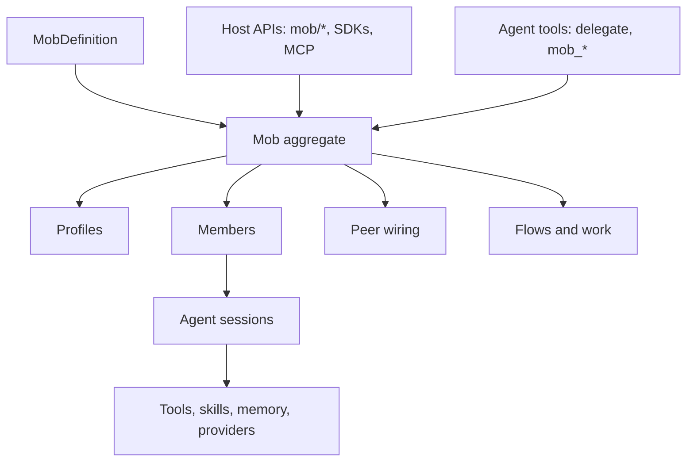

Mobs are Meerkat's multi-agent runtime. A mob is a durable team of agent
members with stable identities, profile-driven behavior, peer wiring, optional
flows, and host-visible lifecycle state.

Use mobs when one session is no longer the right unit of work: release triage
teams, code review panels, research teams, incident rooms, long-running helper
pools, and browser-deployed mobpacks all use the same underlying mob runtime.

<Note>
Mobs are the multi-agent path in Meerkat. The agent-facing `delegate` tool,
explicit `mob_*` tools, SDK `Mob` classes, `mob/*` RPC methods, public MCP mob
tools, and mobpack deployment all route through the mob system.
</Note>

## Choose A Path

| Need | Use |
|------|-----|
| One quick helper from an agent prompt | `delegate` inside `rkat run --tools full` |
| A persistent team the agent can manage | agent-side `mob_create`, `mob_spawn_member`, `mob_wire`, `mob_check_member` |
| An app or service orchestrating members directly | host APIs: JSON-RPC `mob/*`, public MCP `meerkat_mob_*`, Python `Mob`, TypeScript `Mob` |
| A browser-deployed team | Web SDK `@rkat/web` with `MeerkatRuntime.createMob`, or `rkat mob web build` from a mobpack |
| A repeatable workflow across members | mob flows |
| A signed, portable team definition | mobpack |

## Mental Model



A `MobDefinition` describes profiles, limits, wiring rules, topology, and
flows. The running mob records the roster, member lifecycle, events, flow runs,
and work state. Each member is an agent session, but public mob APIs address the
member by stable `AgentIdentity`, not by an internal session or runtime binding.

## Core Concepts

| Concept | Meaning |
|---------|---------|
| Mob | Durable orchestration aggregate: definition, members, events, flows, lifecycle |
| Profile | Role template: model, tool posture, skills, runtime mode, peer description |
| Member | One spawned participant with a stable `AgentIdentity` |
| Wiring | Undirected peer connectivity and mutual trust between members |
| Runtime mode | `autonomous_host` by default, `turn_driven` when explicit control is needed |
| Flow | Declarative workflow that dispatches steps to members |
| Work lane | Cancellable tracked work submitted to a mob or member |
| Mobpack | Portable signed artifact containing a mob definition and optional assets |

## Agent Tools Vs Host APIs

Keep this distinction sharp:

| Surface | Caller | Names | Purpose |
|---------|--------|-------|---------|
| Agent-side tools | The model inside a session | `delegate`, `mob_create`, `mob_spawn_member`, `mob_wire`, `mob_check_member` | Let an agent create helpers and coordinate its own team |
| Host APIs | Your application, CLI, SDK, or service | `mob/create`, `mob/spawn`, `mob/flow_run`, SDK `Mob` methods | Let software create, inspect, drive, and supervise mobs |
| Public MCP tools | External MCP clients | `meerkat_mob_*` | Expose the typed host control plane through MCP |

Agent-side tools are late-bound through the session build path. Host APIs are
the stable control plane for applications and SDKs. Do not treat raw `mob_*`
agent tools as if they were JSON-RPC methods.

## Fast Path: Delegate

`delegate` creates an implicit session-owned mob on first use, spawns a helper,
and wires the helper to the creating session. Use it for bounded helper work
that should report back.

```bash
rkat run --tools full "Ask one helper to inspect the test failure, then summarize what it found."
```

A delegate helper is ephemeral: it is retired after its one task, and also when
the calling turn stops waiting for it first.

For recurring teams, use explicit mobs instead of a chain of ad hoc delegates.

A mob member can also fork itself with `fork_off`. The child starts from the
member's exact committed transcript, runs one task in the background, and
belongs to the forker, which can check, list, and retire it (and whatever it
forks in turn) without manage scope over the mob. The result is recorded in the
forker's transcript as a durable `BackgroundJob` system notice: a forker still
in its turn sees it at the next model call, and an idle forker gets one wake
turn; on a one-shot `rkat run` without `--keep-alive` the
call blocks for it instead. There is no default deadline; `max_run_secs` is an
opt-in autokill. See [Mob tools](/reference/builtin-tools#fork_off-and-council-delivery)
for the result shapes and the ownership rules.

A fork child holds the instruction activations it copied from its source as
history only, and runs no model turn until each inherited key is activated in
the child. The host decides who does that with its fork instruction policy
(`MobBuilder::with_fork_instruction_policy`, or
`MobMcpState::with_fork_instruction_policy`); it is never a tool argument or
part of a mob definition:

- `require_explicit_activation` (the default): the host activates the child
  after `fork_member`. The forks that start the child's turn themselves
  (`fork_off`, the bounded and detached member forks, the live delegation's
  durable fork, and council participants) leave no window for that, so a fork
  of a member with activated host instructions is refused before anything is
  committed, with the typed `fork_instruction_refused` error.
- `reactivate_inherited`: the fork appends the child's own activation of every
  key that was effective in the source, and the child runs at once.
- `refuse`: every fork whose child would inherit an activation is refused.

A durable fork child's model never reads the body of an activation it
copied: it sees a line naming the key, and reads a body only from the
child's own activation. Skills the source loaded with `load_skill`, or was
given as per-turn skill context, follow the same policy as the host set it:
under the default each copied skill is named without its body, under
`refuse` the fork is refused, and under `reactivate_inherited` they are
carried. A fork that leaves no activation window applies this as set, so
under the default it strips the skills instead of refusing.

`fork_helper` (a member spawned with `MemberLaunchMode::Fork`) starts a
fresh session instead and gives it the source's recent conversation as
context. The same policy decides what of it the child gets, by each row's
type. The source's system prompt and host system context are never
carried. Under the default, the source's activated instructions, the
skills it loaded with `load_skill` (each named in their place) and
host-injected context such as memory recall are left out; under `refuse`
a fork whose context holds an activation or a loaded skill is refused;
under `reactivate_inherited` they are carried. A peer message in that
conversation keeps its sender, its text and its sender's taint marker; a
peer request or response keeps its sender and a preview of its params or
result (a response also its status). Neither keeps the ids or instructions
to answer it: the child is not its addressee.
The context fits a byte budget, newest rows first, and a fork whose newest
row alone does not fit is refused with `fork_context_too_large`.

A fork child is told what it was given. Before its first input it gets a
fork notice (a `fork_boundary` system notice) that names its source and,
by name only, the instructions and tools it lost or gained and what its
context carried. A `fork_helper` child gets its context the same way, as
one row before its first input, so a turn-driven helper sees it in its
task turn. A child placed on a member host gets them the same way when
its host serves prompt-context fork children (a host of this release
does); a host of 0.9.4 or earlier gives it the context and the notice as
the start of its first prompt instead.

## Define A Mob

A small mob definition has profiles and optional wiring:

```json
{
  "id": "release-triage",
  "orchestrator": { "profile": "lead" },
  "profiles": {
    "lead": {
      "model": "claude-opus-4-8",
      "peer_description": "Coordinates triage and assigns work",
      "external_addressable": true,
      "tools": {
        "builtins": true,
        "comms": true,
        "mob": true
      }
    },
    "analyst": {
      "model": "claude-sonnet-4-6",
      "peer_description": "Investigates one issue and reports evidence",
      "tools": {
        "builtins": true,
        "comms": true
      }
    }
  },
  "wiring": {
    "auto_wire_orchestrator": true,
    "role_wiring": [
      { "a": "lead", "b": "analyst" }
    ]
  },
  "limits": {
    "max_flow_duration_ms": 600000,
    "max_step_retries": 1
  }
}
```

Profiles are role contracts. Spawn requests may override selected profile
fields, but the definition remains the durable source for the mob's intended
shape.

<Warning>
**Every profile that spawns a member must set `comms = true` under `tools`.**
A member's identity, roster entry, peer wiring, peer messaging, and the
supervisor bridge are all keyed on its comms name (`{mob_id}/{role}/{member}`),
and the comms tools are composed for every member, so a member without comms
cannot be built. `comms` defaults to `false`, which means a profile that merely
omits the key is rejected exactly like one that sets it to `false`. The
rejection happens at spawn, before any session is created. The full message
is:

```text
wiring error: profile '<name>' has tools.comms=false; mob meerkats require comms=true. The default is false, so a profile that omits the key counts as false: set `comms = true` under `[profiles.<name>.tools]`. To keep a member from messaging peers, keep comms on and use `read_only = true` or a per-spawn `tool_access_policy` deny list.
```

It surfaces in two shapes. On the worker plane (`mob/spawn` and Meta's
`meta/ensure_member`) it is JSON-RPC error `-32602` with that text as the
message, prefixed `ensure_member failed: ` on Meta, and the failed spawn
leaves no roster entry behind. On Meta's identity-first plane the identity
record stays and reconciles to outcome `broken`, with the same text as that
identity's `error` in the bootstrap status
(`meta/status_identity_bootstrap`, Python `identity_bootstrap_status()`).
To keep a member from messaging peers, leave `comms = true` and add
`read_only = true` (below) or deny `send_message` through a per-spawn
`tool_access_policy` deny list; disabling comms is never the tool.
</Warning>

### Read-only profiles

`tools.read_only = true` declares a profile whose members may execute only
tools their owning dispatcher declares read-only. It is enforcement at the
execution gate, not prompt guidance, and it is the floor: a spawn request
cannot widen it.

```json
{
  "reviewer": {
    "model": "claude-opus-5",
    "peer_description": "Reviews changes and reports findings; cannot mutate anything",
    "tools": { "builtins": true, "comms": true, "read_only": true }
  }
}
```

A denied call comes back as an ordinary `access_denied` tool error, so the run
continues and the transcript records the refusal. The model-visible tool list is
unchanged (gating never moves the prompt-cache prefix).

What the declaration covers, and what it cannot:

| Tool class | Under `read_only` | Why |
|------------|-------------------|-----|
| Built-ins that declare read-only (`datetime`, `task_get`, `task_list`, `peers`, `blob_inspect`, skill browsing/reads, `view_image`, `web_search`, shell job status/list) | Permitted | The owning tool declares `ReadOnly` |
| Built-ins that mutate (`apply_patch`, `shell`, `blob_save_file`, `generate_image`, `task_create`/`task_update`, `send_message`, `monitor_start`) | Denied | Declared `Mutating` |
| `shell` specifically | Denied, always | Nothing classifies a command line, so there is no read-only shell. File reads in-tree go through `shell`, so a read-only member cannot read files unless the host supplies a dispatcher that declares its own read tools |
| MCP tools | Denied | `readOnlyHint` is a hint from the server being gated, not a proof. Audit the tool and use an explicit allow-list policy instead |
| Host rust bundles / external tool surfaces | Denied until they declare | Undeclared is `Unknown`, and `Unknown` is never admitted |
| Provider-native server tools (provider-run search, code execution, computer use) | Not gated at all | They never traverse the tool dispatcher. A read-only launch is only truthful when the host also disables native tool capabilities |

Anything undeclared is denied: over-denial is honest, silent admission would be
a false guarantee. Hosts widen the read surface by implementing
`AgentToolDispatcher::tool_mutation_class` on their own dispatcher.

### Denying individual tools

`tools.deny` names tools a profile's members may not run even though their
family is enabled, for example the topology tools of `mob = true`:

```toml
[profiles.worker.tools]
comms = true
mob = true
deny = ["mob_wire", "mob_unwire", "mob_spawn_member"]
```

Unlike `read_only`, a deny list works by name, so denied tools are hidden from
the member's tool catalog (the tool list sent to the model) on every build, a
resume included. A call to a denied name is still refused with an ordinary
`access_denied` tool error, and a spawn cannot widen the list. An unknown name,
such as a typo, fails the member's build with `DeclaredToolUnknown`, unless the
profile declares an MCP server that maps no `tool_names` or opts into a bundle
the build withholds; then the name is checked only at call time.

### Opting into host tool bundles

`tools.bundles` names host tool bundles a profile opts into. It is the lenient
twin of the host-named `rust_bundles`: a member build refuses with
`ToolBundleUnavailable` while a `rust_bundles` entry is not registered, but it
mounts each `bundles` entry the mob's builder registered and withholds the
rest. `MobHandle::withheld_tool_bundles()` reports what is withheld. The
registrations are the ceiling and are read again at every build, a resume
included, so a host that stops offering a bundle withdraws it from every
member that opted into it. While any opted bundle is withheld, every deny name
in no vocabulary is checked only at call time, so a typo is reported at build
only once the bundle is mounted again.

Through the public profile input (the agent `mob_create` tool, `mob/create`),
only an inline profile of a child mob, a mob a member creates with
`mob_create`, may opt in, and only to a bundle the host registered as
`ChildToolBundleAvailability::ChildOffered`. Any other name is refused with
`ToolBundleNotOffered`, which lists the bundles the host offers; an empty or
repeated name is an argument error. Realm profile writes and spawn-time
profiles given as public profile input (the agent mob tools) cannot opt in. The
offer is the host's, the same for every child mob, whatever tools the creating
member itself mounts. A bundle the host registered as `ChildAvailable` still
reaches every inline child profile without an opt-in.

```json
{
  "id": "research",
  "profiles": {
    "announcer": {
      "model": "claude-sonnet-4-6",
      "tools": { "comms": true, "bundles": ["announcements"] }
    }
  }
}
```

### Profile model and provider fields

Beyond `model`, a profile can pin provider identity and per-member behavior:

```toml
[profiles.lead]
model = "claude-internal-preview"
# Explicit typed provider (closed vocabulary: anthropic | openai | gemini |
# self_hosted | other). Required for uncatalogued model ids; rejected at load
# if it contradicts a catalogued model's owner.
provider = "anthropic"
# Durable self-hosted binding (with provider = "self_hosted" and a
# [self_hosted.models] entry in the host config).
# self_hosted_server_id = "local"
# Default provider for `Auto` image-generation targets (profile-level wins
# over the mob-level default below).
image_generation_provider = "gemini"
# Per-profile auto-compaction threshold in tokens (non-zero; wins over the
# global config knob and model-aware context-window scaling).
auto_compact_threshold = 60000
# Profile fields that win over durable session metadata when a member
# resumes. Without this, editing `model` in the definition does NOT apply to
# resumed durable sessions. Vocabulary: model | provider | provider_params.
resume_overrides = ["model", "provider"]
```

A resumed member keeps its durable credential binding while its provider is
unchanged. When `provider` in `resume_overrides` moves a member to another
provider, the member keeps its history and resolves the new provider's binding
from its realm, as a fresh member of the profile would: the realm's binding for
that provider, then the parent realms and `global`, then the provider's
environment key. A durable binding backed by a credential account keeps that
account; if no binding for the new provider shares it, the resume is refused
with a typed error and the durable session is left as it was. A host that runs
a member for another host needs the release with this behaviour to resume it.

Anthropic prompt caching is a per-profile `provider_params` decision. From
0.8.33 the default is `automatic` on every backend that supports it (Anthropic
API, Vertex, and Foundry); Bedrock and other backends that report automatic
caching as unsupported stay `disabled`. Releases 0.8.22 through 0.8.32 default
to `disabled` on every backend, so a mob that must behave the same on both
sides of that boundary sets `cache_control` explicitly. Opt a profile out, or
force caching on, with the nested `provider_tag` form:

```toml
[profiles.lead]
model = "claude-opus-4-8"
# Opt this profile out of Anthropic prompt caching.
provider_params = { provider_tag = { provider = "anthropic", cache_control = "disabled" } }

[profiles.analyst]
model = "claude-sonnet-4-6"
# Force caching on, with the one-hour cache lifetime.
provider_params = { provider_tag = { provider = "anthropic", cache_control = "automatic", cache_ttl = "1h" } }
```

`cache_control` lives inside `provider_tag`, not at the top of
`provider_params`. The flat form `provider_params = { cache_control = "disabled" }`
is rejected by the closed field set of `ProviderParamsOverride` and fails the
whole definition parse, so a mob that boots today stops booting after that
edit. The vocabulary is `automatic`, `system_prefix`,
`system_and_conversation`, and `disabled`; `cache_ttl` is `5m` or `1h` and
must be paired with an explicit non-`disabled` `cache_control` in the same tag.
Add `provider_params` to `resume_overrides` when the change must reach members
whose durable sessions already exist.

### Member system prompt

`peer_description` is the roster blurb other members see. It becomes the
member's `PeerMeta.description`, so it shows up in a peer's `peers` tool output
and in the `mob.peer_added` lifecycle notice wired peers receive. It is never
part of this member's own system prompt.

The member's own prompt comes from `profile.skills`. Each listed id is resolved
against a `[skills.<id>]` table in the definition, and the resolved texts are
joined in list order into the system prompt. An id with no `[skills.<id>]`
table is a `missing_skill_ref` validation error and contributes nothing:

```toml
[profiles.analyst]
model = "claude-sonnet-4-6"
skills = ["analyst-role"]
peer_description = "Investigates one issue and reports evidence"

[profiles.analyst.tools]
builtins = true
comms = true

[skills.analyst-role]
source = "inline"
content = """
You investigate exactly one issue at a time. Report evidence, not opinion,
and send your findings to the lead with send_message when you are done.
"""

# Or keep the text in a file:
# [skills.analyst-role]
# source = "path"
# path = "skills/analyst-role.md"
```

A profile whose skills resolve to no text falls back to the host's configured
default prompt, which is Meerkat's generic "You are an autonomous agent..."
unless the realm config overrides it; either way it knows nothing about the
mob or the member's role. The mob comms and WorkGraph operating skills are
preloaded separately and survive any prompt override, so a role prompt does not
have to repeat them.

Identity-first hosts (Meta) have two more knobs that reach the prompt
without editing the definition: `DurableAgentSpec.additional_instructions`,
appended after the skills text and baked once at materialization, and an
`AgentCustomizer` whose `draft.system_prompt` replaces the assembled prompt.
A host that keeps its own per-profile prompt key (for example a `role_summary` key)
parses that key itself and lowers it to `additional_instructions`.

There is no `system_prompt` key on a profile. Loading a TOML definition whose
`[profiles.<name>]` table carries `system_prompt` (or its aliases `prompt` and
`instructions`) fails with `MobError::UnsupportedProfileKey`, whose message
names the profile, the key, and the mechanisms above; a realm-reference table
(`realm_profile = "..."`) is refused the same way. Any other key the table
does not declare (a host-private key such as a downstream app's `role_summary`, a typo
such as `comm = true` under `[profiles.<name>.tools]`, or anything but
`realm_profile` on a realm reference) is reported once per key as an
`unknown_profile_key` warning diagnostic, returned by
`MobDefinition::parse_toml`, and `from_toml` logs one warning per affected
profile when the definition loads; parsing continues, and the key is ignored.
No Meerkat surface emits that diagnostic today: a host that loads `mob.toml`
itself calls `parse_toml` to surface it, and a definition supplied as JSON is
not inspected.

### Custom model registry entries

`[models.<id>]` tables declare uncatalogued models once, at the definition
level. One entry feeds provider inference, compaction scaling, capability
gates, and call timeouts for every profile that references the model:

```toml
# Mob-level default for `Auto` image-generation targets (top-level key).
image_generation_provider = "gemini"

[models.claude-internal-preview]
provider = "anthropic"          # required; concrete API provider only
display_name = "Claude Internal Preview"
context_window = 500000          # drives compaction scaling
max_output_tokens = 16384
vision = true                    # capability flags default to false
web_search = false
call_timeout_secs = 900

[profiles.lead]
model = "claude-internal-preview"
```

The same `[models.<id>]` table shape works in the host's `config.toml` under
`[models]`, next to the per-provider default model strings.

At load time, `rkat mob validate` rejects a profile model that is neither
catalogued, custom-defined under `[models.<id>]`, nor provider-annotated
(`unknown_model`), instead of failing at the member's first delivery.

<Warning>
Mobs do not use prefab or template object types. Create mobs from
`MobDefinition` directly, or package that definition as a mobpack. Flow step
message text can still use the runtime context placeholders described below.
</Warning>

## Create And Spawn

<Tabs>
  <Tab title="JSON-RPC">
    ```json
    {
      "jsonrpc": "2.0",
      "id": 1,
      "method": "mob/create",
      "params": {
        "definition": {
          "id": "release-triage",
          "profiles": {
            "lead": {
              "model": "claude-opus-4-8",
              "tools": { "comms": true },
              "external_addressable": true
            },
            "analyst": {
              "model": "claude-sonnet-4-6",
              "tools": { "comms": true }
            }
          }
        }
      }
    }
    ```

    ```json
    {
      "jsonrpc": "2.0",
      "id": 2,
      "method": "mob/spawn_many",
      "params": {
        "mob_id": "release-triage",
        "specs": [
          { "profile": "lead", "agent_identity": "lead-1" },
          { "profile": "analyst", "agent_identity": "analyst-1" },
          { "profile": "analyst", "agent_identity": "analyst-2", "runtime_mode": "turn_driven" }
        ]
      }
    }
    ```
  </Tab>
  <Tab title="Python">
    ```python
    mob = await client.create_mob(
        definition={
            "id": "release-triage",
            "profiles": {
                "lead": {
                    "model": "claude-opus-4-8",
                    "tools": {"comms": True},
                    "external_addressable": True,
                },
                "analyst": {
                    "model": "claude-sonnet-4-6",
                    "tools": {"comms": True},
                },
            },
        }
    )

    await mob.spawn(profile="lead", agent_identity="lead-1")
    await mob.spawn_many([
        {"profile": "analyst", "agent_identity": "analyst-1"},
        {"profile": "analyst", "agent_identity": "analyst-2", "runtime_mode": "turn_driven"},
    ])
    ```
  </Tab>
  <Tab title="TypeScript">
    ```typescript
    const mob = await client.createMob({
      definition: {
        id: "release-triage",
        profiles: {
          lead: {
            model: "claude-opus-4-8",
            tools: { comms: true },
            external_addressable: true,
          },
          analyst: {
            model: "claude-sonnet-4-6",
            tools: { comms: true },
          },
        },
      },
    });

    await mob.spawn({ profile: "lead", agentIdentity: "lead-1" });
    await mob.spawnMany([
      { profile: "analyst", agentIdentity: "analyst-1" },
      { profile: "analyst", agentIdentity: "analyst-2", runtimeMode: "turn_driven" },
    ]);
    ```
  </Tab>
  <Tab title="Web SDK">
    ```typescript
    import { MeerkatRuntime } from "@rkat/web";
    import * as wasm from "@rkat/web/wasm/meerkat_web_runtime.js";

    const runtime = await MeerkatRuntime.init(wasm, {
      model: "gpt-5.5",
      openaiApiKey: "proxy",
      openaiBaseUrl: "http://localhost:3100/openai",
    });

    const mob = await runtime.createMob({
      id: "release-triage",
      profiles: {
        lead: {
          model: "gpt-5.5",
          tools: { comms: true },
          external_addressable: true,
        },
        analyst: {
          model: "gpt-5.4-mini",
          tools: { comms: true },
        },
      },
    });

    const members = await mob.spawn([
      { profile: "lead", agent_identity: "lead-1" },
      { profile: "analyst", agent_identity: "analyst-1" },
      { profile: "analyst", agent_identity: "analyst-2", runtime_mode: "turn_driven" },
    ]);
    ```
  </Tab>
  <Tab title="CLI">
    ```bash
    rkat run --tools full "Create a release-triage mob with a lead and two analysts, then report member status."
    rkat mob spawn-helper release-triage "Investigate the latest failing check" --agent-identity analyst-3 --profile analyst --result-label failing-check --max-text-bytes 4096 --json
    rkat mob wait-kickoff release-triage --timeout-ms 30000 --json
    ```
  </Tab>
</Tabs>

Spawn defaults matter:

| Field | Default |
|-------|---------|
| `runtime_mode` | `autonomous_host` |
| `launch_mode` | fresh member |
| `tool_access_policy` | inherit |
| `auto_wire_parent` | surface-dependent helper behavior |

Autonomous members run as long-lived peers. `turn_driven` members are useful
when a host wants explicit dispatch control.

A fresh `autonomous_host` member runs exactly one kickoff turn (one model
request) when it is spawned: on its `initial_message`, or without one on a
fallback role prompt. A member that must start idle should be `turn_driven`; it
runs `initial_message` as its first turn, and nothing without one.

A resume of an existing session (a `resume` launch mode) delivers that first
turn only while the session's first turn has never started, and then once.
Otherwise the resume runs no kickoff and does not deliver `initial_message`: the
transcript already holds the member's start, and a first turn that started and
was interrupted is not re-run. A placed member (`placement` set) follows the
same rule: its member host reports whether the adopted session's first turn
started. A member host of 0.9.4 or earlier reports nothing, and a resume there
still runs the first turn.

### Trusted Rust member build overrides

An in-process Rust host can attach a per-member
`Arc<dyn CompactionCurator>` through
`SpawnMemberSpec.compaction_curator_override`. The exact curator reaches the
session build for that spawn or cold resume. It is executable process-local
behavior, not durable configuration: re-supply it from a
`SpawnMemberCustomizer` after restart. Remote placement rejects it before
materialization instead of dropping the override.

A trusted host that decides each member's destination or agent mandate
installs a `MemberRuntimeRegistrationHook` with
`MobBuilder::with_member_runtime_registration_hook` (`runtime-adapter`). Since
0.9.4 each call carries the member's exact registration
(`MemberRuntimeBuildIdentity::registration()`): the one prepared for a new
member, or the current one of a member whose actor is recovered. Bind what the
host decides to that registration, not to an identity derived from the
member's session id or labels; a later registration of the same session is a
different one. The identity is no longer `UnwindSafe`, so wrap it in
`std::panic::AssertUnwindSafe` to move it into `catch_unwind`.

Since 0.9.4 a hook that refuses a restored member's registration
(`select_destination`, `select_agent_mandate`, `prepare_member_surface` or
`verify_member_surface`) gets the same cleanup as a refusal for a new member:
the restore removes that registration exactly (recorded in the session's
history; inputs it still held end `Stopped`) and releases its owner context.
The member stays Broken with `MobError::MemberRegistrationRefused`, shown as
`registration_refusal` in its status, until an explicit repair, and
`ensure_member_live` returns that refusal without asking the hook again. The
member can still be retired, respawned or destroyed. A member that
`MobBuilder::resume` recreates on a fresh session (for example when the session
service keeps no durable sessions) is isolated the same way when its hook
refuses it, and the other members resume. A destination the hook
selected that the runtime did not install is
`MobError::MemberDestinationNotInstalled` instead (the runtime's verdict, not
a refusal): the member keeps its registration, and the repair must select
again with an advanced `context_generation`.

## Identity And Respawn

Mobs separate stable member identity from runtime binding details:

| Identity | Scope |
|----------|-------|
| `AgentIdentity` | Stable public member key; use this in APIs, wiring, status, work, and events |
| `AgentRuntimeId` | Current runtime binding; rotates when a member respawns |
| `FenceToken` | Monotonic stale-write guard for runtime binding effects |
| `Generation` | Member generation counter after respawn |

Use `AgentIdentity` for facts that survive respawn, such as wiring and durable
configuration. Runtime IDs and fence tokens protect the lower-level binding.

Since 0.9.4 a spawn never reuses a generation, across mob resets and restarts
too: resume recovers each identity's highest generation from the whole event
log, so a member re-spawned after a reset and a restart never reuses its
pre-reset runtime id or member address, and a mob that was reset and then
re-spawned a member under a pre-reset identity resumes after a restart (0.9.3
and earlier failed that resume with an internal error). A store written
before 0.9.4 whose last epoch already reused a generation still resumes, and
that identity's next spawn goes above the recovered high-water.

### Durable role migration

A durable member may keep the same mob id, `AgentIdentity`, session, and
transcript while moving to a new role. This is a one-request cold Resume
contract, not a profile alias or standing migration rule.

For an explicit trusted Rust-host resume, declare the exact durable predecessor
role on the spec:

```rust
let spec = SpawnMemberSpec::new(
    "home-automation",
    AgentIdentity::from("home-automation-1"),
)
.with_resume_bridge_session_id_from_role(session_id, "domain");

handle.spawn_spec(spec).await?;
```

For automatic cold restoration after a process restart, install a
`SpawnMemberCustomizer` and call `spec.declare_resume_from_role("domain")?`
only when `ctx.spawn_source == SpawnSource::Resume`, after checking the exact
member identity and requested target profile. The declaration is intentionally
not persisted, so each later migration or restore must re-supply current host
intent.

The runtime enforces all of these facts:

- mob id, `AgentIdentity`, and exact durable session stay fixed
- the declaration must equal the one stored predecessor role
- when the stored and requested roles differ, an omitted declaration returns `MemberRoleMigrationRequired`
- an incorrect, inapplicable, or live-session declaration returns `MemberRoleMigrationRejected`
- even an idle live actor cannot be migrated; the exact session must be cold
- success restamps the current comms name, typed member binding, role/profile labels, callback context, and explicitly configured tooling
- rollback is another declared forward migration or separately versioned durable state, never an old binary silently reclaiming the predecessor role

<Warning>
`resume_from_role` is available on trusted in-process `SpawnMemberSpec` and the
private member-host materialization protocol. It is deliberately absent from
agent-callable spawn tools, standing profiles, CLI spawn helpers, REST, public
MCP, JSON-RPC/SDK spawn contracts, and the Web SDK.
</Warning>

## Wire Peers

Wiring controls which members can see and message each other.

<Tabs>
  <Tab title="JSON-RPC">
    ```json
    {
      "jsonrpc": "2.0",
      "id": 3,
      "method": "mob/wire",
      "params": {
        "mob_id": "release-triage",
        "agent_identity": "lead-1",
        "peer": "analyst-1"
      }
    }
    ```

    ```json
    {
      "jsonrpc": "2.0",
      "id": 4,
      "method": "mob/unwire",
      "params": {
        "mob_id": "release-triage",
        "agent_identity": "lead-1",
        "peer": "analyst-1"
      }
    }
    ```
  </Tab>
  <Tab title="Python">
    ```python
    await mob.wire("lead-1", "analyst-1")
    await mob.unwire("lead-1", "analyst-1")
    ```
  </Tab>
  <Tab title="TypeScript">
    ```typescript
    await mob.wire("lead-1", "analyst-1");
    await mob.unwire("lead-1", "analyst-1");
    ```
  </Tab>
</Tabs>

Topology rules can reject wiring or dispatch that violates the definition. Use
strict topology when roles must not communicate outside an approved graph.

## Send Work

Use member send for direct content delivery. Use the work lane when the caller
needs a tracked, cancellable work reference.

`mob/member_send`, SDK `Member.send`, and `mob/submit_work` with
`origin: "external"` require the target's profile to set
`external_addressable: true` (the default is `false`). The definitions above
opt in only the lead as the application's entry point. For tracked work,
choose a `member_ref` belonging to an opted-in member. This opt-in is not
required for internal flow dispatch or ordinary peer messaging.

<Tabs>
  <Tab title="Member send">
    ```json
    {
      "jsonrpc": "2.0",
      "id": 5,
      "method": "mob/member_send",
      "params": {
        "mob_id": "release-triage",
        "agent_identity": "lead-1",
        "content": "Decompose the task and assign work to the analysts.",
        "handling_mode": "queue"
      }
    }
    ```
  </Tab>
  <Tab title="Tracked work">
    ```json
    {
      "jsonrpc": "2.0",
      "id": 6,
      "method": "mob/submit_work",
      "params": {
        "member_ref": "member_ref_from_spawn_or_members",
        "content": "Inspect the failing release check and return evidence.",
        "origin": "external"
      }
    }
    ```

    ```json
    {
      "jsonrpc": "2.0",
      "id": 7,
      "method": "mob/cancel_work",
      "params": {
        "mob_id": "release-triage",
        "work_ref": "work_123"
      }
    }
    ```
  </Tab>
</Tabs>

`member_ref` is an opaque handle returned by spawn, member list, member send,
helper spawn, fork, and respawn responses. Application code should pass it back
to work-lane APIs as-is instead of constructing it from `mob_id` and
`agent_identity`.

## Flows

Flows are declarative mob workflows. They let a host dispatch repeatable work
without hard-coding all member turns in application code.

The classic flow shape is a flat DAG: steps declare roles, messages,
dependencies, fan-out/fan-in behavior, optional conditions, and tool overlays.
Frame-based flows add nested `FlowSpec.root` frames and `repeat_until` loops.
Both are owned by the mob runtime; support modules such as flow-run projection
are not separate public machines.

```json
{
  "flows": {
    "triage": {
      "steps": {
        "scan": {
          "role": "lead",
          "message": "Review the incident queue and pick the top issue."
        },
        "investigate": {
          "role": "analyst",
          "message": "Investigate the selected issue and return evidence.",
          "depends_on": ["scan"],
          "dispatch_mode": "fan_out"
        },
        "summarize": {
          "role": "lead",
          "message": "Summarize findings and recommend next action.",
          "depends_on": ["investigate"],
          "dispatch_mode": "fan_in"
        }
      }
    }
  }
}
```

### Flow parameters and message templates

Flow activation parameters are available to text in step messages. Use
`{{ params.<path> }}` for input, `{{ steps.<step-id>.output.<path> }}` for a
root-frame result, and
`{{ loops.<loop-id>.iterations.<n>.steps.<step-id>.<path> }}` for an exact
loop iteration. The `.output` segment on a root step is optional.

```json
{
  "role": "lead",
  "message": "Triage severity {{ params.severity }}: {{ params.prompt }}"
}
```

String values render as text; other JSON values render as JSON. Placeholders
are also rendered inside text blocks of multimodal messages, while non-text
blocks are preserved. Invalid syntax, an unknown root, a missing field under a
present value, or indexing into a scalar fails the step closed. A step or loop
root that genuinely has not produced output renders as `null`.

Nested output lookups also depend on the producer step's `output_format`:

| Step setting | Per-target output |
|--------------|---------------|
| `"output_format": "text"` | A JSON string containing the raw text, even if that text looks like JSON |
| `"output_format": "json"` | Parsed JSON, allowing field/index lookup when the value has the corresponding object/array shape |
| Format omitted, `expected_schema_ref` present | `json` |
| Both omitted | `text` |

An explicit format always wins over the schema-aware default. A profile's
`output_schema` constrains the member's structured response; it does not
override a flow step's `text` mode. Asking a text-mode producer to return JSON
is therefore not enough to make `steps.<step-id>.output.<field>` work.

Dispatch and collection still determine the enclosing step-result shape. This
example uses `one_to_one` with `collection_policy: { "type": "any" }` so
`scan` exposes the selected member's output directly instead of a member-keyed
aggregate. Add this flow to a definition containing the lead and analyst
profiles above:

```json
{
  "flows": {
    "structured_triage": {
      "steps": {
        "scan": {
          "role": "lead",
          "message": "Pick the highest-priority issue. Return only JSON with shape {\"issue\":{\"title\":\"the selected issue title\"} }.",
          "output_format": "json",
          "dispatch_mode": "one_to_one",
          "collection_policy": { "type": "any" }
        },
        "investigate": {
          "role": "analyst",
          "message": "Investigate {{ steps.scan.output.issue.title }} and return evidence.",
          "depends_on": ["scan"]
        }
      }
    }
  }
}
```

### Advisory nodes (`failure_policy`)

By default every flow node escalates: if it fails, its frame is classified
`Failed` and the run fails. Declare `"failure_policy": "continue"` on a step,
a frame node, or a `repeat_until` node to mark it advisory. An advisory node's
failure is still recorded - the node stays `Failed` in frame state and the step
is still reported failed - but it no longer decides the frame's terminal
classification.

**`continue` does not keep that node's dependents running.** Dependency
resolution is unchanged by `failure_policy`. With `depends_on_mode: "all"`, a
single dependency ending `Failed`, `Skipped` or `Canceled` sets the dependent
`Skipped`; with `depends_on_mode: "any"`, the dependent is set `Skipped` only
when every dependency ends that way. Either way, a step whose only dependency is
an advisory node does not run when that node fails: the run can still reach
`completed`, but that dependent's step status is `skipped` and a `step_skipped`
event is emitted for it. If you want work to happen after an advisory failure,
the dependent must have a dependency that can still complete.

That makes `continue` useful for one shape: an advisory node and a fallback node
feeding a join with `depends_on_mode: "any"`. The advisory node's failure is
tolerated, the fallback completes, and the join runs on the fallback's output.

```json
{
  "flows": {
    "triage": {
      "steps": {
        "advisory-analyst": {
          "role": "analyst",
          "message": "Optional deep analysis; best effort.",
          "failure_policy": "continue"
        },
        "baseline-analyst": {
          "role": "analyst",
          "message": "Cheap baseline analysis that must succeed."
        },
        "write-up": {
          "role": "writer",
          "message": "Write the report from whatever evidence exists.",
          "depends_on": ["advisory-analyst", "baseline-analyst"],
          "depends_on_mode": "any"
        }
      }
    }
  }
}
```

If `advisory-analyst` fails here, `baseline-analyst` still completes, so
`write-up` is `Ready` rather than `Skipped` and the run completes with the
report written. Drop `baseline-analyst` and `write-up` is skipped instead.

Omitting `failure_policy` means `escalate`. Frame classification is owned by
MobMachine, so a tolerated failure never becomes a fabricated success: the
failed node remains visible in the frame's typed state, the step is recorded
`failed` with a failure-ledger entry, and a `step_failed` event is emitted. Both
the ledger entry and the event carry the step's real failure reason. If the
run's supervisor `escalation_threshold` is crossed by that failure, the
supervisor is still escalated.

If that escalation cannot be delivered - no member currently holds the
supervisor role, the supervisor's turn fails, or the escalation turn exceeds
`escalation_turn_timeout_ms` - the run's terminal class is unchanged. Failing to
carry out an escalation is not a decision that the run failed, so a tolerated
failure still completes; the undelivered escalation is reported as a
`supervisor_escalation_failed` event carrying the escalation error, and no
`supervisor_escalation` event is emitted. The mob is not torn down.

Run and inspect a flow:

<Tabs>
  <Tab title="JSON-RPC">
    ```json
    {
      "jsonrpc": "2.0",
      "id": 8,
      "method": "mob/flow_run",
      "params": {
        "mob_id": "release-triage",
        "flow_id": "triage",
        "params": { "severity": "critical" }
      }
    }
    ```

    ```json
    {
      "jsonrpc": "2.0",
      "id": 9,
      "method": "mob/flow_status",
      "params": {
        "mob_id": "release-triage",
        "run_id": "flow_run_123"
      }
    }
    ```
  </Tab>
  <Tab title="Python">
    ```python
    run_id = await mob.run_flow("triage", {"severity": "critical"})
    status = await mob.flow_status(run_id)
    result = await mob.run_result(run_id)
    ```
  </Tab>
  <Tab title="TypeScript">
    ```typescript
    const runId = await mob.runFlow("triage", { severity: "critical" });
    const status = await mob.flowStatus(runId);
    const result = await mob.runResult(runId);
    ```
  </Tab>
  <Tab title="CLI">
    ```bash
    rkat mob run release-triage --flow triage --param severity='"critical"'
    rkat mob status release-triage <RUN_ID>
    ```
  </Tab>
</Tabs>

### Auditing a run

Every run-result surface carries an `accounting` block next to the flow result:
`rkat mob run --json`, `rkat mob attach --json` (the detached-run audit path),
the `mob/run_result` RPC method, and the `meerkat_mob_run_result` MCP tool. The
two polled surfaces (RPC, MCP) attach it only once the run is terminal, so a
mid-run poll stays cheap and never reports totals for an unfinished run; the CLI
paths wait for terminality before collecting. The block is also absent when
collection failed, which the CLI reports on stderr.

```json
{
  "run_id": "…", "mob_id": "release-triage", "flow_id": "triage",
  "status": "completed",
  "result": { "…": "flow output" },
  "accounting": {
    "attribution": "session_cumulative",
    "members": [
      { "agent_identity": "analyst-1", "role": "analyst", "session_id": "…",
        "model": "claude-sonnet-4-6", "provider": "anthropic",
        "message_count": 12,
        "usage": { "input_tokens": 41230, "output_tokens": 1880, "total_tokens": 43110 } }
    ],
    "usage_total": { "input_tokens": 41230, "output_tokens": 1880, "total_tokens": 43110 },
    "member_session_ids": ["…"],
    "unpriced_reason": "no price data in the model catalog; token counts are exact, monetary cost is not computed"
  }
}
```

Read those numbers exactly as labelled:

- **`attribution: session_cumulative`** - each number is the lifetime total of
  that member's bridge session. It equals the run's usage when the session
  served this run alone; on a mob that has executed several runs it includes the
  other turns. Nothing in the durable run projection records per-run usage.
- **`usage_total`** is the sum of the readable members only. When
  `members_usage_unavailable` is non-zero (remote members, archived sessions)
  it is a floor, and each affected member carries a `usage_unavailable` reason
  instead of a zero. Cache and reasoning counters are summed too. Each
  member's usage is normalized first, including members whose sessions were
  saved before 0.8.22, so on every provider cache reads plus writes stay within
  `input_tokens` and reasoning within `output_tokens`.
- **`members` is the mob's current roster**, not this run's participant set:
  the run projection records no participation, so a member that took no part in
  the run is still listed and its session id still rides in
  `member_session_ids`. Exporting the whole pointer set can pull transcripts
  unrelated to the run.
- **No monetary cost** is reported. The model catalog carries no price data, so
  a cost number would be invented; `unpriced_reason` says so explicitly.

Full transcripts stay with their single authority, the ATIF exporter. The
envelope hands you the pointer set rather than duplicating messages, tool calls,
tool results, or per-turn usage:

```bash
rkat mob run release-triage --flow triage --json \
  | jq -r '.accounting.member_session_ids[]' \
  | xargs -n1 rkat session export-atif
```

In text mode the same facts print as `usage`, `cost`, and `transcript` lines,
the last of which carries the ready-to-run `rkat session export-atif <id>`
command. `rkat run --export-atif` writes a trajectory for a single-session run.

## Observe And Operate

| Task | Methods |
|------|---------|
| List and inspect mobs | `mob/list`, `mob/status`, `mob/snapshot` |
| Inspect roster | `mob/members`, `mob/member_status`, `mob/list_members_matching` |
| Watch events | `mob/events`, SDK event subscriptions |
| Manage lifecycle | `mob/lifecycle`, `mob/retire`, `mob/respawn`, `mob/destroy` |
| Manage flows | `mob/flows`, `mob/flow_run`, `mob/flow_status`, `mob/flow_cancel` |
| Manage work | `mob/submit_work`, `mob/conclude_objective`, `mob/cancel_work`, `mob/cancel_all_work` |
| Wait for startup | `mob/wait_kickoff`, `mob/wait_ready` |
| Manage profiles | `mob/profile/create`, `mob/profile/get`, `mob/profile/list`, `mob/profile/update`, `mob/profile/delete` |

The event log is append-only. For UI and service loops, prefer event cursors or
SDK subscriptions over repeated full snapshots.

Retiring a member also retires every member it spawned with `fork_off`,
transitively and deepest first: `mob/retire` over JSON-RPC, `meerkat_mob_retire`
over MCP, the browser runtime's `mob_retire`, and `MobHandle::retire` in
embedded Rust all cascade (`MobHandle::retire_with_descendants` is an alias).
Each retirement runs through the ordinary retire path and every one is
attempted; the first failure is reported, and a retry converges. Members
spawned by other means are not affected.

`rkat mob force-cancel <MOB_ID> <AGENT_IDENTITY>` (RPC `mob/force_cancel`)
cooperatively cancels a member's in-flight turn without retiring it - the
member stays in the roster and can take new turns. As the operator remedy for
a wedged member it is legal whenever the mob is running and idempotent:
cancelling a member whose runtime is no longer live, or one already retiring,
converges as a no-op success rather than an admission error. An identity the
roster has never seen is refused with a typed `MemberNotFound`. A member whose
runtime registration needs a durability reload is refused with a typed
`MemberReloadRequired` (`-32029`) until its registration is reloaded.

## Persistence

Persistent mobs use SQLite/WAL-backed storage. In-memory storage is used for
tests and WASM/browser-embedded paths. The mob store is realm-scoped in the
runtime-backed surfaces, so a process restart can recover mob state, members,
events, flow snapshots, and work records.

### Cold resume and cancellation

Reconstructing a stopped mob does not implicitly start its members. Explicit
resume prepares the exact session attachments, commits the lifecycle
transition, reconstructs members, and then reconciles readiness, topology, and
operation bindings. Member construction and external reconciliation run
outside the actor loop; status queries and unrelated members do not wait
behind one member's constructor.

The public `running` phase can precede completion of this sequence. Await the
resume operation's result rather than treating that phase alone as a readiness
receipt. An observer timeout or dropped caller does not cancel process-owned
construction or prove that it did not execute.

Lifecycle cancellation retains ownership until admitted work settles.
Retirement, respawn, and registration reload wait behind the affected member's
in-flight resume work. Cleanup failures retain exact retry authority; an
unproven cleanup is not a successful cancellation. Compensation preserves
durable session documents and refuses to remove a successor attachment.

A mob restarted over a persistent store after its process crashed, was killed
or exited without a Shutdown takes its adopted identities' reconcile leases at
once, so each identity's admission reopens as soon as it converges. The
process proves that its predecessor ended with an exclusive lock on the mob
store's `.incarnation-custody` file, which it holds until it exits; never
delete that file while a process may use the store (`rkat storage doctor`
lists it as `mob-incarnation-custody-lock`, and `rkat storage prune` leaves
it). A restart in the same process, a restart while another process holds the
lock, a lease taken without the lock, and a store without a file wait for the
earlier lease to expire (up to 30 s), as before 0.9.5.

### Durable workers

Since 0.9.5 a profile can make its members durable workers:

```toml
[profiles.worker]
model = "claude-sonnet-4-6"
durable = true
```

A spawn of a durable profile records the member with a durable identity
(`SpawnContinuityIntent::DurableIdentity`, keyed by its `AgentIdentity`), so
after a restart a host finds the worker with `durable_identity_members` (see
the next section) and re-attaches it. A durable worker needs a mob whose
member sessions outlive the process. The session service says so through
`keeps_durable_member_sessions`, which defaults to
`supports_persistent_sessions`; a host that runs the persistent session
service over in-memory stores answers it `false`. On any other mob the spawn
is refused with `NonDurableService` (error code `CAPABILITY_UNAVAILABLE`,
structured data kind `mob_non_durable_service`) before anything is created,
instead of spawning a worker that would not survive a restart. `durable` lives
on the profile only, with no separate spawn flag, and an explicit continuity
intent on a Rust spawn wins over it. A host older than 0.9.5 refuses a profile
that sets it.

A durable worker restarts like every member of a persisted mob: it is rebuilt
on its session, and a run it was in continues from its last committed round
(see [Durable runs](/guides/durable-runs#after-a-crash)). A host that tracks
work outside the session, such as a work item another worker may have claimed
meanwhile, can stop such a run from continuing with a resume gate
(`MobBuilder::with_durable_resume_gate`); see
[Durable runs: resume gate](/guides/durable-runs#resume-gate).

### Member binding history (Rust hosts)

Since 0.9.4 a Rust host can ask which incarnation of a member held which
session, as a store read that never waits behind the mob actor:
`MobHandle::member_binding_history()` (also on `read_handle()`) and its
single-read forms `member_binding_for_session`, `last_member_binding`,
`durable_identity_members` and `identity_management`. For a stopped mob,
`MobStorage::read_member_binding_history(path)` reads the same history from
the persistent store, read-only. See
[Member binding history](/reference/mob-architecture#member-binding-history)
for what each read answers.

### Shutdown, destroy and admission (Rust hosts)

Every exported `MobHandle` clone shares one owner token. A mob whose admission
is closed refuses new work with `MobError::AdmissionClosed` and a
`MobAdmissionCloseReason`, while stop, shutdown, destroy, retirement,
cancellation and reads keep working. Since 0.9.4 no mob actor exit leaves
admission open:

| Event | Close reason |
|-------|--------------|
| `MobHandle::shutdown` or `shutdown_with_report` is admitted | `Shutdown` |
| A destroy is admitted (its durable destroy marker is written) | `Destroyed` |
| A durable write's outcome stays uncertain, or a durable recovery fails | `DurabilityFailStop` |
| The actor task ends without its loop returning (a panic or an abort) | `ActorLost` |
| A composition dispatch failure stops the actor | `DispatchFailed` |

An earlier close (`IdleClose`, `LastOwnerReleased`, `StandDown` or one of the
above) keeps its reason. After any of them `acquire_owner()` is refused and
`admission_closed()` reports the reason; 0.9.3 and earlier could still hand out
an owner lease on a shut-down, destroyed or lost actor.

When a mob start's durable recovery fails before the actor admits a command
(`DurabilityFailStop`), `MobHandle::status` and `MobHandle::resume` return the
failure, typed, as `MobError::SharedLifecycleFailure`. For a member's session
it is `MobError::MemberStartupRecoveryFailed`, which names the member, its
session and the cause, for example a store error while the start restores a
retiring member's cleanup delivery. Other commands fail with
`ActorCommandChannelClosed`. An actor that fail-stops later, on a durable
mutation whose outcome stayed uncertain, reports `MobError::DurabilityFailStop`
the same way: its `cause` is that mutation's own error, the first one when
several stayed uncertain, and the command that hit it got the same error,
shared in `SharedLifecycleFailure`. The record classifies as the admission
close it stands for (no wire code, failure class `MobRejected`, `mob/list`
cause `internal`) and carries no durable resume hold, even when its cause
does: the mob needs a restart, not a parked member. Before 0.9.5, `status`
reported only "mob actor reply channel closed", and the cause reached only the
host's error log.

`MobHandle::lifecycle_observation()` (and the same method on `MobReadHandle`)
reads that answer without asking the actor: the last phase the actor
published and, once the actor has stopped, `failure`. That is the cause
`status` reports or, for an actor task that ended while the mob was live and
recorded no cause, the closed-actor error. `status_observation_snapshot()` is
the phase alone and keeps a stopped actor's last live phase. `mob/list`, the
MCP `meerkat_mob_list` tool and the SDKs' mob listings give such a mob's row a
typed `failure` (`cause`, `message`, `code`, `structured_data`): present
means the mob's actor has stopped; `status` is the last machine phase. Before
0.9.5 the row read `Running`.

A member the start cannot restore because another runtime owner on the realm
hosts its session, its hosting claim cannot be taken, or its durable tail could
not be proven does not fail the start when it is retiring, or when its restore
already failed (it is Broken). The start defers that member's custody restore:
the mob runs, the member stays Retiring or Broken with its session untouched,
and `MobHandle::member_status` shows the deferral as `custody_deferred` (the
restore and the cause its last attempt met; both vocabularies may grow, and
the SDKs report a value they do not know as unknown instead of failing the
read). A retire, `redrive_retirement`, respawn or destroy of the member
re-attempts the restore first and answers `MobError::MemberCustodyDeferred`
while it still cannot restore; an explicit resume re-attempts it once and still
succeeds. The mob also re-attempts the restore on its own: once it succeeds, a
retiring member's retirement completes, and a respawn rebuilds a Broken
member. Any other restore failure still stops the start.

While a Shutdown drains, a command the close refuses (spawn, respawn, work, a
flow run, wiring, a host bind, a live commit, resume, reset or reload) fails
with `AdmissionClosed`, and every other request the actor answers (stop,
destroy, complete, retirement, reads, `MobHandle::status`) fails with
`MobError::ShutdownInProgress`: retryable, authority retained, wire code
`SESSION_BUSY`. `MobHandle::stop` returns it at once. Retry once the Shutdown
has finished, after which requests get `ActorCommandChannelClosed` (the actor
has exited or is exiting), or has failed: a failed Shutdown keeps the actor
serving with admission closed for its life, and Stop, Shutdown and Destroy stay
available. 0.9.3 and earlier answered all of these with
`ActorCommandChannelClosed`. A command sent while the actor exits after a
Shutdown now fails instead of waiting forever.

`shutdown_with_report(ShutdownOptions)` returns a `MobShutdownReport` with one
`MemberShutdownOutcome` per member; `is_clean()` is true when every member was
unregistered. Since 0.9.4 a member reported `UnregisterPending { stage,
settlement, .. }` carries a `MemberUnregisterSettlement` that keeps following
the member's exact runtime registration after Shutdown returns, also after the
mob's actor exited: `try_state()` reads `Settled`, `Pending`, `Failed` or
`HandedOver` without waiting, and `settle_within(deadline)` waits, admitting
the unregister itself when Shutdown's deadline passed first. `HandedOver`
means a later owner (a resumed mob, or any caller that reused or attached to
the registration) took it over; the settlement then touches nothing. A member
whose registration is durability-degraded is now unregistered after the
runtime's reload-required discard (reported at stage
`durability_reload_discard` while the runtime refuses the unregister until
then); 0.9.3 and earlier left it registered until the process exited. Stop and
Shutdown report such a member's run and run starts as `ReloadRequired` instead
of failing on it, and a Shutdown holds every member's run starts, reporting the
first failure in roster order.

Since 0.9.5 a graceful Shutdown keeps a durable member's work for the mob's
next start. `MobHandle::shutdown()` and `ShutdownOptions::default()` take the
default `QueuedInputsOnShutdown::RequeueDurable`, which resolves per member:
`QueuedInputsOnShutdown::Requeue(RequeueMaxAge::DEFAULT)`, a 15 minute max
age, for a member whose session commits every round (the mob's session
service keeps persistent sessions and its runtime has a persistence store),
and `QueuedInputsOnShutdown::Stop`, the 0.9.4 behaviour, for any other
member. A member already retiring is stopped either way. To choose for every
member alike, pass
`ShutdownOptions::default().with_queued_inputs(QueuedInputsOnShutdown::Requeue(max_age))`,
where `max_age` is a `RequeueMaxAge` (`RequeueMaxAge::new(duration)` refuses
a bound under one millisecond, zero included, or over 24 hours with
`ShutdownOptionsError`), or `.with_queued_inputs(QueuedInputsOnShutdown::Stop)`,
which ends every queued input as stopped and cancels running turns, as in
0.9.4.

Under `Requeue` the Shutdown holds a member's run starts and does not cancel
its running turn. The member's runtime stop suspends a run that commits
every round at its last committed round: the run's inputs stay bound to it,
with the waiter answer and the max age below, and the run continues from
that round at the next start, before the kept queued inputs run (see
[Durable runs: graceful stops and deploys](/guides/durable-runs#graceful-stops-and-deploys)).
An autonomous member keeps its running turn the same way, and its kickoff
stays open: the next start resumes the run under the same objective, and
when that run is the kickoff's, the kickoff resolves when it ends. A
retiring or host-placed autonomous member is still interrupted, with its
kickoff closed. A draining deploy that first stops the mob with
`MobHandle::stop_with_options(StopOptions::default().leave_runs_running())`
and drains with `MobHandle::drain_stopped_runs` leaves such a member's
kickoff open as well, so the Shutdown that follows decides: its default
keeps the kickoff and the run for the next start, and
`with_queued_inputs(QueuedInputsOnShutdown::Stop)` closes the kickoff and
cancels the run. If no Shutdown follows, the kickoff stays open and resolves
when its run ends. A plain Stop, which interrupts runs, still closes the
kickoff. The runtime stop still cancels a run that commits no rounds,
such as a live bridge run: that turn's own input ends cancelled, and its
user message is not in what a kept input's turn sees.

A member input still queued behind the running turn is kept when it is a
durable prompt in the queue lane that is neither directed nor bound to an
objective, as a host human input submitted with `HandlingMode::Queue` is. It
stays in the member's input store, its waiter ends with
`BoundedTurnFailure::RequeuedAcrossStop`, and the mob's next start runs it
once, in admission order, before new work; a same-key replay after the
restart re-attaches to its result. Do not resubmit it. If it is older than
`max_age`, measured from its admission, when a start finds it still queued
(every such start checks again), it ends as abandoned (`requeue_expired`)
without running, and a same-key replay answers
`BoundedTurnFailure::RequeueExpired`: resubmit it if it is still wanted.
Steer, ephemeral, event, directed and objective-bound inputs that are not
bound to the running turn's run, and peer messages, end as stopped. A
member's kickoff is bound to its objective, so a kickoff still queued at a
requeue Shutdown ends as stopped and is recorded failed, as with `Stop`.
Keeping queued inputs is guaranteed only for a member whose run starts the
Shutdown holds (`MemberRunStarts::Held`): a member that cannot hold them may
start a queued input once its running turn is cancelled, and that input then
belongs to the cancelled run. 0.9.4 cannot open a store that holds a kept
input still queued or a kept run, and cannot read a kept or expired input's
row after it ran or expired (see [Upgrading](/guides/upgrading)): shut a mob
down with `QueuedInputsOnShutdown::Stop` before you downgrade it.

A mob restored with an unfinished destroy starts with admission closed before
`MobBuilder::resume` returns its handle, so nothing is spawned into it while the
destroy is retried. A recorded placed lifecycle intent, such as a Reset, is not
retried while admission is closed; it stays recorded and the next start drives
it. `MobError` is `#[non_exhaustive]` since 0.9.4: an exhaustive `match` needs a
wildcard arm.

Since 0.9.4 a destroy whose member's boundary commit fails while the destroy
waits on that member's ingress detach reloads the member from its durable
store, retries its retirement once, and names it in
`MobDestroyReport::reloaded_members`; 0.9.3 answered `Incomplete`.

A destroy also reloads, before it starts, every member whose runtime requires
a durability reload. When the runtime refuses such a reload as repair-blocked,
for example while a boundary commit past its deadline has not reported its
durable outcome, the destroy answers `Incomplete`. Since 0.9.5 its report also
lists the member in `MobDestroyReport::member_reload_refusals`
(`{"member": ..., "refusal": {"kind": "repair_blocked", "reason": ...}}`
in the `destroy_report` of the `mob_destroy_incomplete` data): retry the
destroy later. The SDKs read that report typed, as a `WireMobDestroyReport`:
`mob_destroy_incomplete_report(error)` in Python and
`mobDestroyIncompleteReport(error)` in TypeScript and `@rkat/web`. A refusal
in the reload pass before the destroy starts leaves the mob unchanged. A
refusal later in the destroy comes after its cleanup has begun: the mob's
admission is closed, and some members may already be retired. A member that
degrades only after those reloads, and whose reload the runtime refuses while
the destroy archives its session, is listed the same way; its `errors` entry
then carries the text of `MobError::MemberReloadRepairBlocked`. Any other
reload failure stays text in `errors` only.

A retire reloads such a member as well, at its quiesce stage. When the runtime
refuses that reload as repair-blocked, the retirement sticks: `retire` answers
`MobError::MemberRetirementStuck`, and since 0.9.5 its cause is
`MobError::MemberReloadRepairBlocked` (`session_id`, `reason`,
`evidence_digest`; structured data kind `mob_member_reload_repair_blocked`
with `retryable: true`, wire code `SessionBusy`) instead of a session error
with the refusal as text. Redrive the retirement with
`MobHandle::redrive_retirement` once the boundary commit has reported its
outcome; the redrive reloads the member and completes the retirement.

A retire that started before the member degraded waits at its quiesce stage
on the boundary commit instead, and reaches its ingress detach once the
commit reports, with the member still degraded. Since 0.9.5 the ingress
detach reloads the member as the quiesce does and retires the cold successor,
so the retirement completes: retry a retire that answered
`MemberRetirementInProgress`. When the runtime refuses that reload as
repair-blocked, or the member degrades just after the stage's reload check,
the retirement sticks with the same `MemberReloadRepairBlocked` cause; redrive
it. Since 0.9.5 the stuck error's own data (kind `mob_retirement_stuck`)
carries the cause's data as `cause_data`, so a client routes on the cause's
kind rather than on its text.

### Admission in custom Rust session services

A custom `MobSessionService` that executes standalone turns must implement
`start_turn_with_admission_notification`. Send its notification only after
generated admission and command handoff; spawning a task or waiting for
terminal completion is not a substitute. The built-in ephemeral service
provides this contract. The default custom-service implementation returns
`Unsupported`, rather than allowing a later delivery or retirement to overtake
an unacknowledged admission.

## Supervisor Rotation

`mob/rotate_supervisor` is a synchronous-looking view over a durable
operation. The mob records a stable operation ID and the complete target
authority before sending the one-way handoff to any member. Each member fences
the old epoch, advances the handoff independently, and exposes a durable
pending, completed, or rejected receipt for that operation ID.

A caller timeout means only that the terminal receipt was not observed before
the deadline. It does not cancel or roll back the member operation; a retry
uses the persisted operation ID and resumes observation. See
[Delivery, Interaction, and Durable Operations](/architecture/delivery-interaction-operations)
for the protocol boundary and recovery semantics.

## Multi-Host Placement

Use a member-host daemon when the controlling mob should place and supervise
members on another machine. The daemon uses its own restart-stable realm,
ideally a dedicated realm or context root; realms are not distributed and do
not need to match the controller's realm. `--isolated` is rejected because it
would select a new throwaway realm on every restart and lose the daemon's
durable member-host state.

```bash
# On the member host. The descriptor is mode 0600 and its bootstrap token is
# single-use.
rkat --realm worker-west-host mob host \
  --listen-tcp 0.0.0.0:4300 \
  --advertise-tcp tcp://worker-west.example.com:4300 \
  --allow-remote \
  --descriptor-out ./worker-west.host.json

# On the controlling host.
rkat --realm team-alpha mob bind-host release-triage \
  --descriptor ./worker-west.host.json
rkat --realm team-alpha mob hosts release-triage --json
```

Mixed local/placed edges also need a reverse lane on the controlling process,
so member hosts can deliver to members that remain local. Configure this in
the controlling realm's effective configuration:

```toml
[mob_host]
listen_tcp = "0.0.0.0:4301"
advertise_tcp = "tcp://controller.example.com:4301"
```

`advertise_tcp` must be dialable from every member host. Without an explicit
controller endpoint, mixed-host route installation remains pending and fails
closed rather than publishing a process-local address.

The descriptor handoff above does not require network pairing. If you enable
the host's pairing branch, provide its runtime-only secret through
`--pairing-password-env <ENV>` or `--pairing-password-file <PATH>` so it stays
out of process arguments. These options conflict with each other and with the
compatibility-only `--pairing-password <PASSWORD>` form. The secret is never
written to `[mob_host]` configuration and must be at least 32 bytes.

The bind report's host id is the `placement` value for `mob/spawn` and
`mob/spawn_many`. Omitting `placement` keeps the member local:

```json
{
  "jsonrpc": "2.0",
  "id": 1,
  "method": "mob/spawn",
  "params": {
    "mob_id": "release-triage",
    "profile": "analyst",
    "agent_identity": "west-analyst-1",
    "placement": "<HOST_ID>"
  }
}
```

Placement does not transfer mob authority to the member host. The controlling
host remains the sole owner of roster, topology, placement, route obligations,
grants, merged observation, and teardown. The member host owns realm-local
execution, session history, credentials, compaction, and memory. A remote
member therefore uses its host's realm even when the controller has a realm
with the same name.

A placed member can also be wired to an external peer (`mob/wire` with an
external peer descriptor). The edge is the same controller-owned external
edge as for a local member; its trust row is installed on the member's host,
tracked as a route-install obligation (`mob/route_installs` reports it under
`outstanding_external` until the host acknowledges it), and reinstalled after
a host restart, a member revival, or a controller restart. Unwiring removes
the host row before the edge is committed as unwired. Read a placed member's
dialable endpoint (address and key) with `MobHandle::member_endpoint_status`
or `member_peer_endpoint`.

Security note: wiring a placed member to an external peer makes that member's
runtime on the member host trust the descriptor and dial its address. Only a
caller with wiring authority over the mob can do this (the same admission as
wiring a local member), but treat external descriptors as trusted input: the
member host will connect to whatever address the controller installs. A wire
is refused when the member's host is not bound or its carrier binding is
inactive, and when the member is already wired to the same peer id under a
different name.

The placed session id is diagnostic identity in the owning member-host realm,
not a controller-local `session/*` handle. Drive the member by
`agent_identity`, and read its transcript with `mob/member_history`. Generic
session history, transcript revision, and transcript edit operations are not
proxied across hosts in v1.

### Placed-member operator authority

A placed member's mob operator tools (`spawn_member`, `list_members`,
`retire_member` and the rest) are upcalls to the controlling host, which
admits each one against the operator authority it recorded when it compiled
the member. A session build hook on the member host does not change that
authority.

A placed member whose profile enables mob tools and that has no ceiling keeps
manage scope over its mob, including the privileged spawn arguments: it can
spawn any profile of the mob, with a runtime mode, a launch mode or a
requested tool access policy, and it can list and retire every member. That
is more than a local member gets by default, which holds no manage scope.

Controllers narrow a placed member by setting a ceiling on its spawn request.
In a Rust host, set it with `SpawnMemberSpec::with_operator_authority_ceiling`,
or from a `SpawnMemberCustomizer` with `set_operator_authority_ceiling`:

```rust
use meerkat_mob::MemberOperatorAuthorityCeiling;

let spec = SpawnMemberSpec::new("analyst", "west-analyst-1")
    .with_placement(host_id)
    .with_operator_authority_ceiling(
        MemberOperatorAuthorityCeiling::unrestricted()
            .without_manage()
            .with_spawn_profiles(["worker"]),
    );
```

A ceiling only lowers the default authority:

- `without_manage()` drops manage scope. The member then spawns only the
  profiles it holds, never with a privileged spawn argument, and it is refused
  the operator tools that need manage scope, such as `list_members` and
  `retire_member`.
- `with_spawn_profiles(...)` keeps only the listed profiles (a profile the mob
  does not define is ignored). It needs `without_manage()`, because manage
  scope admits every profile: a ceiling with both is refused with
  `MobError::OperatorAuthorityCeilingRefused` (`SpawnProfilesWithManage`).
- `without_create()` and `without_mutate()` drop create and profile-mutation
  authority.

The controlling host records the lowered authority with the member, so it
holds across controlling restarts and member revivals. A respawn (`respawn` or
`respawn_with_successor_spec`) keeps it: a spawn customizer sees the recorded
ceiling on the respawn request, and a ceiling set on that request replaces it.
When the record cannot be read, the respawn is refused before anything is
retired.

A ceiling also bounds every member that member spawns itself (its
`spawn_member` and `spawn_many_members` calls): the child is compiled with at
most the authority recorded for the member that asked for it. A ceiling on the
child's own spawn request, or one a spawn customizer sets, can narrow that
bound but never widen it, so a narrowed member cannot regain authority through
a member it spawns, and the bound holds across the child's restarts and
respawns. A member without a ceiling bounds its children by nothing more than
the default. A flow run needs manage scope. When a member that has it but
carries a ceiling starts a flow that would provision a member, the run is
refused before it starts: flow provisions are local, and no ceiling can bound
a local member. Its flows whose roles already have members still run.

A ceiling on a spawn without a placement is refused (`UnplacedMember`), since
a local member's operator authority is set by its own session build. The
JSON-RPC, REST and SDK spawn surfaces do not carry a ceiling.

### Placed-member portability

Remote placement compiles one digest-covered `PortableMemberSpec`. Admission
rejects host-local or secret-bearing behavior before any materialization
request; it never silently strips the field and launches a weaker member.

The typed non-portable causes cover:

- Rust tool bundles (`rust_bundles`, and since 0.9.4 bundles a profile opts into with `tools.bundles`), per-spawn external tools, mob-default external tools, and a default LLM client override
- an in-process compaction curator override
- a host-surface MCP allow-list, an inherited tool filter, and WorkGraph tools
- non-empty shell environment, MCP stdio environment, or MCP HTTP headers

Placement is also mutually exclusive with an explicit `backend` or
`RuntimeBinding`: one member has one execution transport story.

WorkGraph commitments and stores stay on the controller, so a profile that
requests WorkGraph tools cannot be placed remotely. Schedule tools are
portable. Memory and declarative MCP servers can be portable, but only when
the bound host advertises the required capability and the MCP declaration does
not carry secret environment or header values. The same admission ladder
fails closed when the host lacks required autonomous-member, durable-session,
tracked-cancel, protocol-v4, memory-store, or MCP capability.

Operator surface boundaries are intentional:

| Surface | Multi-host contract |
| --- | --- |
| Trusted in-process Rust host | Full `MobHandle` authority when supplied the required principal, including `hard_cancel_member`; one-shot role migration remains a spawn-spec-only contract |
| JSON-RPC and Python/TypeScript SDKs | Full placement, host, grant, observation, `mob/hard_cancel_member`, and live families |
| REST and public MCP | Remote-transparent ordinary operations plus read-only hosts, route installs, and member history; no host/grant/live/hard-cancel administration |
| CLI | Host bind/revoke/list, grant management, observation, and live verbs; `force-cancel` is cooperative and distinct from RPC/SDK hard cancel |
| Agent tools | May request a bound placement during delegate/spawn; cannot bind hosts, administer grants, inspect operator state, control live channels, or hard-cancel |
| Web/WASM | Single-host only; non-local placement fails through the typed capability boundary |

The identity-routed mob member live family is WebSocket-only. An explicit
`transport = "webrtc"` request to `mob/member_live_open` is rejected with
`LiveTransportUnsupported` for both local and placed members. Use the
session-scoped `live/open` path for a controller-local session when WebRTC is
required; there is no controller `session/*` path to a placed session.

Use `mob/hosts`, `mob/route_installs`, and `mob/member_history` (or the
matching CLI commands) for placement diagnostics. Python and TypeScript expose
the full typed RPC family. REST and public MCP intentionally expose the three
read-only observations, while host binding, grants, hard cancel, and member
live control remain outside REST and public MCP. Host binding, grants, and
member live control also have explicit CLI verbs. On public transport
surfaces, hard cancel is RPC/SDK-only; trusted in-process `MobHandle` callers
also expose it as `hard_cancel_member` (`mob/hard_cancel_member`, Python
`Mob.hard_cancel`, and TypeScript `Mob.hardCancel`). `rkat mob force-cancel`
is the distinct cooperative boundary cancel.
Browser/WASM mobs remain single-host and reject non-local placement through
their typed capability boundary.

Embedded and explicitly delegated non-owner console principals need control
scopes. Stock v1 RPC, REST, stdio, MCP, and CLI entrypoints mint the owning
console principal; manage narrower delegated principals with `rkat mob grant`,
`rkat mob revoke-grant`, and `rkat mob grants`. Scope denials and
host/cursor/fence failures are typed consistently across console surfaces.

## External Members

Most members are normal session-backed agents. External members are advanced:
they require an external runtime binding with a concrete address and trusted
peer identity so the orchestrator can route supervisor bridge traffic to the
right process. This binds one already-running external member; for a managed
host that can materialize multiple placed members, use the member-host flow
above. For a remote `rkat` process, start it with the signed comms listener and
write the binding file:

```bash
rkat run \
  --comms-name worker-west-1 \
  --comms-listen-tcp 0.0.0.0:4200 \
  --comms-advertise-tcp worker-west-1.example.com:4200 \
  --comms-binding-out ./worker-west-1.binding.json \
  --keep-alive \
  "You are worker-west-1."
```

`--comms-binding-out` writes the current external binding shape: `kind:
"external"`, advertised address, Ed25519 public identity, and typed
`bootstrap_token`. Current mob supervisors require that typed bootstrap token
for external bridge binding; a bare `External` backend tag, a raw address, or a
query-string-only bootstrap token is rejected.

Use external members only when the member must run outside the local Meerkat
runtime, such as another host, sandbox, or service process.

## Live Channels

Live channels execute in the owning session. For a mob member, address the
member by identity through `rkat mob live open`, RPC
`mob/member_live_open`, Python `Mob.member_live_open`, or TypeScript
`Mob.memberLiveOpen`. That path is placement-transparent and returns the
owning host's WebSocket endpoint.

The mob member family deliberately rejects explicit WebRTC for local and
placed members. If a controller-local member needs WebRTC, use the generic
session-scoped `live/open` surface with its local session id. A placed session
cannot be opened through the controller's generic session surface.

See [Live channels](/guides/realtime).

## Mobpacks

A mobpack packages a mob definition and optional assets into a portable
artifact:

```bash
rkat mob pack ./mobs/release-triage -o ./dist/release-triage.mobpack
rkat mob inspect ./dist/release-triage.mobpack
rkat mob validate ./dist/release-triage.mobpack --trust-policy permissive
rkat mob run ./dist/release-triage.mobpack --prompt "triage latest release regressions" --trust-policy permissive
```

Use mobpacks when the mob should be versioned, signed, reviewed, deployed, or
bundled for browser deployment. `mob web build` copies required prebuilt
wasm-pack output into that bundle; it does not compile wasm32.

## Troubleshooting

| Symptom | Check |
|---------|-------|
| Helper never replies | Confirm `--tools full` or mob tools are enabled, then inspect `mob_check_member` / `mob/member_status` |
| `member_already_exists` | Pick a new `agent_identity` or `respawn` the existing member |
| `profile_not_found` | Confirm the profile name exists in the `MobDefinition` or profile store |
| `wiring error: ... mob meerkats require comms=true` | Set `comms = true` under the profile's `tools`; the key defaults to `false`, so omitting it is the same as disabling it. Keep comms on and use `read_only = true` or a `tool_access_policy` deny list when a member must not message peers |
| `topology_violation` | Check role wiring and topology rules before sending work |
| External spawn rejected | Verify the external binding includes address, Ed25519 identity, and typed bootstrap token |
| Flow run missing | Use `mob/flows` first and confirm the `flow_id` exists in the definition |
| Live open fails | Confirm the member's model has realtime capability and `rkat-rpc --live-ws` is enabled when using RPC audio |

## See Also

<CardGroup cols={3}>
  <Card title="Mob architecture" icon="diagram-project" href="/reference/mob-architecture">
    Runtime ownership, member identity, flows, persistence, and live-channel boundaries.
  </Card>
  <Card title="Mobs concept" icon="users" href="/concepts/mobs">
    The conceptual model behind members, profiles, wiring, and host-vs-agent surfaces.
  </Card>
  <Card title="Mobpack" icon="box" href="/guides/mobpack">
    Package, sign, validate, deploy, and build browser-target mob artifacts.
  </Card>
</CardGroup>
