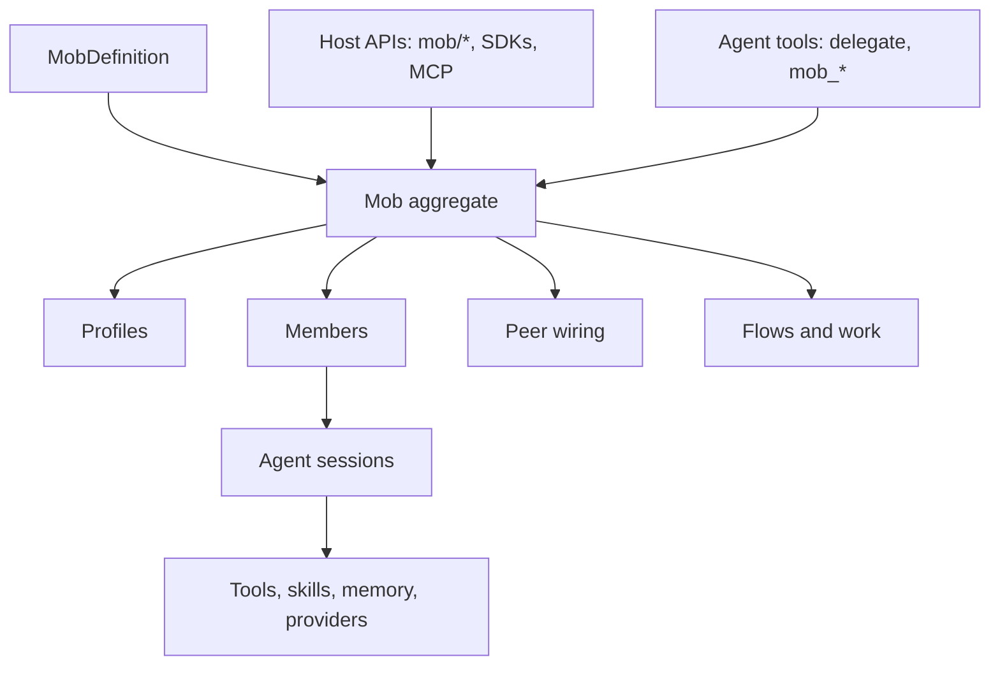

Mobs are Meerkat's multi-agent runtime. A mob is a durable team of agent
members with stable identities, profile-driven behavior, peer wiring, optional
flows, and host-visible lifecycle state.

Use mobs when one session is no longer the right unit of work: release triage
teams, code review panels, research teams, incident rooms, long-running helper
pools, and browser-deployed mobpacks all use the same underlying mob runtime.

<Note>
Mobs are the multi-agent path in Meerkat. The agent-facing `delegate` tool,
explicit `mob_*` tools, SDK `Mob` classes, `mob/*` RPC methods, public MCP mob
tools, and mobpack deployment all route through the mob system.
</Note>

## Choose A Path

| Need | Use |
|------|-----|
| One quick helper from an agent prompt | `delegate` inside `rkat run --tools full` |
| A persistent team the agent can manage | agent-side `mob_create`, `mob_spawn_member`, `mob_wire`, `mob_check_member`, on a host that keeps sessions (JSON-RPC, REST, or the MCP server) |
| An app or service orchestrating members directly | host APIs: JSON-RPC `mob/*`, public MCP `meerkat_mob_*`, Python `Mob`, TypeScript `Mob` |
| A browser-deployed team | Web SDK `@rkat/web` with `MeerkatRuntime.createMob`, or `rkat mob web build` from a mobpack |
| A repeatable workflow across members | mob flows |
| A signed, portable team definition | mobpack |

`rkat run` keeps its sessions in memory, so the members of a team an agent
creates there end with that run's process. A team that must outlive the
process belongs on a host that keeps sessions.

## Mental Model



A `MobDefinition` describes profiles, limits, wiring rules, topology, and
flows. The running mob records the roster, member lifecycle, events, flow runs,
and work state. Each member is an agent session, but public mob APIs address the
member by stable `AgentIdentity`, not by an internal session or runtime binding.

## Core Concepts

| Concept | Meaning |
|---------|---------|
| Mob | Durable orchestration aggregate: definition, members, events, flows, lifecycle |
| Profile | Role template: model, tool posture, skills, runtime mode, peer description |
| Member | One spawned participant with a stable `AgentIdentity` |
| Wiring | Undirected peer connectivity and mutual trust between members |
| Runtime mode | `autonomous_host` by default, `turn_driven` when explicit control is needed |
| Flow | Declarative workflow that dispatches steps to members |
| Work lane | Tracked work submitted to a mob or member |
| Mobpack | Portable signed artifact containing a mob definition and optional assets |

## Agent Tools Vs Host APIs

Keep this distinction sharp:

| Surface | Caller | Names | Purpose |
|---------|--------|-------|---------|
| Agent-side tools | The model inside a session | `delegate`, `mob_create`, `mob_spawn_member`, `mob_wire`, `mob_check_member` | Let an agent create helpers and coordinate its own team |
| Host APIs | Your application, CLI, SDK, or service | `mob/create`, `mob/spawn`, `mob/flow_run`, SDK `Mob` methods | Let software create, inspect, drive, and supervise mobs |
| Public MCP tools | External MCP clients | `meerkat_mob_*` | Expose the typed host control plane through MCP |

Agent-side tools are late-bound through the session build path. Host APIs are
the stable control plane for applications and SDKs. Do not treat raw `mob_*`
agent tools as if they were JSON-RPC methods.

## Fast Path: Delegate

`delegate` creates an implicit session-owned mob on first use, spawns a helper,
and wires the helper to the creating session. Use it for bounded helper work
that should report back.

```bash
rkat run --tools full "Ask one helper to inspect the test failure, then summarize what it found."
```

A delegate helper is ephemeral: it is retired after its one task. What
becomes of a helper whose call ends before the helper has answered differs
by release.

In 0.9.18 the generic `delegate` timeout does not return a helper ID or say
whether cleanup finished. There may be no helper yet. If the call is dropped
after its retirement guard is armed, the runtime tries to retire the helper
in the background; it is not guaranteed either to stay seated or to have
been retired when the caller sees the timeout.

The owned wait and the typed error in the rest of this paragraph are not in
0.9.18: they come with the release that carries this change. From that
release the call
owns its wait: what the tool call's time limit allows (ten minutes by
default), or a shorter `max_run_secs`. A call can end before the helper has
answered in two ways. When the wait ends while the caller still waits, the
call starts the helper's cleanup (a cancel of its run, then its retirement)
and answers a typed error (`delegate_helper_ended`) that names the helper's
mob and member id. Read the error's `helper` field for what became of the
helper: the cleanup can still be under way when the call answers
(`end_pending`), and it can have failed. When the call is dropped (the
calling turn is interrupted, so the caller is gone), the cleanup goes ahead
without it, and no typed error is sent: nobody is left to receive one, and
the host's log says how the cleanup went. A tool call the helper makes is
bounded by what
the call still waits, less room for the helper to report, so a helper's slow
tool times out inside the helper and the helper reports it; a `delegate` the
helper makes itself waits what is left, and is refused before anything is
started when that is under 30 seconds. A helper's long model call, and a
helper placed on another host, are not bounded that way, and in the rare
cases in which the calling host holds no bound for the helper (the
[reference](/reference/builtin-tools#delegate-its-wait-and-how-it-ends)
lists them) the helper runs under its own tool deadlines alone. A helper
can still be a member after a call that ended without its result: the
reference's
[table of the error's fields](/reference/builtin-tools#delegate-its-wait-and-how-it-ends)
says, for each value of `helper`, what became of it (`retirement_failed`
and `mob_not_running` are two that leave it a member). A helper whose call
ended with its host stays too: a restarted host restores it seated and
idle. A helper that stays does so until its owner's session is archived
(for an owner that is a
mob member retired by its mob: until the host's next start) or it is
retired with `mob_retire_member` by a session that manages the mob (the
error's `session_manages_mob` says whether the caller does), or by the host.
On a Meta
gateway the idle sweep retires it once it has been idle for
`implicit_delegate_idle_retire_secs` (300 seconds by default). See
[`delegate`: its wait and how it ends](/reference/builtin-tools#delegate-its-wait-and-how-it-ends).

Unless its `tooling` supplies a profile, a helper runs on the model and
provider (and self-hosted server) the calling session runs on when the call
runs, so a session on a realm `[models.<id>]` entry or a self-hosted model
delegates. That is the session's current identity: after a turn that named
another `model`, `provider`, `self_hosted_server_id` or `auth_binding`, the
next `delegate` follows the switch. The helper also resolves its credentials
through the session's auth binding; a session with none leaves the helper to
the realm's resolution. Three helpers do not take the session's binding: one
whose `tooling` supplies an inline profile builds on that profile, which names
no binding; one whose `tooling` names a realm profile builds on that profile's
binding, or on the realm's default; and one placed on another host resolves
its credentials on that host. A `delegate` whose session's route changed since
the last one replaces
the session's implicit mob, with everything in it (members spawned there
included), and its result says it created the mob. The current identity is
read from the session's stored metadata, which `rkat` and the JSON-RPC, REST
and MCP servers keep; a session on the in-memory ephemeral session service,
which keeps none, delegates on the route it was built with.

A session's implicit mob (its delegates and the forks seated there) and the
mobs its agent created belong to the session, and they end with it: they are
destroyed when the session is archived. From 0.9.15, besides that, only the
route change described above replaces the implicit mob, and a mob the agent
created ends when it is destroyed by name: a turn that fails, is cancelled
or is abandoned, a request that is cancelled, and a stop of the host end
none of them, and the session keeps its mobs for its next turn.

<Warning>
Known issue, noted 2026-11-13: in releases up to and including 0.9.14 (the first affected release differs by case: see the release page for the range of each), a turn that cannot be started can permanently destroy the mobs its session owns. See
the [known issue on the 0.9.14 release page](https://github.com/lukacf/meerkat/releases/tag/v0.9.14)
for the affected releases, the cases and what to do.
</Warning>

For recurring teams, use explicit mobs instead of a chain of ad hoc delegates.

A mob member can also fork itself with `fork_off`. The child starts from the
member's exact committed transcript, runs one task in the background, and
belongs to the forker, which can check, list, and retire it (and whatever it
forks in turn) without manage scope over the mob. The result is recorded in the
forker's transcript as a durable `BackgroundJob` system notice: a forker still
in its turn sees it at the next model call, and an idle forker gets one wake
turn; on a one-shot `rkat run` without `--keep-alive` the
call blocks for it instead. There is no default deadline; `max_run_secs` is an
opt-in autokill. See [Mob tools](/reference/builtin-tools#fork_off-and-council-delivery)
for the result shapes and the ownership rules.

A fork child holds the instruction activations it copied from its source as
history only, and runs no model turn until each inherited key is activated in
the child. The host decides who does that with its fork instruction policy
(`MobBuilder::with_fork_instruction_policy`, or
`MobMcpState::with_fork_instruction_policy`); it is never a tool argument or
part of a mob definition:

- `require_explicit_activation` (the default): the host activates the child
  after `fork_member`. The forks that start the child's turn themselves
  (`fork_off`, the bounded and detached member forks, the live delegation's
  durable fork, and council participants) leave no window for that, so a fork
  of a member with activated host instructions is refused before anything is
  committed, with the typed `fork_instruction_refused` error.
- `reactivate_inherited`: the fork appends the child's own activation of every
  key that was effective in the source, and the child runs at once. A fork
  (durable, or `fork_helper` below) whose carried head of a key is a row whose
  body a compaction of the source retired (a later row of that key, past the
  fork point, superseded it) is refused with the typed cause
  `head_body_retired` before anything is committed; a fork at a later boundary
  carries the superseding row with its body.
- `refuse`: every fork whose child would inherit an activation is refused.

A durable fork child's model never reads the body of an activation it
copied: it sees a line naming the key, and reads a body only from the
child's own activation. Skills the source loaded with `load_skill`, or was
given as per-turn skill context, follow the same policy as the host set it:
under the default each copied skill is named without its body, under
`refuse` the fork is refused, and under `reactivate_inherited` they are
carried. A fork that leaves no activation window applies this as set, so
under the default it strips the skills instead of refusing.

`fork_helper` (a member spawned with `MemberLaunchMode::Fork`) starts a
fresh session instead and gives it the source's recent conversation as
context. The same policy decides what of it the child gets, by each row's
type. The source's system prompt and host system context are never
carried. Under the default, the source's activated instructions, the
skills it loaded with `load_skill` (each named in their place) and
host-injected context such as memory recall are left out; under `refuse`
a fork whose context holds an activation or a loaded skill is refused;
under `reactivate_inherited` they are carried. A peer message in that
conversation keeps its sender, its text and its sender's taint marker; a
peer request or response keeps its sender and a preview of its params or
result (a response also its status). Neither keeps the ids or instructions
to answer it: the child is not its addressee.
The context fits a byte budget, newest rows first, and a fork whose newest
row alone does not fit is refused with `fork_context_too_large`.

A fork child is told what it was given. Before its first input it gets a
fork notice (a `fork_boundary` system notice) that names its source and,
by name only, the instructions and tools it lost or gained and what its
context carried. A `fork_helper` child gets its context the same way, as
one row before its first input, so a turn-driven helper sees it in its
task turn. A child placed on a member host gets them the same way when
its host serves prompt-context fork children (a host of this release
does); a host of 0.9.4 or earlier gives it the context and the notice as
the start of its first prompt instead.

## Define A Mob

A small mob definition has profiles and optional wiring:

```json
{
  "id": "release-triage",
  "orchestrator": { "profile": "lead" },
  "profiles": {
    "lead": {
      "model": "claude-opus-4-8",
      "peer_description": "Coordinates triage and assigns work",
      "external_addressable": true,
      "tools": {
        "builtins": true,
        "comms": true,
        "mob": true
      }
    },
    "analyst": {
      "model": "claude-sonnet-4-6",
      "peer_description": "Investigates one issue and reports evidence",
      "tools": {
        "builtins": true,
        "comms": true
      }
    }
  },
  "wiring": {
    "auto_wire_orchestrator": true,
    "role_wiring": [
      { "a": "lead", "b": "analyst" }
    ]
  },
  "limits": {
    "max_flow_duration_ms": 600000,
    "max_step_retries": 1
  }
}
```

Profiles are role contracts. Spawn requests may override selected profile
fields, but the definition remains the durable source for the mob's intended
shape.

From 0.9.15 a mob id that starts with `council--` is reserved: it is the id
form of the
mob a [temporary council](/guides/temporary-councils#real-temporary-mobs)
runs in. A create under such an id is refused, on every surface, as an
invalid definition (`reserved_system_identifier` at `id`). A mob an earlier
release created under such an id keeps loading and working; the mob state
logs one warning that names it.

<Warning>
**Every profile that spawns a member must set `comms = true` under `tools`.**
A member's identity, roster entry, peer wiring, peer messaging, and the
supervisor bridge are all keyed on its comms name (`{mob_id}/{role}/{member}`),
and the comms tools are composed for every member, so a member without comms
cannot be built. `comms` defaults to `false`, which means a profile that merely
omits the key is rejected exactly like one that sets it to `false`. The
rejection happens at spawn, before any session is created. The full message
is:

```text
wiring error: profile '<name>' has tools.comms=false; mob meerkats require comms=true. The default is false, so a profile that omits the key counts as false: set `comms = true` under `[profiles.<name>.tools]`. To keep a member from messaging peers, keep comms on and use `read_only = true` or a per-spawn `tool_access_policy` deny list.
```

It surfaces in two shapes. On the worker plane (`mob/spawn` and Meta's
`meta/ensure_member`) it is JSON-RPC error `-32602` with that text as the
message, prefixed `ensure_member failed: ` on Meta, and the failed spawn
leaves no roster entry behind. On Meta's identity-first plane the identity
record stays and reconciles to outcome `broken`, with the same text as that
identity's `error` in the bootstrap status
(`meta/status_identity_bootstrap`, Python `identity_bootstrap_status()`).
To keep a member from messaging peers, leave `comms = true` and add
`read_only = true` (below) or deny `send_message` through a per-spawn
`tool_access_policy` deny list; disabling comms is never the tool.
</Warning>

### Read-only profiles

`tools.read_only = true` declares a profile whose members may execute only
tools their owning dispatcher declares read-only. It is enforcement at the
execution gate, not prompt guidance, and it is the floor: a spawn request
cannot widen it.

```json
{
  "reviewer": {
    "model": "claude-opus-5",
    "peer_description": "Reviews changes and reports findings; cannot mutate anything",
    "tools": { "builtins": true, "comms": true, "read_only": true }
  }
}
```

A denied call comes back as an ordinary `access_denied` tool error, so the run
continues and the transcript records the refusal. The model-visible tool list is
unchanged (gating never moves the prompt-cache prefix).

What the declaration covers, and what it cannot:

| Tool class | Under `read_only` | Why |
|------------|-------------------|-----|
| Built-ins that declare read-only (`datetime`, `task_get`, `task_list`, `peers`, `blob_inspect`, skill browsing/reads, `view_image`, `web_search`, shell job status/list) | Permitted | The owning tool declares `ReadOnly` |
| Built-ins that mutate (`apply_patch`, `shell`, `blob_save_file`, `generate_image`, `task_create`/`task_update`, `send_message`, `monitor_start`) | Denied | Declared `Mutating` |
| `shell` specifically | Denied, always | Nothing classifies a command line, so there is no read-only shell. File reads in-tree go through `shell`, so a read-only member cannot read files unless the host supplies a dispatcher that declares its own read tools |
| MCP tools | Denied | `readOnlyHint` is a hint from the server being gated, not a proof. Audit the tool and use an explicit allow-list policy instead |
| Host rust bundles / external tool surfaces | Denied until they declare | Undeclared is `Unknown`, and `Unknown` is never admitted |
| Provider-native server tools (provider-run search, code execution, computer use) | Not gated at all | They never traverse the tool dispatcher. A read-only launch is only truthful when the host also disables native tool capabilities |

Anything undeclared is denied: over-denial is honest, silent admission would be
a false guarantee. Hosts widen the read surface by implementing
`AgentToolDispatcher::tool_mutation_class` on their own dispatcher.

### Denying individual tools

`tools.deny` names tools a profile's members may not run even though their
family is enabled, for example the topology tools of `mob = true`:

```toml
[profiles.worker.tools]
comms = true
mob = true
deny = ["mob_wire", "mob_unwire", "mob_spawn_member"]
```

Unlike `read_only`, a deny list works by name, so denied tools are hidden from
the member's tool catalog (the tool list sent to the model) on every build, a
resume included. A call to a denied name is still refused with an ordinary
`access_denied` tool error, and a spawn cannot widen the list. An unknown name,
such as a typo, fails the member's build with `DeclaredToolUnknown`, unless the
profile declares an MCP server that maps no `tool_names` or opts into a bundle
the build withholds; then the name is checked only at call time.

`shell = true` turns on the whole shell family, the script monitor
`monitor_start` included. A profile that wants `shell` and its three job tools
without the monitor says so by name:

```toml
[profiles.worker.tools]
comms = true
shell = true
deny = ["monitor_start"]
```

The deny also holds for a monitor the member started earlier: after a host
restart, at the member's next shell job call, it is not run again and its
job ends as `needs_attention` (`monitor_start_not_permitted`). An operator's
own monitor for the member is not the member's to end and is left as it is,
until an operator calls `monitors/start` or `jobs/cancel` for the member's
session.
The host's
own monitor route is not bound by the deny; the `monitor_start` entry of the
built-in tools reference says what it does. A deny that names `shell` closes
`monitor_start` with it.

### Granting tools to a member at run time

`tools.grant_gated` mounts built-in tool families, tool names and the tools of
MCP servers hidden: the member is not shown them and every call is refused
until a live [scoped tool grant](/concepts/tools#scoped-tool-grants) opens
them, for a bounded window. Leave a gated family's switch off; the gate mounts
it closed, and a binary that does not know the gate keeps it off.

```toml
[profiles.worker.tools]
comms = true
grant_gated = { families = ["shell"], tools = ["deploy"], mcp_servers = ["tickets"] }
```

A gated MCP server the profile configures (`tools.mcp_servers`) starts no
process until a live grant of that server (`{"kind": "mcp_server", "server":
"tickets"}`) covers the member at a build, so the member connects it at its
next build, a respawn for one, and not before; the build decides this as it
composes the member's tools. `unconfigured_mcp_servers =
true` gates every MCP server the profile does not configure, whatever path
attaches it later; the servers it configures stay open.

At every build, resume included, a member's gate is its own profile's gate
joined with its role's current gate, so a member spawned with its own profile
still gets its role's gate at its next build. A store-owned identity declared
with its role's named profile is built from the role's definition, as a worker
of the role is: its own gate is the role's current gate, less the families its
declaration switches off; one declared with an exact profile of its own
(`profile_override`) gets the role's gate as role entries, and so does one
whose desired material does not record where its profile came from (one
adopted by an earlier release). A role entry never fails the build: a role
tool name and a role MCP server are gated from the moment they appear, a role
family is gated where the member mounts it, and a role family the member does
not mount is ignored. A grant to the member's identity (`tool_grants/grant`
with `{"kind": "identity", "mob_id", "identity"}`) follows the member across
respawns and restarts, and ends when the identity ends, with the grants of
the session the mob holds for it then: at the end of a plain retire; at the
end of a retirement that unlists or removes an identity entry; at the
unlist of an unseated identity entry, or a complete roster's seal of one it
does not list and no host's intent row names; at the removal
of an unseated store-owned identity; when a respawn whose replacement fails
after the old member's archive is abandoned, by its own step or by the
resume after a stop; or at a reset of the mob. A respawn keeps them, and so
does a host's adoption of a declared identity, which ends the identity's
entry, not the identity. A name
created again needs a grant of its own, and a later resume, which replays
the earlier respawn's abandonment, ends none of its grants. A grant between a respawn's
retirement of the old member and the seating of its replacement answers
`subject_unknown`, since the identity is out of the roster then: retry it
once the respawn answers. An identity grant answers `applies`,
whether the member's running build gates its target (`at_next_build` for a
gated server the profile configures that the running build left
unattached), and `tool_grants/list`
answers the member's gate, running and next build. A member whose gate names
anything cannot be placed on another host.

### Opting into host tool bundles

`tools.bundles` names host tool bundles a profile opts into. It is the lenient
twin of the host-named `rust_bundles`: a member build refuses with
`ToolBundleUnavailable` while a `rust_bundles` entry is not registered, but it
mounts each `bundles` entry the mob's builder registered and withholds the
rest. `MobHandle::withheld_tool_bundles()` reports what is withheld. The
registrations are the ceiling and are read again at every build, a resume
included, so a host that stops offering a bundle withdraws it from every
member that opted into it. While any opted bundle is withheld, every deny name
in no vocabulary is checked only at call time, so a typo is reported at build
only once the bundle is mounted again.

Through the public profile input (the agent `mob_create` tool, `mob/create`),
only an inline profile of a child mob, a mob a member creates with
`mob_create`, may opt in, and only to a bundle the host registered as
`ChildToolBundleAvailability::ChildOffered`. Any other name is refused with
`ToolBundleNotOffered`, which lists the bundles the host offers; an empty or
repeated name is an argument error. Realm profile writes and spawn-time
profiles given as public profile input (the agent mob tools and the MCP
profile tools) cannot opt in. The
offer is the host's, the same for every child mob, whatever tools the creating
member itself mounts. A bundle the host registered as `ChildAvailable` still
reaches every inline child profile without an opt-in.

```json
{
  "id": "research",
  "profiles": {
    "announcer": {
      "model": "claude-sonnet-4-6",
      "tools": { "comms": true, "bundles": ["announcements"] }
    }
  }
}
```

### Profile model and provider fields

Beyond `model`, a profile can pin provider identity and per-member behavior:

```toml
[profiles.lead]
model = "claude-internal-preview"
# Explicit typed provider (closed vocabulary: anthropic | openai | gemini |
# self_hosted | other). Required for uncatalogued model ids; rejected at load
# if it contradicts a catalogued model's owner.
provider = "anthropic"
# Durable self-hosted binding (with provider = "self_hosted" and a
# [self_hosted.models] entry in the host config).
# self_hosted_server_id = "local"
# Realm auth binding the members resolve their credentials through. Omitted,
# a member resolves its realm's binding for the provider.
# auth_binding = { realm = "global", binding = "team_key" }
# Default provider for `Auto` image-generation targets (profile-level wins
# over the mob-level default below).
image_generation_provider = "gemini"
# Per-profile auto-compaction threshold in tokens (non-zero; wins over the
# global config knob and model-aware context-window scaling).
auto_compact_threshold = 60000
# Profile fields that win over durable session metadata when a member
# resumes. Without this, editing `model` in the definition does NOT apply to
# resumed durable sessions. Vocabulary: model | provider | provider_params |
# reasoning_effort (from 0.9.15).
resume_overrides = ["model", "provider"]
```

A profile sets its members' provider-neutral
[reasoning effort](/concepts/providers#reasoning-effort) level in its
provider params: `provider_params = { reasoning_effort = "high" }`. The
member's build checks the level against the profile's model and route like
any session's, and refuses it with the same typed `reasoning_effort_refused`
data. From 0.9.15, a member built from such a profile holds the level
(also when the profile came with `mob/spawn`'s `override_profile`): while it has a
turn running or queued, a JSON-RPC request that changes its model,
provider, provider params, auth binding or level is answered
`SESSION_BUSY` at once and is not queued (see
[Model settings on a busy session](/api/rpc#model-settings-on-a-busy-session)).
The request is `mob/turn_start` for a `turn_driven` member, and
`turn/start` with the member's session id for an autonomous one
(`mob/turn_start` is refused for an autonomous member with `-32602`). An
autonomous member runs turns of its own, so the caller cannot know when
it is idle: send the request again, or set the level in the profile or
at the spawn.
No flow step, kickoff, peer message, member send, scheduled delivery or
wake is answered busy; the rule is on `turn/start` and `mob/turn_start`.
A resumed member keeps the level its session recorded. With
`provider_params` in `resume_overrides`, a level the profile's params name is
seated with them, and params that name no level leave the recorded level in
place; add `reasoning_effort` to `resume_overrides` to make the profile
decide the level on resume in every case: the level its `provider_params`
name, or none. A member host that runs 0.9.14 refuses
a member spec that carries a level: it fails closed with a spec digest
mismatch and does not ignore the level, so upgrade member hosts before a
profile sets a level.

From 0.9.15, a level in a profile is a one-way step for a rollback. A mob
whose definition holds a level in any profile, even a profile no member ever
used, cannot be read by 0.9.14: after a rollback 0.9.14 quarantines the whole
mob (its content is kept, and the mob is whole again on 0.9.15), and a Meta
gateway on 0.9.14 does not start on a state directory that holds such a mob,
so nothing stored in that directory can be used there. Removing the level
from the definition afterwards does not help; the only way back is to
destroy the mob on 0.9.15 and create it anew, which loses its members,
their conversations and its history. See
[Rolling back to 0.9.14](/guides/upgrading#rolling-back-to-0-9-14).

If the route stops accepting the profile's level between a member's spawn
and its resume (an account's model list changed, or the model was swapped),
only that member is affected. Under on-demand restore it stays dormant until
its first wake and is then listed as broken with the reason; under eager
restore it is broken at start. The mob keeps running and nothing is lost: the
member keeps its seat, its session and its conversation. To recover, make
the route accept the level again or change the level, then respawn that
member (the same session, the conversation kept) or restart the host. A
plain retry does not seat it, and removing the level from the profile alone
does not help, because a resumed member keeps the level its session
recorded.

A profile's `auth_binding` is an explicit build input: its members build on
that binding, a resumed member included, and a spawn that names its own
binding wins over it. Only an operator's own definition may name it: a mob
pack whose definition names one fails validation, and Connect refuses an
application setup definition that names one. An owner can also write a realm
profile that names one, through JSON-RPC `mob/profile/create` and
`mob/profile/update` and the MCP profile tools; reading that profile back does
not show the binding. A member placed on a member host
resolves its credentials there and does not carry the profile's binding, and
an adaptive layer refuses a profile that names one.

Otherwise, a resumed member keeps its durable credential binding while its
provider is unchanged. When `provider` in `resume_overrides` moves a member to
another provider, the member keeps its history and resolves the new provider's
binding from its realm, as a fresh member of the profile would: the realm's
binding for that provider, then the parent realms and `global`, then the
provider's environment key. A durable binding backed by a credential account
keeps that account; if no binding for the new provider shares it, the resume is
refused with a typed error and the durable session is left as it was. A host
that runs a member for another host needs the release with this behaviour to
resume it.

Anthropic prompt caching is a per-profile `provider_params` decision. From
0.8.33 the default is `automatic` on every backend that supports it (Anthropic
API, Vertex, and Foundry); Bedrock and other backends that report automatic
caching as unsupported stay `disabled`. Releases 0.8.22 through 0.8.32 default
to `disabled` on every backend, so a mob that must behave the same on both
sides of that boundary sets `cache_control` explicitly. Opt a profile out, or
force caching on, with the nested `provider_tag` form:

```toml
[profiles.lead]
model = "claude-opus-4-8"
# Opt this profile out of Anthropic prompt caching.
provider_params = { provider_tag = { provider = "anthropic", cache_control = "disabled" } }

[profiles.analyst]
model = "claude-sonnet-4-6"
# Force caching on, with the one-hour cache lifetime.
provider_params = { provider_tag = { provider = "anthropic", cache_control = "automatic", cache_ttl = "1h" } }
```

`cache_control` lives inside `provider_tag`, not at the top of
`provider_params`. The flat form `provider_params = { cache_control = "disabled" }`
is rejected by the closed field set of `ProviderParamsOverride` and fails the
whole definition parse, so a mob that boots today stops booting after that
edit. The vocabulary is `automatic`, `system_prefix`,
`system_and_conversation`, and `disabled`; `cache_ttl` is `5m` or `1h` and
must be paired with an explicit non-`disabled` `cache_control` in the same tag.
Add `provider_params` to `resume_overrides` when the change must reach members
whose durable sessions already exist.

### Member system prompt

`peer_description` is the roster blurb other members see. It becomes the
member's `PeerMeta.description`, so it shows up in a peer's `peers` tool output
and in the `mob.peer_added` lifecycle notice wired peers receive. It is never
part of this member's own system prompt.

The member's own prompt comes from `profile.skills`. Each listed id is resolved
against a `[skills.<id>]` table in the definition, and the resolved texts are
joined in list order into the system prompt. An id with no `[skills.<id>]`
table is a `missing_skill_ref` validation error and contributes nothing:

```toml
[profiles.analyst]
model = "claude-sonnet-4-6"
skills = ["analyst-role"]
peer_description = "Investigates one issue and reports evidence"

[profiles.analyst.tools]
builtins = true
comms = true

[skills.analyst-role]
source = "inline"
content = """
You investigate exactly one issue at a time. Report evidence, not opinion,
and send your findings to the lead with send_message when you are done.
"""

# Or keep the text in a file:
# [skills.analyst-role]
# source = "path"
# path = "skills/analyst-role.md"
```

A profile whose skills resolve to no text falls back to the host's configured
default prompt, which is Meerkat's generic "You are an autonomous agent..."
unless the realm config overrides it; either way it knows nothing about the
mob or the member's role. The mob comms and WorkGraph operating skills are
preloaded separately and survive any prompt override, so a role prompt does not
have to repeat them.

<Note>
Fixed in 0.9.15: on affected older Linux x86_64 archives, members spawned
without their built-in skill instructions even though their communication
tools were present. Copying a skill into the project did not restore member
preloads. The published Meta `rpc_gateway` was not affected. For the affected
versions, see the
[known issue on the 0.9.14 release page](https://github.com/lukacf/meerkat/releases/tag/v0.9.14).
</Note>

Identity-first hosts (Meta) have two more knobs that reach the prompt
without editing the definition: `DurableAgentSpec.additional_instructions`,
appended after the skills text and baked once at materialization, and an
`AgentCustomizer` whose `draft.system_prompt` replaces the assembled prompt.
A host that keeps its own per-profile prompt key (for example a `role_summary` key)
parses that key itself and lowers it to `additional_instructions`.

A member's session records the instruction sections it was built with in its
durable build state, and keeps them through every rebuild: a restart, a wake
and a fork child's seating resume the session, name no sections and write no
prompt, so they leave the record alone (a fork child records its source's
sections). A Rust host reads them with
`MobSessionService::recorded_build_instructions(session_id)` on the mob's
session service, for the member's session
(`MobHandle::resolve_bridge_session_id`). The read comes from the session's
committed state, without waking the member or decoding its transcript:

| Answer | Meaning |
| --- | --- |
| `Some(sections)` | The sections the session's build was given, in order. |
| `Some(vec![])` | The session was built with no sections. |
| `None` | Not known: the service holds no committed session under that id, or the session's record does not say (it was built by 0.9.14 or an earlier release, or such a release's resume erased the record). |

A seat no build has created yet has no session, so the read answers `None`
for it: its sections are still its seat's spec. Its first build may append
the sections the host's spawn customizer adds, so afterwards the session
records the spec's sections followed by those.

The read has limits. It answers for the service's own sessions, so a session
another host keeps answers `None`. It takes no caller principal: a surface
that serves it admits its caller first. On a persistent session service it
still answers an archived session's record.

`PersistentSessionService` answers from the session's committed metadata
(the committed head on a HeadCanonical store; on a WholeBlob store the
committed body is fetched and verified, and its rows are skipped), and Core's
RPC and CLI hosts forward the read to it. A host whose session service is
its own decorator forwards the method to the service it wraps: the trait
default answers the same for a session that is not archived, from the
persisted session, which loads its transcript.

There is no `system_prompt` key on a profile. Loading a TOML definition whose
`[profiles.<name>]` table carries `system_prompt` (or its aliases `prompt` and
`instructions`) fails with `MobError::UnsupportedProfileKey`, whose message
names the profile, the key, and the mechanisms above; a realm-reference table
(`realm_profile = "..."`) is refused the same way. Any other key the table
does not declare (a host-private key such as a downstream app's `role_summary`, a typo
such as `comm = true` under `[profiles.<name>.tools]`, or anything but
`realm_profile` on a realm reference) is reported once per key as an
`unknown_profile_key` warning diagnostic, returned by
`MobDefinition::parse_toml`, and `from_toml` logs one warning per affected
profile when the definition loads; parsing continues, and the key is ignored.
No Meerkat surface emits that diagnostic today: a host that loads `mob.toml`
itself calls `parse_toml` to surface it, and a definition supplied as JSON is
not inspected.

### Custom model registry entries

`[models.<id>]` tables declare uncatalogued models once, at the definition
level. One entry feeds provider inference, compaction scaling, capability
gates, and call timeouts for every profile that references the model:

```toml
# Mob-level default for `Auto` image-generation targets (top-level key).
image_generation_provider = "gemini"

[models.claude-internal-preview]
provider = "anthropic"          # required; concrete API provider only
display_name = "Claude Internal Preview"
context_window = 500000          # drives compaction scaling
max_output_tokens = 16384
vision = true                    # capability flags default to false
web_search = false
call_timeout_secs = 900

[profiles.lead]
model = "claude-internal-preview"
```

The same `[models.<id>]` table shape works in the host's `config.toml` under
`[models]`, next to the per-provider default model strings.

At load time, `rkat mob validate` rejects a profile model that is neither
catalogued, custom-defined under `[models.<id>]`, nor provider-annotated
(`unknown_model`), instead of failing at the member's first delivery.

<Warning>
Mobs do not use prefab or template object types. Create mobs from
`MobDefinition` directly, or package that definition as a mobpack. Flow step
message text can still use the runtime context placeholders described below.
</Warning>

## Create And Spawn

<Tabs>
  <Tab title="JSON-RPC">
    ```json
    {
      "jsonrpc": "2.0",
      "id": 1,
      "method": "mob/create",
      "params": {
        "definition": {
          "id": "release-triage",
          "profiles": {
            "lead": {
              "model": "claude-opus-4-8",
              "tools": { "comms": true },
              "external_addressable": true
            },
            "analyst": {
              "model": "claude-sonnet-4-6",
              "tools": { "comms": true }
            }
          }
        }
      }
    }
    ```

    ```json
    {
      "jsonrpc": "2.0",
      "id": 2,
      "method": "mob/spawn_many",
      "params": {
        "mob_id": "release-triage",
        "specs": [
          { "profile": "lead", "agent_identity": "lead-1" },
          { "profile": "analyst", "agent_identity": "analyst-1" },
          { "profile": "analyst", "agent_identity": "analyst-2", "runtime_mode": "turn_driven" }
        ]
      }
    }
    ```
  </Tab>
  <Tab title="Python">
    ```python
    mob = await client.create_mob(
        definition={
            "id": "release-triage",
            "profiles": {
                "lead": {
                    "model": "claude-opus-4-8",
                    "tools": {"comms": True},
                    "external_addressable": True,
                },
                "analyst": {
                    "model": "claude-sonnet-4-6",
                    "tools": {"comms": True},
                },
            },
        }
    )

    await mob.spawn(profile="lead", agent_identity="lead-1")
    await mob.spawn_many([
        {"profile": "analyst", "agent_identity": "analyst-1"},
        {"profile": "analyst", "agent_identity": "analyst-2", "runtime_mode": "turn_driven"},
    ])
    ```
  </Tab>
  <Tab title="TypeScript">
    ```typescript
    const mob = await client.createMob({
      definition: {
        id: "release-triage",
        profiles: {
          lead: {
            model: "claude-opus-4-8",
            tools: { comms: true },
            external_addressable: true,
          },
          analyst: {
            model: "claude-sonnet-4-6",
            tools: { comms: true },
          },
        },
      },
    });

    await mob.spawn({ profile: "lead", agentIdentity: "lead-1" });
    await mob.spawnMany([
      { profile: "analyst", agentIdentity: "analyst-1" },
      { profile: "analyst", agentIdentity: "analyst-2", runtimeMode: "turn_driven" },
    ]);
    ```
  </Tab>
  <Tab title="Web SDK">
    ```typescript
    import { MeerkatRuntime } from "@rkat/web";
    import * as wasm from "@rkat/web/wasm/meerkat_web_runtime.js";

    const runtime = await MeerkatRuntime.init(wasm, {
      model: "gpt-5.5",
      openaiApiKey: "proxy",
      openaiBaseUrl: "http://127.0.0.1:3100/openai",
    });

    const mob = await runtime.createMob({
      id: "release-triage",
      profiles: {
        lead: {
          model: "gpt-5.5",
          tools: { comms: true },
          external_addressable: true,
        },
        analyst: {
          model: "gpt-5.4-mini",
          tools: { comms: true },
        },
      },
    });

    const members = await mob.spawn([
      { profile: "lead", agent_identity: "lead-1" },
      { profile: "analyst", agent_identity: "analyst-1" },
      { profile: "analyst", agent_identity: "analyst-2", runtime_mode: "turn_driven" },
    ]);
    ```

    <Warning>
    Known issue, noted 2026-11-14: the proxy that ships with `@rkat/web` 0.4.1 through 0.9.14 (`npx @rkat/web proxy`) is not an authenticated proxy. It does not check who calls it, and it listens on every network interface of the machine although it prints `localhost`. See the [known issue on the 0.9.14 release page](https://github.com/lukacf/meerkat/releases/tag/v0.9.14) for who needs to act and what to do.
    </Warning>
  </Tab>
  <Tab title="CLI">
    ```bash
    rkat run --tools full "Create a release-triage mob with a lead and two analysts, then report member status."
    rkat mob spawn-helper release-triage "Investigate the latest failing check" --agent-identity analyst-3 --profile analyst --result-label failing-check --max-text-bytes 4096 --json
    rkat mob wait-kickoff release-triage --timeout-ms 30000 --json
    ```
  </Tab>
</Tabs>

Spawn defaults matter:

| Field | Default |
|-------|---------|
| `runtime_mode` | `autonomous_host` |
| `launch_mode` | fresh member |
| `tool_access_policy` | inherit |
| `auto_wire_parent` | `false`; when `true`, a spawn made from a member's own turn into its own mob (the agent tool `mob_spawn_member`, or the member tools `spawn_member` and `spawn_many_members`) wires the new member to that member, and any other spawn wires nothing |
| `definition_wiring` (Rust `SpawnMemberSpec` only) | `Applies`: the definition's wiring rules (`auto_wire_orchestrator`, `role_wiring`) wire the member. `DefinitionWiring::Exempt` seats it with no edge those rules declare, and no member spawned, seated or rotated later is wired to it by them (see [Wire Peers](#wire-peers)); it is also outside the definition's role-wide flow steps, which only role targets naming it reach, and a durable fork of it is seated exempt too |
| `entry_custody` (Rust `SpawnMemberSpec` only) | `false`: the member is a worker. `true` (`with_entry_custody(true)`) seats the member of an identity entry through a spawn or a dormant seat: a host's own durable identity, which no worker reconcile spawns or retires (`reconcile` and `ensure_member` refuse a spec with entry custody), no spawn without entry custody takes, and neither the agent lane nor the agent mob tools act on (see [Identity entries](/reference/mob-architecture#identity-entries)) |

Autonomous members run as long-lived peers. `turn_driven` members are useful
when a host wants explicit dispatch control: only they take `mob/turn_start`.

A fresh `autonomous_host` member runs exactly one kickoff turn (one model
request) when it is spawned: on its `initial_message`, or without one on a
fallback role prompt. A member that must start idle should be `turn_driven`; it
runs `initial_message` as its first turn, and nothing without one.

A resume of an existing session (a `resume` launch mode) delivers that first
turn only while the session's first turn has never started, and then once.
Otherwise the resume runs no kickoff and does not deliver `initial_message`: the
transcript already holds the member's start, and a first turn that started and
was interrupted is not re-run. A placed member (`placement` set) follows the
same rule: its member host reports whether the adopted session's first turn
started. A member host of 0.9.4 or earlier reports nothing, and a resume there
still runs the first turn.

`mob/ensure_member` (Rust `MobHandle::ensure_member`) is the idempotent spawn:
it spawns the member only when its identity holds none and otherwise answers
the existing member, and `mob/ingress_interaction` ensures its ingress member
the same way before it delivers. When a spawn of the same member is still in
flight, the call waits for that spawn to seat the member and answers with it,
within a 60 second ready-wait budget, after which it answers
`ReadyWaitTimedOut`; if that spawn fails before its member is committed, the
waiting call spawns the member itself. A second spawn of a member whose first
spawn has not settled yet is refused `MemberAlreadyExists`.
An ensure of a reserved name (a removed identity's, or a name this build
cannot read) is refused `IdentityMember`, as a spawn of that name is, before
anything is recorded or created.

### Trusted Rust member build overrides

An in-process Rust host can attach a per-member
`Arc<dyn CompactionCurator>` through
`SpawnMemberSpec.compaction_curator_override`. The exact curator reaches the
session build for that spawn or cold resume. It is executable process-local
behavior, not durable configuration: re-supply it from a
`SpawnMemberCustomizer` after restart. Remote placement rejects it before
materialization instead of dropping the override.

A host gates a member's tool calls with a per-member
`SpawnMemberSpec.tool_dispatch_admission` (an `Arc<dyn ToolDispatchAdmission>`),
usually set by its `SpawnMemberCustomizer`. It is process-local: it is never
persisted and never copied to a fork. When a member whose build runs under one
is forked (the agent tools `fork_off` and `council`, `MobHandle::fork_member`
and its siblings, a live delegation), the customizer is asked for the child
before the child is seated, and only the `tool_dispatch_admission` of its
answer is used: the child runs under it, or the fork is refused with
`MobError::DispatchAdmissionRequired`. A refused `fork_off` or handle fork
forks nothing; a refused council branch is refused after the council forked
its source for it, and the council's cleanup removes that fork. A
`fork_helper` child of such a member is asked as any spawn is, and is refused
the same way when the customizer installs none. Every later build of such a
child (a wake, a restore after a restart, a reload, an explicit resume) and a
respawn successor of it ask again, and are refused when the customizer
installs none, so the child never runs without an admission. A fork child
seated before 0.9.11, whose spawn row records nothing, is asked the same way
each time it is rebuilt and runs under the admission the customizer installs,
or under none when it installs none. A member a spawn policy seats is asked
too, for its admission alone (`SpawnSource::PolicySpawn`), and runs under what
the customizer installs. Before 0.9.11 such members ran with no admission.

A trusted host that decides each member's destination or agent mandate
installs a `MemberRuntimeRegistrationHook` with
`MobBuilder::with_member_runtime_registration_hook` (`runtime-adapter`). Since
0.9.4 each call carries the member's exact registration
(`MemberRuntimeBuildIdentity::registration()`): the one prepared for a new
member, or the current one of a member whose actor is recovered. Bind what the
host decides to that registration, not to an identity derived from the
member's session id or labels; a later registration of the same session is a
different one. The identity is no longer `UnwindSafe`, so wrap it in
`std::panic::AssertUnwindSafe` to move it into `catch_unwind`.

Since 0.9.4 a hook that refuses a restored member's registration
(`select_destination`, `select_agent_mandate`, `prepare_member_surface` or
`verify_member_surface`) gets the same cleanup as a refusal for a new member:
the restore removes that registration exactly (recorded in the session's
history; inputs it still held end `Stopped`) and releases its owner context.
The member stays Broken with `MobError::MemberRegistrationRefused`, shown as
`registration_refusal` in its status, until an explicit repair, and
`ensure_member_live` returns that refusal without asking the hook again. The
member can still be retired, respawned or destroyed. A member that
`MobBuilder::resume` recreates on a fresh session (for example when the session
service keeps no durable sessions) is isolated the same way when its hook
refuses it, and the other members resume. A destination the hook
selected that the runtime did not install is
`MobError::MemberDestinationNotInstalled` instead (the runtime's verdict, not
a refusal): the member keeps its registration, and the repair must select
again with an advanced `context_generation`. Since 0.9.9 the hooks are called
as tasks on the host's runtime, where the member's turns run, and a call that
ends without an answer is not recorded as the host's refusal.

Since 0.9.9 every member build a mob runtime performs (a fresh spawn, a
restore or a wake) carries that runtime's incarnation witness in
`SessionBuildOptions::mob_incarnation` (`AgentBuildConfig::mob_incarnation`),
so a host's member build hook mints the member's mob operator scope for the
mob as it runs, also for a member restored at boot before the host holds the
mob's handle. The witness is never persisted, and a placed member built on a
host that does not run its mob carries none. The mob runtime also receives the
live mob operator authority of every member session it builds locally:
`MobHandle::member_spawn_profile_scope_contains(origin_session, profile)` and
`MobHandle::member_manage_scope_contains(origin_session)` read whether that
session's own authority holds spawn-profile scope for the profile, and manage
scope, in the mob as it runs (the facts the spawn tools pass to the mob
machine's spawn admission). Each reads only that session's authority and
finds none for a session the runtime did not build or whose build bound none.
A hook that edits a member build's external tools wraps them: tools it
replaces outright leave the session with no recorded authority.

## Identity And Respawn

Mobs separate stable member identity from runtime binding details:

| Identity | Scope |
|----------|-------|
| `AgentIdentity` | Stable public member key; use this in APIs, wiring, status, work, and events |
| `AgentRuntimeId` | Current runtime binding; rotates when a member respawns |
| `FenceToken` | Monotonic stale-write guard for runtime binding effects |
| `Generation` | Member generation counter after respawn |

Use `AgentIdentity` for facts that survive respawn, such as wiring and durable
configuration. Runtime IDs and fence tokens protect the lower-level binding.

Since 0.9.4 a spawn never reuses a generation, across mob resets and restarts
too: resume recovers each identity's highest generation from the whole event
log, so a member re-spawned after a reset and a restart never reuses its
pre-reset runtime id or member address, and a mob that was reset and then
re-spawned a member under a pre-reset identity resumes after a restart (0.9.3
and earlier failed that resume with an internal error). A store written
before 0.9.4 whose last epoch already reused a generation still resumes, and
that identity's next spawn goes above the recovered high-water.

When a session's mobs end depends on what archives the session. A member
its mob retires has its session archived by the mob, and the mobs that
session owns (the mobs its agent created with `mob_create`, and the session's
implicit mob with its delegates and forks) end with it at the next start of
the host: the mob's retire archives the session and leaves its mobs to that
start. The archive of a store-owned identity is such a retirement: each of
the mobs its agent created is removed with its store at the host's next
start, and unarchiving the identity does not bring them back. A session
archived through a surface's own archive call (JSON-RPC
`session/archive`, the REST and MCP archive) has its mobs destroyed at that
call. A
worker's respawn (`respawn`, `mob/respawn`, the `mob_respawn` tool of
`MobMcpDispatcher`) retires the member and gives its successor a new session,
so the mobs the old incarnation created and its delegates are not carried
over to the successor.
An identity entry's member is respawned on its own session
(`MobHandle::respawn_member`, and `respawn` of such a member), so the mobs
that session owns do not end with the respawn, and its agent keeps managing
the mobs it created with `mob_create`: that management follows a member
through its same-session successors, and ends when the member is reset onto
a fresh session or is retired and later seated again. Which side a member
is on follows from how it was created: a member a
host seats through an identity entry (a declared or store-owned identity, the
way a host keeps a durable roster) is an entry's member; a member spawned
directly (a host's spawn call, an agent's `mob_spawn_member`, a helper) is a
worker.

### Dormant seats and comms keys (Rust hosts)

A dormant seat (`MobHandle::seat_dormant_members`, a `rotate_member` that
seats, an identity entry's seat) records a member's comms endpoint before the
member's first build, so it reads or mints the member's key pair where that
build will load it. On in-process comms, when the host declares no root, the
seat takes the root the mob's session service reports
(`session_comms_identity_root`: where its agent factory keeps each session's
key pair, under the factory's `user_config_root`; see
[where a session's keys are kept](/guides/comms#where-a-session%E2%80%99s-keys-are-kept)), so a host that composes
its own session service needs no
`MobBuilder::with_member_comms_identity_root`. A declared root, and
`MobBuilder::with_network_member_comms`, win over the report. A service that
reports `NotKept`, or a root it cannot resolve, has every seat refused typed
(`MobError::WiringError`, naming the report) unless the host declares a root:
no other root stands in for the one its builds use. The report covers
in-process keys only. A host whose members run on TCP or UDS declares
`MobBuilder::with_network_member_comms`; without it the seat records an
in-process endpoint, the member's first wake refuses it as an endpoint
mismatch, and the member needs a rotation (`MobHandle::rotate_member`).

### Durable role migration

A durable member may keep the same mob id, `AgentIdentity`, session, and
transcript while moving to a new role. This is a one-request cold Resume
contract, not a profile alias or standing migration rule.

For an explicit trusted Rust-host resume, declare the exact durable predecessor
role on the spec:

```rust
let spec = SpawnMemberSpec::new(
    "home-automation",
    AgentIdentity::from("home-automation-1"),
)
.with_resume_bridge_session_id_from_role(session_id, "domain");

handle.spawn_spec(spec).await?;
```

For automatic cold restoration after a process restart, install a
`SpawnMemberCustomizer` and call `spec.declare_resume_from_role("domain")?`
only when `ctx.spawn_source == SpawnSource::Resume`, after checking the exact
member identity and requested target profile. The declaration is intentionally
not persisted, so each later migration or restore must re-supply current host
intent. A same-session respawn that names another profile
(`MobHandle::respawn_member` with `MemberRespawn::with_profile`) declares its
migration itself: the next incarnation's spawn row records the role its
session was last built under, so its first build restamps the session, after a
restart too, with no customizer (see
[Respawn, rotation and scoped release](/reference/mob-architecture#respawn-rotation-and-scoped-release)).

The runtime enforces all of these facts:

- mob id, `AgentIdentity`, and exact durable session stay fixed
- the declaration must equal the one stored predecessor role
- when the stored and requested roles differ, an omitted declaration returns `MemberRoleMigrationRequired`
- an incorrect, inapplicable, or live-session declaration returns `MemberRoleMigrationRejected`
- even an idle live actor cannot be migrated; the exact session must be cold
- success restamps the current comms name, typed member binding, role/profile labels, callback context, and explicitly configured tooling
- rollback is another declared forward migration or separately versioned durable state, never an old binary silently reclaiming the predecessor role

<Warning>
`resume_from_role` is available on trusted in-process `SpawnMemberSpec` and the
private member-host materialization protocol. It is deliberately absent from
agent-callable spawn tools, standing profiles, CLI spawn helpers, REST, public
MCP, JSON-RPC/SDK spawn contracts, and the Web SDK.
</Warning>

### Declared identities (Rust hosts)

A Rust host that keeps its own roster of durable identities declares it, and
Core applies it: `MobHandle::apply_declared_roster`. Pass the host's whole
roster as a complete one, and apply it once after every start, before the
host wakes or seats its identities:

```rust
let roster = DeclaredRoster::complete(
    identities
        .iter()
        .map(|identity| DeclaredEntry::new(SpawnMemberSpec::new("assistant", identity.clone()))),
);
let outcome = handle.apply_declared_roster(roster).await?;
for (identity, answer) in &outcome.entries {
    // Seated, Kept, Restamped, RoleMigrationHeld, Deferred, Refused, ...
}
```

Each identity gets its own typed answer, and one identity's refusal never
fails the pass. An unchanged roster writes nothing and wakes nothing. A
changed runtime mode, or a role move declared with
`DeclaredRoster::with_role_migration`, restamps the member on its own session;
an undeclared role move holds the member until an apply declares the move or
restores the role. A change of display name, labels, context or instructions
alone keeps the seat. The full set of verdicts is in
[The declared apply](/reference/mob-architecture#the-declared-apply).

Retiring a declared identity that stays listed does not take it out of the
roster: its member is retired, and the next apply seats it again on its own
session. To take an identity out of the roster (unlist it), apply a complete
roster without it, or unlist that identity alone
(`MobHandle::unlist_declared_identity`): Core retires its member and ends
the entry. An identity unlisted and listed again comes back on the session it
last had, with its history. Removing an identity
(`MobHandle::remove_identity`) is different and permanent: it tombstones the
name, which is never an identity or a member again.

## Wire Peers

Wiring controls which members can see and message each other.

<Tabs>
  <Tab title="JSON-RPC">
    ```json
    {
      "jsonrpc": "2.0",
      "id": 3,
      "method": "mob/wire",
      "params": {
        "mob_id": "release-triage",
        "agent_identity": "lead-1",
        "peer": "analyst-1"
      }
    }
    ```

    ```json
    {
      "jsonrpc": "2.0",
      "id": 4,
      "method": "mob/unwire",
      "params": {
        "mob_id": "release-triage",
        "agent_identity": "lead-1",
        "peer": "analyst-1"
      }
    }
    ```
  </Tab>
  <Tab title="Python">
    ```python
    await mob.wire("lead-1", "analyst-1")
    await mob.unwire("lead-1", "analyst-1")
    ```
  </Tab>
  <Tab title="TypeScript">
    ```typescript
    await mob.wire("lead-1", "analyst-1");
    await mob.unwire("lead-1", "analyst-1");
    ```
  </Tab>
</Tabs>

Topology rules can reject wiring or dispatch that violates the definition. Use
strict topology when roles must not communicate outside an approved graph.

The definition's `wiring` rules wire members as they are seated:
`auto_wire_orchestrator` joins each member to the orchestrator's members, and
each `role_wiring` rule joins the members of its two profiles. A Rust host can
take one member out of those rules in both directions with
`SpawnMemberSpec::with_definition_wiring(DefinitionWiring::Exempt)`: the
member is seated with no edge the rules declare, whatever its profile, and no
member spawned, seated dormant or rotated after it is wired to it by them.
Explicit wiring (`mob/wire`, topology operations) still applies to it, and a
respawn restores the explicit edges it held. The exemption is recorded with
the member, so a restart and a respawn keep it; a rotation
(`MobHandle::rotate_member`) takes the exemption of the spec it seats. A
durable fork of an exempt member (`MobHandle::fork_member`, an agent's
`fork_off` child, a temporary council's local participant, a live delegation
worker from `MobHandle::fork_member_at_turn_boundary`) is seated exempt
too, whatever seating its request states. A member placed on a member host
cannot be exempt.

An exempt member is outside the definition's role-wide flow dispatch as
well: a flow step on its profile dispatches to it only when the run's role
targets name it (`MobHandle::run_flow_with_role_targets`), a flow's
supervisor escalation never picks it, and a role whose only Active members
are exempt gets a provisioned flow member, as a role with none does.

## Send Work

Use member send for direct content delivery. Use the work lane when the caller
needs a work reference for the unit it submitted: `mob/submit_work` returns a
`work_ref`. One submitted unit cannot be cancelled by that reference; see
[Cancel work](#cancel-work) below.

`mob/member_send`, SDK `Member.send`, and `mob/submit_work` with
`origin: "external"` require the target's profile to set
`external_addressable: true` (the default is `false`). The definitions above
opt in only the lead as the application's entry point. For tracked work,
choose a `member_ref` belonging to an opted-in member. This opt-in is not
required for internal flow dispatch or ordinary peer messaging.

<Tabs>
  <Tab title="Member send">
    ```json
    {
      "jsonrpc": "2.0",
      "id": 5,
      "method": "mob/member_send",
      "params": {
        "mob_id": "release-triage",
        "agent_identity": "lead-1",
        "content": "Decompose the task and assign work to the analysts.",
        "handling_mode": "queue"
      }
    }
    ```
  </Tab>
  <Tab title="Tracked work">
    ```json
    {
      "jsonrpc": "2.0",
      "id": 6,
      "method": "mob/submit_work",
      "params": {
        "member_ref": "member_ref_from_spawn_or_members",
        "content": "Inspect the failing release check and return evidence.",
        "origin": "external"
      }
    }
    ```
  </Tab>
</Tabs>

`member_ref` is an opaque handle returned by spawn, member list, member send,
helper spawn, fork, and respawn responses. Application code should pass it back
to work-lane APIs as-is instead of constructing it from `mob_id` and
`agent_identity`.

### Cancel work

One submitted unit cannot be cancelled. The host lists `mob/cancel_work`, and
it is always refused. An otherwise valid call is refused with `-32602`:

```text
per-unit work cancellation is unsupported for <work_ref>: no work-tracking ledger is wired
```

The submitted unit runs on. A `work_ref` that is not a UUID is refused one
step earlier, also with `-32602` (`work_ref must be a valid UUID: ...`).

`mob/cancel_all_work` is a different call. It takes a `member_ref` and
cancels the work that member had admitted when the cancel was taken, not one
unit: the member's current run is cancelled at the run's next boundary, and
the input it held queued is abandoned. Input admitted after the cancel is
untouched. The boundary can be some way off: while a model response is in
progress, the run ends when that response ends (about 30 seconds after the
call in one run each of `mob/cancel_all_work` and `mob/force_cancel` on
0.9.15, with a long model response in progress: a measurement, not a bound).
To end one run at once and keep the member's queued input, stop that run
instead with `mob/stop_member_run` (in one run on 0.9.15 the run ended at
once and the queued input ran next). Cancelling an idle member is not an
error. On success the result is `{"mob_id": "...", "ok": true}`. The cancel
is of that member's work only: a flow run on another member stays active,
and from 0.9.15 a stop of the mob is still refused while it is (see
[Stopping a mob with an active flow run](#stopping-a-mob-with-an-active-flow-run)).

<Warning>
Known issue in 0.9.5 through 0.9.14, noted 2026-11-13 and corrected
2026-11-14 after runs on the published 0.9.14 `rkat-rpc` (measured on
0.9.14; 0.9.5 through 0.9.13 read from the source; 0.8.51 through 0.9.4 not
determined): `mob/cancel_all_work` can destroy the mobs that the member's
session owns.

- With a turn waiting: the mobs are destroyed when a turn a client sent to
  the member's session (`turn/start` on its session id) or a
  `mob/turn_start` is waiting behind the member's run when the cancel is
  taken (measured on a default realm and on a realm created with
  `--realm-backend jsonl`). The waiting turn itself may still run. With
  nothing waiting, a default realm keeps the mobs.
- On a realm created with `--realm-backend jsonl`, nothing needs to be
  waiting: the first turn started on the member's session after the cancel
  (measured for `turn/start`) is answered with an internal error (`-32603`)
  and is not completed, and the mobs are destroyed at that turn. Before
  0.9.14 this case is not determined.

Work the mob itself admitted (member sends, submitted work) and still queued
at the cancel does not count as a waiting turn. See the
[known issue on the 0.9.14 release page](https://github.com/lukacf/meerkat/releases/tag/v0.9.14).
Fixed in 0.9.15 (see Fixed in the CHANGELOG under `## [0.9.15]`). On 0.9.5
through 0.9.14, do not call `mob/cancel_all_work` on a member while such a
turn is queued. On a `jsonl` realm, do not call it at all on a member whose
session owns mobs; if you already have, restart the process before the next
turn is sent to that member (after a restart the next turn ran and the mobs
were kept, in one run).
</Warning>

Fixed in 0.9.17 (see Fixed in the CHANGELOG under `## [0.9.17]`). Through
0.9.16, on a realm created with `--realm-backend jsonl` (and on in-memory
stores), the first work a member's session takes after `mob/cancel_all_work`
ended a running run is lost once. A turn a client then starts on the
member's session (`turn/start`) is answered an internal error (`-32603`,
`turn abandoned: ...`) and its result is not kept; a `mob/member_send` is
accepted, and its run ends failed without its result; its sender gets no
error. The work after that runs: send the lost work again. A realm on the
default `sqlite` backend is not affected.

## Flows

Flows are declarative mob workflows. They let a host dispatch repeatable work
without hard-coding all member turns in application code.

The classic flow shape is a flat DAG: steps declare roles, messages,
dependencies, fan-out/fan-in behavior, optional conditions, and tool overlays.
Frame-based flows add nested `FlowSpec.root` frames and `repeat_until` loops.
Both are owned by the mob runtime; support modules such as flow-run projection
are not separate public machines.

```json
{
  "flows": {
    "triage": {
      "steps": {
        "scan": {
          "role": "lead",
          "message": "Review the incident queue and pick the top issue."
        },
        "investigate": {
          "role": "analyst",
          "message": "Investigate the selected issue and return evidence.",
          "depends_on": ["scan"],
          "dispatch_mode": "fan_out"
        },
        "summarize": {
          "role": "lead",
          "message": "Summarize findings and recommend next action.",
          "depends_on": ["investigate"],
          "dispatch_mode": "fan_in"
        }
      }
    }
  }
}
```

### Flow parameters and message templates

Flow activation parameters are available to text in step messages. Use
`{{ params.<path> }}` for input, `{{ steps.<step-id>.output.<path> }}` for a
root-frame result, and
`{{ loops.<loop-id>.iterations.<n>.steps.<step-id>.<path> }}` for an exact
loop iteration. The `.output` segment on a root step is optional.

```json
{
  "role": "lead",
  "message": "Triage severity {{ params.severity }}: {{ params.prompt }}"
}
```

String values render as text; other JSON values render as JSON. Placeholders
are also rendered inside text blocks of multimodal messages, while non-text
blocks are preserved. Invalid syntax, an unknown root, a missing field under a
present value, or indexing into a scalar fails the step closed. A step or loop
root that genuinely has not produced output renders as `null`.

Nested output lookups also depend on the producer step's `output_format`:

| Step setting | Per-target output |
|--------------|---------------|
| `"output_format": "text"` | A JSON string containing the raw text, even if that text looks like JSON |
| `"output_format": "json"` | Parsed JSON, allowing field/index lookup when the value has the corresponding object/array shape |
| Format omitted, `expected_schema_ref` present | `json` |
| Both omitted | `text` |

An explicit format always wins over the schema-aware default. A profile's
`output_schema` constrains the member's structured response; it does not
override a flow step's `text` mode. Asking a text-mode producer to return JSON
is therefore not enough to make `steps.<step-id>.output.<field>` work.

Dispatch and collection still determine the enclosing step-result shape. This
example uses `one_to_one` with `collection_policy: { "type": "any" }` so
`scan` exposes the selected member's output directly instead of a member-keyed
aggregate. Add this flow to a definition containing the lead and analyst
profiles above:

```json
{
  "flows": {
    "structured_triage": {
      "steps": {
        "scan": {
          "role": "lead",
          "message": "Pick the highest-priority issue. Return only JSON with shape {\"issue\":{\"title\":\"the selected issue title\"} }.",
          "output_format": "json",
          "dispatch_mode": "one_to_one",
          "collection_policy": { "type": "any" }
        },
        "investigate": {
          "role": "analyst",
          "message": "Investigate {{ steps.scan.output.issue.title }} and return evidence.",
          "depends_on": ["scan"]
        }
      }
    }
  }
}
```

### Advisory nodes (`failure_policy`)

By default every flow node escalates: if it fails, its frame is classified
`Failed` and the run fails. Declare `"failure_policy": "continue"` on a step,
a frame node, or a `repeat_until` node to mark it advisory. An advisory node's
failure is still recorded - the node stays `Failed` in frame state and the step
is still reported failed - but it no longer decides the frame's terminal
classification.

**`continue` does not keep that node's dependents running.** Dependency
resolution is unchanged by `failure_policy`. With `depends_on_mode: "all"`, a
single dependency ending `Failed`, `Skipped` or `Canceled` sets the dependent
`Skipped`; with `depends_on_mode: "any"`, the dependent is set `Skipped` only
when every dependency ends that way. Either way, a step whose only dependency is
an advisory node does not run when that node fails: the run can still reach
`completed`, but that dependent's step status is `skipped` and a `step_skipped`
event is emitted for it. If you want work to happen after an advisory failure,
the dependent must have a dependency that can still complete.

That makes `continue` useful for one shape: an advisory node and a fallback node
feeding a join with `depends_on_mode: "any"`. The advisory node's failure is
tolerated, the fallback completes, and the join runs on the fallback's output.

```json
{
  "flows": {
    "triage": {
      "steps": {
        "advisory-analyst": {
          "role": "analyst",
          "message": "Optional deep analysis; best effort.",
          "failure_policy": "continue"
        },
        "baseline-analyst": {
          "role": "analyst",
          "message": "Cheap baseline analysis that must succeed."
        },
        "write-up": {
          "role": "writer",
          "message": "Write the report from whatever evidence exists.",
          "depends_on": ["advisory-analyst", "baseline-analyst"],
          "depends_on_mode": "any"
        }
      }
    }
  }
}
```

If `advisory-analyst` fails here, `baseline-analyst` still completes, so
`write-up` is `Ready` rather than `Skipped` and the run completes with the
report written. Drop `baseline-analyst` and `write-up` is skipped instead.

Omitting `failure_policy` means `escalate`. Frame classification is owned by
MobMachine, so a tolerated failure never becomes a fabricated success: the
failed node remains visible in the frame's typed state, the step is recorded
`failed` with a failure-ledger entry, and a `step_failed` event is emitted. Both
the ledger entry and the event carry the step's real failure reason. If the
run's supervisor `escalation_threshold` is crossed by that failure, the
supervisor is still escalated.

If that escalation cannot be delivered - no member currently holds the
supervisor role, the supervisor's turn fails, or the escalation turn exceeds
`escalation_turn_timeout_ms` - the run's terminal class is unchanged. Failing to
carry out an escalation is not a decision that the run failed, so a tolerated
failure still completes; the undelivered escalation is reported as a
`supervisor_escalation_failed` event carrying the escalation error, and no
`supervisor_escalation` event is emitted. The mob is not torn down.

Run and inspect a flow:

<Tabs>
  <Tab title="JSON-RPC">
    ```json
    {
      "jsonrpc": "2.0",
      "id": 8,
      "method": "mob/flow_run",
      "params": {
        "mob_id": "release-triage",
        "flow_id": "triage",
        "params": { "severity": "critical" }
      }
    }
    ```

    ```json
    {
      "jsonrpc": "2.0",
      "id": 9,
      "method": "mob/flow_status",
      "params": {
        "mob_id": "release-triage",
        "run_id": "flow_run_123"
      }
    }
    ```
  </Tab>
  <Tab title="Python">
    ```python
    run_id = await mob.run_flow("triage", {"severity": "critical"})
    status = await mob.flow_status(run_id)
    result = await mob.run_result(run_id)
    ```
  </Tab>
  <Tab title="TypeScript">
    ```typescript
    const runId = await mob.runFlow("triage", { severity: "critical" });
    const status = await mob.flowStatus(runId);
    const result = await mob.runResult(runId);
    ```
  </Tab>
  <Tab title="CLI">
    ```bash
    rkat mob run release-triage --flow triage --param severity='"critical"'
    rkat mob status release-triage <RUN_ID>
    ```
  </Tab>
</Tabs>

### Auditing a run

Every run-result surface carries an `accounting` block next to the flow result:
`rkat mob run --json`, `rkat mob attach --json` (the detached-run audit path),
the `mob/run_result` RPC method, and the `meerkat_mob_run_result` MCP tool. The
two polled surfaces (RPC, MCP) attach it only once the run is terminal, so a
mid-run poll stays cheap and never reports totals for an unfinished run; the CLI
paths wait for terminality before collecting. The block is also absent when
collection failed, which the CLI reports on stderr.

```json
{
  "run_id": "…", "mob_id": "release-triage", "flow_id": "triage",
  "status": "completed",
  "result": { "…": "flow output" },
  "accounting": {
    "attribution": "session_cumulative",
    "members": [
      { "agent_identity": "analyst-1", "role": "analyst", "session_id": "…",
        "model": "claude-sonnet-4-6", "provider": "anthropic",
        "message_count": 12,
        "usage": { "input_tokens": 41230, "output_tokens": 1880, "total_tokens": 43110 } }
    ],
    "usage_total": { "input_tokens": 41230, "output_tokens": 1880, "total_tokens": 43110 },
    "member_session_ids": ["…"],
    "unpriced_reason": "no price data in the model catalog; token counts are exact, monetary cost is not computed"
  }
}
```

Read those numbers exactly as labelled:

- **`attribution: session_cumulative`** - each number is the lifetime total of
  that member's bridge session. It equals the run's usage when the session
  served this run alone; on a mob that has executed several runs it includes the
  other turns. Nothing in the durable run projection records per-run usage.
- **`usage_total`** is the sum of the readable members only. When
  `members_usage_unavailable` is non-zero (remote members, archived sessions)
  it is a floor, and each affected member carries a `usage_unavailable` reason
  instead of a zero. Cache and reasoning counters are summed too. Each
  member's usage is normalized first, including members whose sessions were
  saved before 0.8.22, so on every provider cache reads plus writes stay within
  `input_tokens` and reasoning within `output_tokens`.
- **`members` is the mob's current roster**, not this run's participant set:
  the run projection records no participation, so a member that took no part in
  the run is still listed and its session id still rides in
  `member_session_ids`. Exporting the whole pointer set can pull transcripts
  unrelated to the run.
- **No monetary cost** is reported. The model catalog carries no price data, so
  a cost number would be invented; `unpriced_reason` says so explicitly.

Full transcripts stay with their single authority, the ATIF exporter. The
envelope hands you the pointer set rather than duplicating messages, tool calls,
tool results, or per-turn usage:

```bash
rkat mob run release-triage --flow triage --json \
  | jq -r '.accounting.member_session_ids[]' \
  | xargs -n1 rkat session export-atif
```

In text mode the same facts print as `usage`, `cost`, and `transcript` lines,
the last of which carries the ready-to-run `rkat session export-atif <id>`
command. `rkat run --export-atif` writes a trajectory for a single-session run.

### Stopping a mob with an active flow run

A mob refuses a stop while one of its flow runs is active. `mob/lifecycle`
with `action: "stop"` (`MobHandle::stop` in embedded Rust) is answered with
the invalid transition error (`MobError::InvalidTransition`, `invalid state
transition: Running -> Stopped`), the mob stays running and the run goes on.
On JSON-RPC this is error `-32602` with the message `invalid state
transition: Running -> Stopped` and no error data.

To stop the mob, wait for the run to end, or cancel it with `mob/flow_cancel`
(`MobHandle::cancel_flow`; the run id is the one `mob/flow_run` or `mob/run`
returned) and send the stop once `mob/flow_status` reports the run terminal. A stop
sent right after the run turns terminal can still be refused for a moment;
send it again. A run that `mob/flow_cancel` does not bring to a terminal
status keeps the stop refused; complete, reset or destroy the mob instead.

Cancelling one member's work does not end a flow run on another member.
From 0.9.15, after `mob/force_cancel`, `mob/hard_cancel_member` or
`mob/cancel_all_work` on one member, a flow run that is active on another
member is still active and the stop is still refused until that run ends or
is cancelled. In 0.9.14 the stop was admitted and the run went on, no
longer counted (read from the 0.9.14 source, not run on that release).

## Observe And Operate

| Task | Methods |
|------|---------|
| List and inspect mobs | `mob/list`, `mob/status`, `mob/snapshot` |
| Retry a quarantined mob's restore | `mob/restore_retry` (see [Quarantined mobs and degraded members](#quarantined-mobs-and-degraded-members)) |
| Inspect roster | `mob/members`, `mob/member_status`, `mob/list_members_matching` |
| Watch events | `mob/events`, SDK event subscriptions |
| Manage lifecycle | `mob/lifecycle`, `mob/retire`, `mob/respawn`, `mob/destroy` |
| Manage flows | `mob/flows`, `mob/flow_run`, `mob/flow_status`, `mob/flow_cancel` |
| Manage work | `mob/submit_work`, `mob/conclude_objective`, `mob/cancel_all_work`, `mob/cancel_work` (listed and always refused; see [Cancel work](#cancel-work)) |
| Wait for startup | `mob/wait_kickoff`, `mob/wait_ready` |
| Manage profiles | `mob/profile/create`, `mob/profile/get`, `mob/profile/list`, `mob/profile/update`, `mob/profile/delete` |

The event log is append-only. For UI and service loops, prefer event cursors or
SDK subscriptions over repeated full snapshots.

Retiring a member also retires every member it spawned with `fork_off`,
transitively and deepest first: `mob/retire` over JSON-RPC, `meerkat_mob_retire`
over MCP, the browser runtime's `mob_retire`, and `MobHandle::retire` in
embedded Rust all cascade (`MobHandle::retire_with_descendants` is an alias).
Each retirement runs through the ordinary retire path and every one is
attempted; the first failure is reported, and a retry converges. Ordinary tool-spawned
members are not retired by this cascade. Keeping a seat does not guarantee
that a new turn or scheduled delivery will be accepted, or that an earlier
operation can return its result to its original recipient.
The mobs the retired member created itself and its delegates end with its
session, at the next start of the host.

Retiring a declared identity that its host's roster still lists does not
remove it: the identity entry outlives the retirement, and the host's next
declared apply seats it again. Unlist the identity first (see
[Declared identities](#declared-identities-rust-hosts)).

`rkat mob force-cancel <MOB_ID> <AGENT_IDENTITY>` (RPC `mob/force_cancel`)
cooperatively cancels the work a member had admitted, without retiring it:
the member's current run is cancelled at the run's next boundary and the
input it held queued is abandoned, as with `mob/cancel_all_work` (both calls
reach the same cancel, by reading the source; in one run on 0.9.15 a send
queued behind the running turn never ran after the force cancel). The member
stays in the roster and can take new turns. As the operator remedy for a
wedged member it is legal whenever the mob is running and idempotent:
cancelling a member whose runtime is no longer live, or one already
retiring, converges as a no-op success rather than an admission error. An
identity the roster has never seen is refused with a typed `MemberNotFound`.
A member whose runtime registration needs a durability reload is refused
with a typed `MemberReloadRequired` (`-32029`) until its registration is
reloaded. The cancel is of that member's work only: a flow run on another
member stays active, and from 0.9.15 a stop of the mob is still refused
while it is (see
[Stopping a mob with an active flow run](#stopping-a-mob-with-an-active-flow-run)).

## Persistence

Persistent mobs use SQLite/WAL-backed storage. In-memory storage is used for
tests and WASM/browser-embedded paths. The mob store is realm-scoped in the
runtime-backed surfaces, so a process restart can recover mob state, members,
events, flow snapshots, and work records.

### Cold resume and cancellation

Reconstructing a stopped mob does not implicitly start its members. Explicit
resume prepares the exact session attachments, commits the lifecycle
transition, reconstructs members, and then reconciles readiness, topology, and
operation bindings. Member construction and external reconciliation run
outside the actor loop; status queries and unrelated members do not wait
behind one member's constructor.

The public `running` phase can precede completion of this sequence. Await the
resume operation's result rather than treating that phase alone as a readiness
receipt. An observer timeout or dropped caller does not cancel process-owned
construction or prove that it did not execute.

Lifecycle cancellation retains ownership until admitted work settles.
Retirement, respawn, and registration reload wait behind the affected member's
in-flight resume work. Cleanup failures retain exact retry authority; an
unproven cleanup is not a successful cancellation. Compensation preserves
durable session documents and refuses to remove a successor attachment.

A mob restarted over a persistent store after its process crashed, was killed
or exited without a Shutdown takes its adopted identities' reconcile leases at
once, so each identity's admission reopens as soon as it converges. The
process proves that its predecessor ended with an exclusive lock on the mob
store's `.incarnation-custody` file, which it holds until it exits; never
delete that file while a process may use the store (`rkat storage doctor`
lists it as `mob-incarnation-custody-lock`, and `rkat storage prune` leaves
it). A restart in the same process, a restart while another process holds the
lock, a lease taken without the lock, and a store without a file wait for the
earlier lease to expire (up to 30 s), as before 0.9.5.

Identity adoption (`mob/adopt_member_identity_declaration`, REST
`POST /mob/{id}/members/{agent_identity}/identity-adoption`, or
`MobHandle::adopt_member_identity_declaration`) needs a mob whose runtime has
a runtime store. Reconciliation realizes an adoption by retiring the attached
member and resuming its exact session from the lifecycle record in the
runtime's store, and a runtime without a store keeps no such record: every
mob on an `EphemeralSessionService` runs on one. Since 0.9.5 such a mob
refuses the adoption with `IdentityAdoptionRequiresPersistentRuntime` (error
code `CAPABILITY_UNAVAILABLE`: JSON-RPC `-32020`, REST `501`; structured data
kind `mob_identity_adoption_requires_persistent_runtime`) before anything
changes: no intent is recorded, and the member stays attached and serving.
Build the mob over the persistent session service to adopt its members. Its
runtime has a store whatever the realm backend, so unlike a durable worker an
adopted member does not need sessions that outlive the process: a mob in a
`memory` realm can adopt its members.

### Choose who manages wiring before adoption

Leave `wiring_custody` at its default, `external_managed`, if your host
manages the wiring. You must still send `"owned_wiring": []`: the adoption
request requires the field, and this custody rejects a nonempty list.

From 0.9.15, with `identity_owned`, wire the members first (`mob/wire`).
In `owned_wiring`, list exactly the edges for which the member being adopted
has the lexicographically smaller identity name. For example, for one edge
between `a` and `b`, send `[{"a":"a","b":"b"}]` when adopting `a` and
`[]` when adopting `b`. Declaring an edge does not create it.

Read `convergence.condition` with `mob/member_tool_declaration` after
adoption. In a check on the released 0.9.15 Linux x86_64 `rkat-rpc`, the
member with a prewired, declared edge reported `converged`. The member
whose declared edge had not been wired reported `repair_blocked`, despite
an `adopted` reply and matching desired and active revision numbers. A
prewired member with default custody and an empty list reported `converged`.
The [0.9.15 known limitations](https://github.com/lukacf/meerkat/blob/v0.9.15/CHANGELOG.md#L4053)
also describe the reverse mismatch: if an existing edge to a larger-named
member is missing from the declaration under `identity_owned`, reconciliation
can report `repair_blocked`. That case was not part of the binary check.

For connectivity, `mob/members` shows the recorded `wired_to` edges; ask the
member to use its `peers` tool to see which peers it can address. Neither list
is a delivery receipt.

### Restoring mobs on demand

A Rust host of `MobMcpState` with a persistent root chooses how the mob set
restores its persisted mobs with `with_mob_restore_policy`:

- `MobRestorePolicy::Eager` (the default, and what the CLI, `rkat-rpc`,
  `rkat-rest` and `rkat-mcp` use) restores every mob store when the set is
  first used.
- `MobRestorePolicy::OnDemand` takes a census instead: the store files are
  listed, every mob is known and dormant, and no store is opened. The first
  lookup of a dormant mob (a request, a delivery to one of its members, a
  completion owed to one of its members, a flow that targets it) loads that
  mob alone; lookups that arrive together share one load. At start only the
  mobs whose members hold recovery work or pending deliveries are loaded.
  Every ten minutes each mob that has been loaded at least that long is
  asked whether it is idle: an idle mob is unloaded and is dormant again; a
  mob with work in flight, a member being spawned, or a held owner lease
  (`MobHandle::acquire_owner`) stays loaded. A member that waits for a
  detached job holds no work in its mob by waiting: a member that convened
  a detached council over members of other mobs leaves its own mob idle, so
  that mob can be unloaded while the council runs, and the council's
  outcome loads it again. A mob with
  in-memory storage, and a mob whose handle the host inserted itself, is
  never unloaded: the set could not load it again. A host's default mob is
  never asked either (see "Host mobs and the default mob" below).

  The idle question is a step of its own. From the moment it is put until
  the mob's actor answered, the mob's handle is not handed out, also when
  the actor then answers that it is busy: a lookup by id, a destroy and a
  completion owed to a member wait for the answer and are then served by
  the same mob (busy) or by the mob loaded again (idle). A member lookup
  does not wait: it hands out no handle, and it reads the roster of that
  mob from its actor, which still runs. The
  mob is not hidden meanwhile: `mob_list` and `MobInventory::managed` list
  it until its actor closed, and it is `dormant` only once that actor has
  ended. The question is bounded at 30 seconds; an actor that gives no
  answer in that time is read as busy and its mob is served again.

Under either policy every persisted mob is hosted from the first verb on:
its id is taken (a create of a mob from a definition under it is refused
with `MobError::MobAlreadyExists`, whose structured data names the kind
`mob_already_exists` and the id; a create from a mobpack answers the mob
for the same pack and its own refusal otherwise; under the id of a held
or quarantined mob either create answers that mob's own error), and
`MobInventory`
lists it,
as `managed` (also while its idle question is open), `held`, `quarantined`,
or, when it is known and no actor runs for it, `dormant`. A dormant mob has
no lifecycle to report until something loads
it. Who created it is listed beside it (`MobInventory::dormant_creation`,
the `MobProvenance` of its creation) once the set has read that without
loading the mob: in the sweep described next, which opens each dormant
store once anyway, or because the set created or loaded the mob before it
was unloaded. Until then, and for a store whose creation record cannot be
read, the mob is listed without it; a listing never opens a store. The
mob's own incarnation is listed the same way
(`MobInventory::dormant_incarnation`): read in the same opens, kept for a
mob the set created or loaded, and absent for a mob whose store was not
read. A host that needs who created one mob before the sweep reached that
mob's store asks `MobMcpState::unloaded_mob_creation`: it answers from the
store's record when the record keeps it, and otherwise opens that one
dormant store once, without loading the mob, and the record keeps the
answer. It never opens a quarantined store: for such a mob it answers what
the record kept before the store failed, or nothing. That read keeps the
mob's incarnation and whether it is stopped from the same open. A mob
whose idle unload is admitted and not answered yet is answered from its
record as well: its store is not opened and the read does not wait for the
unload.

A mob an operator stopped stays stopped while it is not loaded.
`MobInventory::dormant_stopped` names the dormant mobs that are stopped
(each is also in `dormant`): the idle unload keeps the mob's own word when
it closes a stopped mob, and after a restart the set reads it where it
opens the store anyway, in the sweep and in the read above, or at the first
send below. A stopped mob whose store was not read yet is listed as
`dormant` only. A send to a member of such a mob and a run of one of its
flows (`mob_member_send`, `mob_member_send_with_external_identity`,
`mob_run_flow_with_stream`, `mob_run_flow_with_external_identity`; a host's
own call asks `MobMcpState::handle_for_work`) are refused as the loaded
stopped mob refuses them, `MobError::InvalidTransition` from `Stopped` to
`Running`, and do not load it. Every other call loads it, and the stopped
mob answers for itself: a read, an operator's verb (only a resume starts
it), a keyed send, a turn start, an ingress interaction, submitted work,
the begin of an external delivery, an agent's mob tools. The refusal is
given without a load where the mob set's console principal is the owner;
for any other principal the mob is loaded and its own grants decide the
answer. So a schedule that fires for a member of a stopped mob that is not
loaded loads the mob: the delivery begins as it does for a loaded stopped
mob, the send is refused, the occurrence ends with its delivery failed,
and the mob is unloaded again when it is idle. The
work the eager restore does for every store (tearing down a child
mob whose owner was archived while the process was down, sweeping an empty
store, quarantining an unreadable one) runs under `OnDemand` as a sweep over
the dormant stores after the set is ready, one store at a time; a store
that owes none of it stays dormant. The scavenge of child mobs whose owner
session was archived (`scavenge_orphaned_bridge_session_scoped_mobs`) runs
the same sweep, so a dormant child of an owner archived while the process
runs is torn down too. A store that cannot be read is quarantined when it is
first read, by a request that names its mob or by that sweep, never by the
census. The wire surfaces do not show `dormant`: they use the eager policy.

#### Limits in this release

`OnDemand` is offered to Rust hosts that can accept the limits below. Read
them before selecting it. "Not served" below means a mob that is dormant,
and also a mob whose idle question is open: any loaded mob, a busy one
included, for the moment its actor takes to answer, once every ten minutes.

- **No Core surface selects it.** The CLI, `rkat-rpc`, `rkat-rest` and
  `rkat-mcp` use `Eager`, and no configuration key changes that. A Rust
  host that builds its own `MobMcpState` can choose `OnDemand`; Meta's
  gateways do, for a launch that declares its default mob (see the Meta
  changelog).
- **The idle period is a constant.** Ten minutes, both for how long a mob
  stays loaded before it is asked and for how often the set asks. No option
  sets it, nor the 30 second bound of the question.
- **An open event stream does not keep its mob loaded.** A subscription to
  a mob's or a member's events is not work the idle unload sees: the mob
  can be unloaded under it, which ends the stream. Hold an owner lease
  (`MobHandle::acquire_owner`) for as long as a stream must stay attached.
- **Some reads see served mobs only.** A mob that is not served is served
  again by a request that names its mob id, by a destroy, by a delivery to
  one of its members, by a completion owed to one of its members, by a
  delivery to a session whose implicit delegation mob it is, and by a
  WorkGraph flow that targets it. A member lookup loads the dormant mob its
  session's stored member binding names, and reads a mob whose idle
  question is open without waiting. The reads below load nothing:
  - `mob_handles_snapshot`, and what is built on it (the live delegation
    views), holds no mob that is not served. A mob whose idle question is
    open is missing from it for that moment, and the change signal
    (`mob_set_changes`) does not fire for the question: a caller that took
    its snapshot in that moment sees the mob again only at its next
    snapshot. `mob_list` lists the mob throughout; `mob_inventory` is the
    read that also names dormant mobs. A host that stands down by closing
    the state's admission, taking this snapshot and shutting down the mobs
    in it misses a mob whose idle question was open at the snapshot: it
    looks again once `stand_down` has returned, when that question has
    been answered and the mob is in the snapshot again or dormant.
  - The reads that start from a session instead of a mob id answer "no
    such member" or "not owned" for a dormant mob:
    `find_mobs_for_bridge_session` (a dormant child mob of that owner is
    not listed; the owner's implicit delegation mob is found, since its id
    derives from the session), retiring a member by its bridge session,
    the member handle and the objective principal of a bridge session,
    whether a session owns a live bridge session, and whether a mob is a
    session's implicit delegation mob. A mob whose idle question is open
    is seen by all of them, and those that go on to the mob wait for the
    answer.
  - The continuation resolver's read of the member a session belongs to,
    and its check of external work committed to a member, answer from the
    served mobs: for a mob that is not served the first finds no member,
    and the second leaves the row waiting. A completion owed to a member,
    and a continuation addressed to a member's delivery address, serve the
    member's mob first; a completion whose job no served mob holds waits
    while any mob is not served and is never refused as absent.
  - The fork_off re-link after a restart, which runs for the mobs loaded
    then and for each other mob when it is loaded.
  - The agent tool `mob_list` names a mob that is not loaded to the
    session that created it with `mob_create` and to a caller that holds
    a manage grant over it (the mob its `delegate` calls use among them),
    as `Dormant`, or `Stopped` for a mob that was stopped before it was
    unloaded, from what the set's records keep: who created the mob, and
    the incarnation a grant is bound to. A mob whose record the set has
    not read yet is listed once it is loaded; naming the mob by its id in
    another tool loads it.
- **A handle taken just before the idle question can be refused.** A
  mutating call on it that reaches the mob after its actor closed idle
  answers `AdmissionClosed` with the reason `IdleClose` and did nothing.
  Nothing retries it: look the mob up again and repeat the call, which
  waits for the unload and is served by the mob loaded again. A read on
  such a handle (the roster, the lifecycle) is not refused: it answers
  from the last state of the mob that was unloaded. A handle kept across
  an unload reaches an actor that has ended; a host that keeps handles
  holds an owner lease or looks the mob up per call.
- **An actor that is deciding the idle question when its bound passes can
  close after its mob was returned to service.** A question that is
  abandoned at its bound before the actor reached it closes nothing: the
  actor skips a question nobody waits for. Only an actor that was already
  deciding it at that moment can still close idle. The mob then refuses
  new work with the same `AdmissionClosed` until the next unload pass,
  which unloads it.
- **A mob whose actor does not end stays not served.** The unload gives
  an actor that closed idle ten minutes to answer its shutdown and then
  ten minutes to end. An actor that misses either bound keeps its store:
  the mob is not dormant, no second actor is loaded over the store, and
  `mob_list` still lists it. A lookup of it takes the unload up again,
  waits through both bounds, twenty minutes at most, and then answers an
  error. The mob is served again when the actor has ended, or by a
  restart.
- **A session without a stored member binding names no mob.** A member
  session written before member bindings were stored (it gets one at its
  next build) is not found in a dormant mob by a member lookup, and its
  recovery work does not load its mob at start. It is found once something
  else loads that mob.
- **Held and quarantined mobs read as gone to a continuation**, as under
  `Eager`, once the set is complete. `OnDemand` adds one way into a
  quarantine: a load that ended without an outcome (its task was cancelled
  or panicked) quarantines its store as `store_unavailable`, and the next
  lookup re-attempts it.
- **The archive scavenge reads every dormant store.** Each call of
  `scavenge_orphaned_bridge_session_scoped_mobs` runs the whole sweep: one
  open and a few reads per dormant store.
- **A mob that was closed idle by its host is not held by its destroy.** A
  destroy holds its mob against the idle unload with an owner lease, which
  a mob whose admission is already closed cannot give. Such a mob (the
  host called `close_if_idle` itself, or a late answer closed it) can be
  unloaded while its destroy runs; destroy it before, or after, the idle
  pass has unloaded it.
- **A host's handle under an id the persistent root also holds: the first
  holder keeps the id.** A handle a host inserts (`mob_insert_handle`)
  before the first verb of the set, or under the id of a mob that is
  dormant after the census, holds the id for this process. The set files
  no record for the root's store under that id, never loads it beside the
  handle and leaves the store exactly as it was found; the mob stored
  there is not served in this process, and the next process lists it
  again. A handle inserted under the id of a mob the set itself runs (a
  store it loaded, or a mob it created), or of a store the set is
  loading, holds before activation or keeps quarantined, is refused
  (`try_mob_insert_handle`) with the answer a create under that id gets:
  the id is taken while the mob runs or its store loads, and a held or
  quarantined store answers its own refusal. A handle replaces the
  handle of a mob a host inserted before, and takes the id of a mob the
  set ran once that mob has ended (it was shut down and its actor is
  over): nothing is left running that the handle would leave unheld. A
  mob that is being destroyed keeps its id until its destroy is recorded
  in the set, also in the moment after its actor has ended: a handle
  under it is refused until then. No
  collision of ids destroys a
  stored mob: a store whose mob turns out to be a second mob of one id is
  shut down again and kept as found.
- **A create takes its mob's id before the mob is built.** From the first
  step of a create, before the host's create admission is asked and before
  any storage exists, the id is that create's until it ends. A second
  create under the id made meanwhile (by a host or by a member through its
  mob tools) is refused at once with `MobAlreadyExists` and builds nothing,
  and a host's handle under it is refused the same way. A create from a
  mobpack waits for the create in flight instead: when that one ends it
  answers the mob's id for the same pack, refuses a different pack, or,
  when the create ended without a mob, takes the id itself. A create that
  is refused or fails frees the id in the same step.

### Host mobs and the default mob (Rust hosts)

A `MobMcpState` builds every mob it creates or restores with one state-wide
configuration. A Rust host that builds the mobs it creates itself in its own
way installs a host composition, and a host whose launch names one mob
declares it as the default mob. Both are set when the state is built; the
CLI, `rkat-rpc`, `rkat-rest` and `rkat-mcp` set neither.

**The host composition.** `with_host_mob_composition` installs a
`HostMobComposition`. The set asks it for every build of a mob whose
creation records `MobProvenance::Host` (a mob created with
`mob_create_definition` or from a mobpack, with no owner session), and for
the default mob: once at the create, and again at each load of the mob's
store (a restart, a load after an idle unload, a re-attempt of a quarantined
store). Such a build starts clean: `compose` gets a builder over the
definition and the storage with nothing of the set's state-wide
configuration on it, and gives it everything the mob needs: the session
service, the runtime adapter, the member build preparer, the members held
pending, the composition authority, the resume gate, the spawn customizer.
The realm's skill sources are state-wide configuration too: a host mob's
definition defines every skill its profiles name. A definition that does
not is refused at the create: one whose inline profile names a skill only
the realm knows by the definition's own validation, and one whose profile
refers to a realm profile that names such a skill with
`profile '...' references skill '...' that is not defined in the mob
definition` (the set resolves the realm profile at the create for this).
Define, in a host mob's definition, every skill the realm profiles it
refers to name. The default mob's own create is not checked this way: it
keeps the realm profiles of its own store.
`resume_expectation`, asked first at a load, can name the stored definition
the load must find; a store whose definition moved since then refuses the
load before the mob runs. An error from either refuses the build: a create
fails with it and leaves no mob behind (the store file of a further host
mob is removed again), and a load quarantines the store with it as the
cause. A mob created for an owner session (an agent's `mob_create`, the
implicit delegation mob, a temporary council) is never given to the
composition: it is built with the state-wide configuration, and a child mob
keeps the child application tool policy.

A composition must be able to build a mob that is not the default mob from
the moment the state is built. It may take its time: when the eager restore,
the start of an on-demand set or the sweep over the dormant mobs meets a
host mob, the build runs on as the state's own task and the pass goes on,
so the set's first verb does not wait for it. That build is the one load of
its store: a lookup of the mob waits for it, a restore pass that runs again
starts no second one and does not wait for it, and it holds the state's
admission until it ends, so a close of the state's admission waits for it.
(A state that was not shared with `into_shared` owns no tasks and builds
inline.)

**The default mob.** `with_default_mob(DefaultMobDeclaration::persistent(id, store))`
tells the set the id of the launch's mob and the file of its store (any
path, also one under the set's persistent root;
`DefaultMobDeclaration::in_memory(id)` keeps it in memory). The declared file exists
from the declaration on: the set opens the host's forked-participant table
in it, and that is the one such table of the host. Temporary councils,
every other mob, the set's own reads and the default mob use it, and it
takes precedence over the table of the persistent root and over
`with_forked_participant_store`. (A default mob in memory uses the set's
own table.) A file whose table cannot be opened at the declaration is tried
again before the set's first pass; when that fails too, the set runs with
its own table and the default mob is not served in that process (the serve
answers a typed error), so a host never has two such tables. The set then
owns the default mob like every mob it hosts:

- `serve_default_mob(definition)` creates the mob in that store when the
  store holds no mob, with provenance `Host`, and loads it when it does (the
  stored definition stands). The create is the launch's own act: the create
  hook (`set_before_create`) is not asked for it, and a create the
  composition refuses leaves the declared file with no mob in it. The serve
  never changes the mob's phase: a mob that was stopped is served stopped,
  and stays stopped until the launch resumes it on the handle it was
  served. Nothing resumes a stopped mob without a resume request, the
  default mob included.
- `serve_default_mob(DefaultMobServe::new(definition).declaring_update(revision))`
  also declares an update of the stored definition: the serve advances the
  store's definition to the given one, compare-and-swapped on the revision
  the launch read, before the mob is loaded, and answers the revision it
  committed. A declaration the store does not admit refuses the serve and
  changes nothing. An update the serve committed stays committed when the
  load after it fails: the serve's error, `DefaultMobServeError`, carries
  the failure (`error`) and the revision the serve committed
  (`declared_update`), so the launch can account for it.
- `default_mob_stored_definition()` reads what the store holds before
  anything is built. It opens the store as a launch opens its own store,
  for reading and writing, and the serve then loads through that same open
  (a stand-down with no serve releases it). A read that fails answers its
  error and quarantines nothing.
- **The set waits for the launch.** Until the launch's first serve has
  ended, a lookup, a delivery or a completion that names the default mob or
  one of its members waits, and nothing loads the mob or asks the
  composition for it: the eager restore, the start's load of the mobs whose
  members hold work and the sweep over the dormant mobs leave it alone too.
  So the composition is never asked for the default mob before the launch
  is ready. Meanwhile `mob_inventory` lists the mob as `dormant`, under
  either restore policy, and `mob_list` does not list it. The wait has no
  time limit of its own: the serve ends it, however the serve ends (also
  when it panics or its caller drops it), and a stand-down releases the
  waiters with its own error. The dropped caller is covered for a state
  shared with `into_shared`, which runs the serve as its own task, as
  every host here does; a state that is not shared runs the serve in its
  caller, and a caller that drops it there leaves the wait standing
  until a later serve or a stand-down. A serve refused on its arguments (another
  mob's definition, a declaration the store does not admit) releases
  nobody. What is refused under the default mob's id (a create, a handle, a
  destroy) is refused at once. A default mob in memory is held the same
  way: a lookup of it waits for the launch's first serve, which creates
  it.
- A store that cannot be opened or read, that holds another mob, or whose
  build the composition refuses, is quarantined under the default mob's id,
  and the serve answers the typed quarantine; the file is kept as found.
  The next serve re-attempts a quarantined default store once, with its
  declared update applied first when it declares one. A file at that place
  with no mob in it is never removed.
- The default mob's id is the launch's: every other create under it is
  refused (`MobError::MobAlreadyExists`, before the default mob exists
  too), and so are a handle the host inserts under it
  (`mob_insert_handle`) and a destroy of the mob through the set
  (`mob_destroy`, the lifecycle verb, the agent tool). Another store of the
  root that names the same id is quarantined as a conflict under its
  file's name and never served as the default mob.
- The default mob keeps the realm profiles of its own store; the set's
  realm profile store serves every other mob.
- The idle unload never asks the default mob, and a host that declares its
  default mob does not call `declare_mob_set_restored`: the set's census
  covers the declared store.

A completion owed to a member of a mob (a council's outcome, a `fork_off`
result) is committed against the set. A set that has not taken its census
yet, because no verb ran, cannot say whether a store of the host holds the
mob: it answers such a commit an error, for every mob id, and the
completion stays owed. The caller asks again; the set's own deliveries
after a restart take the census before they ask. Only a mob verb (which
takes the census) or, for a host that inserts handles,
`declare_mob_set_restored` ends that state: a host on which neither ever
happens keeps such a commit owed. What is owed stays with its producer: the
caller sees `Unavailable`, and a council's job stays unsettled on its
custody record, where `relink_detached_councils` reports it.

A council's outcome owed to a member of a mob that is not served is never
committed to that member's session as a plain session. The re-link after a
restart loads an ordinary dormant mob for the delivery and commits the
outcome for the member. For the default mob that awaits its launch's serve,
and for a mob that is held or quarantined, it leaves the outcome owed
(`CouncilRelinkAction::AwaitingMob`) and delivers it once that mob is
served. A convener with no stored member binding may be a member of the
default mob (a session written before bindings were stored), so on a host
with a default mob its outcome stays owed in the same states, and is a
plain session's only once the served default mob does not seat it. A
default store that stays quarantined therefore keeps such outcomes owed
for as long as it does: the inventory lists the mob as quarantined, the
council's job stays unsettled on its custody record, and the recovery
sweep logs, at each pass, one line per mob it leaves outcomes owed to
(the mob, how many, and the state that holds them: the default mob awaits
its serve, the mob is held, quarantined or not loaded; a mob that was
served or went away after the pass decided is named so, and the next pass
decides again). An
unfinished council over the default mob's members is recovered after the
serve. A default mob in memory is held the same way: the set knows it from
the declaration on, names it as not loaded, and a lookup of it waits for
the launch's first serve, which creates it.

### Quarantined mobs and degraded members

A host that restores its persisted mobs when it starts (the CLI, `rkat-rpc`,
`rkat-rest` and `rkat-mcp`, and any Rust host of `MobMcpState` with a
persistent root) restores each mob store on its own. Since 0.9.9 a store that
does not restore no longer fails the restore of the others: it is
quarantined.

- **What quarantined means.** The store is kept exactly as found and no actor
  runs for the mob. Every other mob restores and serves. `mob/list` lists the
  mob under `quarantined`, not under `mobs` (so do the MCP `meerkat_mob_list`
  tool, the `mob_list` tool of the Rust `MobMcpDispatcher`, and
  `MobMcpState::mob_inventory`), and every call that addresses its id, a
  create of that id included, answers the `mob_quarantined` refusal. The
  agent-side `mob_list` tool lists only the mobs the calling agent may
  manage, and only a mob's actor can answer that, so it never lists a
  quarantined mob: it fails closed. Its structured data carries `kind:
  "mob_quarantined"`, `mob_id`, `class`, `retryable`, `content_retained`,
  `cause` (the failure the last restore attempt met) and `code`. From
  0.9.15: an agent's own mob tool that names the id is answered the same
  kind with `mob_id`, `class`, `retryable` and `content_retained` only, no
  `cause` and no `code`; the cause is in the host's list and in the host's
  log. Through 0.9.14 an agent's tool is answered every field. Only a mob
  root that cannot be created, read or listed still fails the whole restore.

The class says why a mob is quarantined:

| Class | Meaning | Code a lookup answers | Heals by itself |
|-------|---------|-----------------------|-----------------|
| `store_unavailable` | A store could not serve a read the restore needed now, for example a host store that answered unavailable. Nothing is known to be wrong with the stored data. | `SESSION_RUNTIME_UNAVAILABLE`, `retryable: true` | Yes: the next call that addresses the mob by id re-attempts its restore once, and so does the next start |
| `store_unreadable` | The mob's store, or stored state its restore needs, cannot be opened, read or decoded. | The code of the cause | At the next start once the store is repaired, or by an explicit retry |
| `resume_refused` | The restore refused the store for another typed reason, such as records that disagree among themselves. | The code of the cause | At the next start once the store is repaired, or by an explicit retry |

- **Re-attempts.** One re-attempt of a mob's restore runs at a time: a call
  that meets a re-attempt in flight answers the refusal at once and never
  waits for it. Any call that addresses a `store_unavailable` mob by id can
  start the re-attempt, before the call checks what its caller may do with
  the mob. From 0.9.15: an agent's own mob tool is the exception (through
  0.9.14 it starts the re-attempt like any other call): it starts the
  re-attempt only when the agent's authority names the mob (a manage grant,
  a spawn profile scope or a recorded incarnation under the id) or the
  agent's session is the creator the mob's creation record names; any other
  agent's call is answered the refusal and starts nothing. A re-attempt runs
  to its end even when the call that started it
  goes away (a client that disconnects), and a call that meets a mob a
  re-attempt is restoring answers the refusal or the restored mob, never
  that the mob does not exist. A list never re-attempts, and a
  `store_unreadable` or `resume_refused` mob is never re-attempted on its
  own. Every start classifies every store again, so a mob of any class
  restores at the next start once its store does.
- **Retry after a repair.** `mob/restore_retry` (Rust
  `MobMcpState::mob_restore_retry`, owner console only) re-attempts the
  restore of a quarantined mob of any class and answers `restored`, `held`
  (a child mob held until its owner resolves), `settled` (the store held no
  mob any more, or a child was torn down with its archived owner) or
  `not_quarantined`. A re-attempt that fails answers the `mob_quarantined`
  refusal again, with the class it met, and the mob stays listed with its
  `attempts` counted. An unknown id is not found.
- **Degraded members.** A member whose restore at a mob start fails on its
  own (see the custody deferral above) degrades that member only: the mob
  runs, and the member shows `custody_deferred` with the cause, for example
  `store_unavailable` or `store_unreadable`, until a re-attempt restores it.
  A Dormant member is never read at a start, so a store fault behind it
  degrades nothing.

A quarantined store's roster still counts for member lookups: a create by a
session that roster names is refused with `ProvenanceUnavailable`, and so is
every create by a session while the roster cannot be read at all (a
`store_unreadable` store), since that session may be one of its members.
Repair or remove such a store to admit them again. A host
decides what a quarantine means for its own boot; Meerkat Meta, for example,
fails its boot when its own mob is quarantined and lists every other
quarantined mob in its hosted set and gateway status.

### Durable workers

Since 0.9.5 a profile can make its members durable workers:

```toml
[profiles.worker]
model = "claude-sonnet-4-6"
durable = true
```

A spawn of a durable profile records the member with a durable identity
(`SpawnContinuityIntent::DurableIdentity`, keyed by its `AgentIdentity`), so
after a restart a host finds the worker with `durable_identity_members` (see
the next section) and re-attaches it. A durable worker needs a mob whose
member sessions outlive the process. The session service says so through
`keeps_durable_member_sessions`, which defaults to
`supports_persistent_sessions`; a host that runs the persistent session
service over in-memory stores answers it `false`. On any other mob the spawn
is refused with `NonDurableService` (error code `CAPABILITY_UNAVAILABLE`,
structured data kind `mob_non_durable_service`) before anything is created,
instead of spawning a worker that would not survive a restart. `durable` lives
on the profile only, with no separate spawn flag, and an explicit continuity
intent on a Rust spawn wins over it. A host older than 0.9.5 refuses a profile
that sets it.

A durable worker restarts like every member of a persisted mob: it is rebuilt
on its session, and a run it was in continues from its last committed round
(see [Durable runs](/guides/durable-runs#after-a-crash)). A host that tracks
work outside the session, such as a work item another worker may have claimed
meanwhile, can stop such a run from continuing with a resume gate
(`MobBuilder::with_durable_resume_gate`); see
[Durable runs: resume gate](/guides/durable-runs#resume-gate).

### Member binding history (Rust hosts)

Since 0.9.4 a Rust host can ask which incarnation of a member held which
session, as a store read that never waits behind the mob actor:
`MobHandle::member_binding_history()` (also on `read_handle()`) and its
single-read forms `member_binding_for_session`, `last_member_binding`,
`durable_identity_members` and `identity_management`. For a stopped mob,
`MobStorage::read_member_binding_history(path)` reads the same history from
the persistent store, read-only. See
[Member binding history](/reference/mob-architecture#member-binding-history)
for what each read answers.

### Operator instructions

A host gives a mob's members standing System-plane instructions by slot
(a namespace the host owns and a key), revision and body, for a target:
every member (`{"kind": "mob"}`, `OperatorInstructionTarget::Mob` in Rust),
the members of one profile (`{"kind": "profile", "profile": ...}`) or one
member (`{"kind": "member", "agent_identity": ...}`). A target
is a predicate, not a reference: a member added later, or moved to the
profile later, receives the record then, and a target that names a missing
profile or member matches nobody (the receipt's `matched_members` shows
zero). Since 0.9.11 the verbs are on JSON-RPC (`mob/set_instruction`,
`mob/revoke_instruction` and `mob/instruction_status`; see
[RPC operator instructions](/api/rpc#operator-instructions)) and in the Python
and TypeScript SDKs. The Web SDK has none: browser sessions keep no durable
session document, so every delivery would be refused
(`durability_unavailable`).

<CodeGroup>
```python Python
mob = client.mob("team")
receipt = await mob.set_instruction(
    "app.example", "tone", 1, "Answer formally.",
    {"kind": "profile", "profile": "worker"},
)
# Revoke at a higher revision; the record keeps its target.
await mob.revoke_instruction("app.example", "tone", 2)
status = await mob.instruction_status(profile="worker")
```

```typescript TypeScript
const mob = client.mob("team");
const receipt = await mob.setInstruction(
  "app.example", "tone", 1, "Answer formally.",
  { kind: "profile", profile: "worker" },
);
// Revoke at a higher revision; the record keeps its target.
await mob.revokeInstruction("app.example", "tone", 2);
const status = await mob.instructionStatus({ profile: "worker" });
```

```rust Rust
use meerkat_mob::{OperatorInstructionTarget, OperatorInstructionWrite};

let receipt = handle
    .set_operator_instruction(OperatorInstructionWrite {
        slot: slot.clone(),        // InstructionSlot { namespace, key }
        revision,                  // strictly increasing per slot
        body: "Answer formally.".to_string(),
        content_sha256: None,      // checked against the body when given
        target: OperatorInstructionTarget::Profile { profile: "worker".into() },
    })
    .await?;
// Revoke at a higher revision; the record keeps its target.
handle.revoke_operator_instruction(slot, next_revision).await?;
```
</CodeGroup>

The receipt returns once the record is in the mob's journal. Delivery is
asynchronous: every member whose snapshot the write changes (the record's
old or new target selects it) is owed it, and the mob records the member's
whole snapshot in the member's session, through the session while it is
live and store-only while it is dormant. Nothing wakes or materializes a
member to deliver. A member born on a new session (a spawn, a rotation, an
unborn seat's first wake) carries the snapshot from its first build. A
record owed to a local member seated dormant on a conversation it already
has is tried at every wake a delivery causes, after the conversation is
loaded and before the member is Live. When the member's session takes the
write then (it answers within 5 seconds, the mob's journal answers the read
of the member's own records within 5 seconds, and no other delivery to the
member is in flight past 5 seconds), the record is in that conversation
before the run that woke the member starts, and that run carries the entry
once. A write that fails or is not answered in time leaves the member owed:
the mob tries again at once when the member is Live again and then on its
own retry, at most 30 seconds after its previous attempt ended, and the
entry reaches the first run that starts after a write succeeded. A write an
owner refuses, or a session service that keeps no durable session document,
blocks the member: the record is not tried again until a write selects the
member again, the member is seated again, or the mob restarts. A lift, a
start, a warm reload and a placed member do not pass the wake step: a
member seated eagerly on a conversation (a spawn with a Resume launch), and
a member the mob brings up itself, are recorded by the mob's own delivery,
tried at once when the member is Live and not ordered before a run of it. A
member the mob brings up itself at a start or a lift with work already
queued may start that run before the write is tried; the entry then reaches
the first run that starts after the write. A member that stays Live between
runs is not tried at each run start. Each
session applies its target at its next fresh run start, never inside a run.
Dormant members are recorded at most 16 at a time by default
(`MobBuilder::with_member_instruction_delivery_concurrency`); deliveries
through live sessions run in their own lane. An exact repeat answers as a
duplicate; a lower revision, the same revision with other content, a body
over 256 KiB, a 65th record or more than 1 MiB of Active bodies in one
member's snapshot, and a
completed or destroyed mob are refused typed
(`OperatorInstructionError::code`; on the wire `error.data.instruction_set_code`).

A member's snapshot is the shared records (targeted at every member or at a
profile) plus the member-targeted records that name the member (and, for a
fork, the records written for the first member of its fork family and its
forks, see `include_forks` below). Any other
member-targeted record is not in it, so a member's session and its
status row do not grow with the number of other members that hold a record.
The two limits bound that snapshot, the shared records and the member's own
together: at most 64 records (`slot_limit_exceeded`) and 1 MiB of Active
bodies (`active_set_budget_exceeded`). A mob can therefore hold a
member-targeted record for each of any number of members, such as one
standing text per agent. Shared records are in every snapshot, so they stay
within 64 records and 1 MiB as before, and a mob that already holds 64 shared
records has no room for a member's own. A higher revision that would move a
record into a full snapshot (a member's record retargeted to every member,
or to a member whose snapshot is full) is refused the same way.
A revoked slot keeps its record (its
effect Absent), so it counts toward the 64 records of the snapshots it is in
(every member's for a shared record, its one member's for a member-targeted
record) until a reset clears the
records. A record that names a member the mob no longer has is in no
snapshot, but the limits still count it under the name it targets: they
count a member-targeted record by its target, seated or not, so the records
of a retired or never-seated name keep taking room from new shared records
(a shared record must fit beside the most records any one name holds, and
beside what another name's records pass to its forks, see below) until
they are written with another target or a reset clears them. A refused
shared write does not name the member whose snapshot is full; the status
read's `desired` list shows each record's target. Writes need the `AdminHost` scope and are never an agent tool. On a
governed runtime (a runtime with a native work authorization host) every
write and revoke is refused `prepared_authorization_required` before anything
is journaled: such a write needs prepared authorization, which this release
does not mint, so a retry is refused the same way.

A member-targeted record covers the member's forks when it is written with
`include_forks`
(`{"kind": "member", "agent_identity": ..., "include_forks": true}`,
`OperatorInstructionTarget::Member { include_forks: true, .. }` in Rust).
Without it, the default, the record is its member's alone and a fork of the
member runs without it, as before. With it the record follows the member's
fork family from its root. Written for a member that is not itself a fork,
it selects that member and every fork below it, forks of forks included.
Written for a member that is itself a fork, it selects that member only:
that fork's own forks
follow the records written for the first member of their family, not for
the fork between. Each member's row of `mob/instruction_status` lists the
records of its snapshot, a fork's included, so the rows show which members
a record selects, and the
write's `matched_members` counts the seated ones. A durable
fork (`fork_off`, `MobHandle::fork_member` and its bounded and detached
forms, `mob/fork_member`, a
live delegation's fork) has its snapshot recorded in its committed session
before it is seated, and a helper fork
(a spawn with a fork launch mode) is born with it. A seated fork then
follows the record like any member it selects: a higher revision and the
revoke reach it as entries appended at its next fresh run start, and nothing
already in the fork's conversation is rewritten. A fork taken after the
record was revoked gets the record's slot with no body: nothing of it is in
effect in that fork. A higher revision that writes the record without
`include_forks` (or for another member) takes it from the seated forks: each
drops it at its next fresh run start. A durable fork copies its
source's conversation up to the fork point, so its model also reads the
source's earlier entry
rows, each as a header without a body
(`[meerkat-inherited-operator-instructions-v1]`,
`status=not_active_in_child`): those are history, and the fork's own entry
after them is what applies. The same recording puts the shared records
(targeted at every member or at its profile) in every durable fork's
snapshot before its seat; before, a fork that started its own turn could
run it without them. A
fork whose snapshot cannot be recorded is not seated
(`fork_member_provision_failed`): once the mob has recorded its first
operator instruction, a durable fork fails over a child session that refuses
the record for any reason, where a seated child was only blocked before
(another owner of the session's target, or a session service that keeps no
durable session document or does not forward the record). The mob holds each
fork's lineage (the
first member of the family it descends from) with its roster: it survives a
restart, it follows the fork's identity through a respawn, a rotation and a
host's adoption, and it ends with the fork's
identity. The lineage names that member as a target does, by name, across
lives: the forks of a member that was removed keep following the records
written for that name until those are revoked, and a record written with
`include_forks` for a new member seated under that name, as a fork or not,
reaches the earlier
member's forks too (the one exception to "that member only"). A record for
a member and its forks counts in the
snapshot of every other name as well (any name may be seated as a fork of
that member), so such a write is refused `slot_limit_exceeded` or
`active_set_budget_exceeded` when it would not fit beside the most another
name holds: a member that holds 64 records of its own blocks every
`include_forks` write for another member, and one name's records for forks
lower
the room every other name has for its own. The refusal does not name that
member: the mob logs a warning at the refused write that names the member
whose snapshot would be full and what fills it (the shared records, its
own, and what another member's records pass to forks; with no
member-targeted record it says that the shared records alone fill every
snapshot), and the status
read's `desired` list shows each record's target. No fork is refused
at its seat for room. The participants of a
temporary council are seated in the council's own mob, which holds none of
their source's records: they are not covered. Only a fork the mob itself
takes (the routes above) joins a fork family: a session forked outside the
mob and seated later as a member is not a fork for this rule, and neither
is a fork seated by a release before 0.9.15 (see
[Upgrading](/guides/upgrading#operator-instructions-for-a-member-and-its-forks)).
A placed helper fork whose seat the mob repairs after its host stopped in
the middle of it is seated outside its fork family (the mob logs a warning
that names the member).

`mob/instruction_status` (`MobHandle::operator_instruction_status`, scope
`ReadHistory`) reads the
records and, per member, its residency, its delivery state (`current`,
`owed` with the last retryable failure, or `blocked` with a reason), and per
slot of its snapshot what the member should have, what its session recorded
and the entry
that put it in effect, with the reason a change is still pending (the
session's next run start, a model that lowers System rows only in the
leading prefix, or one that cannot carry them at all). It reads committed
session state and never wakes a member; a member whose session cannot be
read is reported with the reason, and the page still answers. A member is
blocked for one of `owned_by_session`, `owned_by_other_mob`,
`slot_managed_by_activation`, `durability_unavailable` (its session service
keeps no durable session document) or `member_host_unsupported`. The last
failure is diagnostic and is not kept across a restart. The reasons
and the residency are advisory and may grow: the SDKs keep a value they do
not know as `{"unknown": <the value>}`. A member's session also publishes an
`operator_instructions_applied` event for each entry it applies (an
observation; the status read is the authority).

A member's session target belongs to its mob: another mob's delivery to it
is refused (`owned_by_other_mob`) until the owning mob releases it, which a
mob does when a member whose session its host keeps retires and when the mob
is destroyed. A destroy goes on past every member whose release does not land
and answers incomplete naming each of them, still seated, so one retry
releases them all; a member session whose operator-instruction state does not
read has nothing to release and never holds up a retirement or a destroy. A
member's session refuses its own host's session-level writes
(`session/set_instruction` and
`SessionServiceInstructionExt::set_session_instruction` answer
`owned_by_mob`) from the moment a mob seats it, even before the mob writes
anything, so the mob's first write never replaces a write the host was told
was recorded; write to a member through `mob/set_instruction`
(`MobHandle::set_operator_instruction`) with a member target instead. A
dormant resume seat stamps the member binding
at the seat, without a wake, on a session that names none. The member binding
a mob stamps on a session is never cleared, so a session a mob seated keeps
refusing its host's own writes after the member retires with the session kept,
after a failed attach rolls back, or after a dormant seat that stamped it is
refused. A failed attach, or a member that retires before the mob's first
write, therefore leaves the instructions its host wrote before the attach in
effect, and its host can no longer change or revoke them: revoke them before
attaching a session that may leave the mob. A host's
standalone adoption (`Session::rebind_instruction_owner` to the session) of a
session a mob built or seated is refused `owned_by_mob` too. A member seated
over an existing session whose own host wrote its target before (an attach)
hands that target to the mob at the mob's first delivery: the mob's snapshot
replaces what the host wrote. That first delivery waits until the member's
spawn has activated, so an attach whose activation fails rolls back with the
host's session untouched. An attached member's first activation turn (its
kickoff or initial message) therefore runs before the mob's instructions
arrive; they apply from its next fresh run start. A blocked member stays
blocked until a write with a new revision of a slot that selects it, a new
seat of the member, or a restart; an exact repeat of a write does not unblock
it. A reset clears the records and keeps the generation moving forward, so a
session never sees an older snapshot replace a newer one. A placed member
(one on another host) receives its snapshot on its member host: the mob
sends it over the supervisor bridge, and the host records it in the
member's session the same way, without waking the member. A member placed
by a spawn that mints its session on a 0.9.11 member host is born with its
snapshot too: the mob asks the host's features once for the spawn, the
host records the snapshot in the session it mints, and the member's first
turn (its initial message or kickoff) already has the instructions. On an
older or a governed member host the member is born without them: its
first turn runs without the instructions, and its delivery then blocks it
`member_host_unsupported`, as follows. In a mob whose
hosts run different releases, a placed member whose member host runs a
release before 0.9.11 is reported blocked (`member_host_unsupported`): its
host refuses the record before any effect, nothing is recorded, and the
member stays blocked until its host runs 0.9.11 and a write selects it
again (or it is seated again). A placed member on a governed member host
(its runtime has a native work authorization host) is blocked
`member_host_unsupported` too: the host refuses the record
`prepared_authorization_required` before anything is written, since this
release provides no prepared authorization for instruction writes. A
snapshot whose record would not fit the supervisor bridge's frame (about
1 MiB with its envelope, which a snapshot's 1 MiB active budget can reach) is
not sent: the placed member is blocked `member_host_unsupported` until a
write changes its snapshot. The status read reports a placed member's
delivery but does not read its session on the member host
(`effective_read` is `unreadable`). A member's status row lists a record
that moved to another member until the member's session has revoked it;
for a member whose session the read does not reach (a placed member, an
unreadable session) such a record leaves the row at once, and the member's
delivery reads `owed` until its new snapshot is recorded. A mob that recorded operator
instructions journals
them at mob event schema 10, which a release before operator instructions
refuses for every mob of that realm, not only that one: see
[Downgrading to 0.9.8](/guides/upgrading#downgrading-to-0-9-8) before any
downgrade. `rkat storage doctor` lists such mobs
(`operator-instruction-mob-events`); it reads the mob databases on disk
(`mobs/<name>.db` in each realm's state directory), not a host store.

### Shutdown, destroy and admission (Rust hosts)

Every exported `MobHandle` clone shares one owner token. A mob whose admission
is closed refuses new work with `MobError::AdmissionClosed` and a
`MobAdmissionCloseReason`, while stop, shutdown, destroy, retirement,
cancellation and reads keep working. Since 0.9.4 no mob actor exit leaves
admission open:

| Event | Close reason |
|-------|--------------|
| `MobHandle::shutdown` or `shutdown_with_report` is admitted | `Shutdown` |
| A destroy is admitted (its durable destroy marker is written) | `Destroyed` |
| A durable write's outcome stays uncertain, or a durable recovery fails | `DurabilityFailStop` |
| The actor task ends without its loop returning (a panic or an abort) | `ActorLost` |
| A composition dispatch failure stops the actor | `DispatchFailed` |

An earlier close (`IdleClose`, `LastOwnerReleased`, `StandDown` or one of the
above) keeps its reason. After any of them `acquire_owner()` is refused and
`admission_closed()` reports the reason; 0.9.3 and earlier could still hand out
an owner lease on a shut-down, destroyed or lost actor.

When a mob start's durable recovery fails before the actor admits a command
(`DurabilityFailStop`), `MobHandle::status` and `MobHandle::resume` return the
failure, typed, as `MobError::SharedLifecycleFailure`. For a member's session
it is `MobError::MemberStartupRecoveryFailed`, which names the member, its
session and the cause, for example a store error while the start restores a
retiring member's cleanup delivery. Other commands fail with
`ActorCommandChannelClosed`. An actor that fail-stops later, on a durable
mutation whose outcome stayed uncertain, reports `MobError::DurabilityFailStop`
the same way: its `cause` is that mutation's own error, the first one when
several stayed uncertain, and the command that hit it got the same error,
shared in `SharedLifecycleFailure`. The record classifies as the admission
close it stands for (no wire code, failure class `MobRejected`, `mob/list`
cause `internal`) and carries no durable resume hold, even when its cause
does: the mob needs a restart, not a parked member. Before 0.9.5, `status`
reported only "mob actor reply channel closed", and the cause reached only the
host's error log.

`MobHandle::lifecycle_observation()` (and the same method on `MobReadHandle`)
reads that answer without asking the actor: the last phase the actor
published and, once the actor has stopped, `failure`. That is the cause
`status` reports or, for an actor task that ended while the mob was live and
recorded no cause, the closed-actor error. `status_observation_snapshot()` is
the phase alone and keeps a stopped actor's last live phase. `mob/list`, the
MCP `meerkat_mob_list` tool and the SDKs' mob listings give such a mob's row a
typed `failure` (`cause`, `message`, `code`, `structured_data`): present
means the mob's actor has stopped; `status` is the last machine phase. Before
0.9.5 the row read `Running`.

From 0.9.15 the observation also carries `owed_intent`: the Stop, Complete,
Reset, retirement of every member or Destroy that was durably begun and has
not landed, or `None` when the mob's machine state owes nothing. A resume waits
only a short bounded time for the first attempt at a recovered Stop or
Complete, so the phase read right after it can still be `Running` while the
Stop is owed. A host that acts on the phase after a resume (lifting a Stopped
mob, for example) first calls
`MobHandle::wait_until_no_lifecycle_intent_is_owed()`, which returns the phase
once nothing is owed and has no bound of its own. Two reads say "nothing
owed" while the mob's log still owes an intent: the read handle inside a
pre-activation hook of a resume (the open intent is applied after the hook;
read it from the handle the resume returns), and the handles of an actor that
a graceful Shutdown ended over an owed Stop (they read `Stopped`; the next
resume reports the Stop as owed and drives it). When the actor ends before the
intent lands, the wait returns a typed error: the fail-stop cause, the
closed-actor error for a task that ended in a live phase, or
`ActorCommandChannelClosed` for an actor that ended in a terminal phase with
the intent still owed; after a graceful Shutdown over an owed Stop the wait
returns `Stopped`, as those handles read. That `Stopped` is the answer of
that actor: a host that records "stopped" durably takes it from the next
start's wait, not from a wait a Shutdown may have ended.

A member whose cleanup delivery the start cannot restore (a retiring member,
or any member bound to a session of a Stopped or Completed mob) does not fail
the start when the failure is the member's own and came before the restore had
an effect: another runtime owner on the realm hosts its session, its hosting
claim cannot be taken, its durable tail could not be proven, or a read of its
session state failed before any settle of its durable tail ran
(`store_unavailable` when the store could not serve now, `store_unreadable`
when the state cannot be read or decoded). The start defers
that member's custody restore: the mob runs, the member keeps its state and its
session untouched, and `MobHandle::member_status` shows the deferral as
`custody_deferred` (the restore and the cause its last attempt met; both
vocabularies may grow, and the SDKs report a value they do not know as unknown
instead of failing the read). The member is degraded, not Broken. A retire,
`redrive_retirement` or respawn of the member re-attempts the restore first
and answers `MobError::MemberCustodyDeferred` while it still cannot restore;
an explicit resume re-attempts it once and still succeeds. A restore
that owes work (a retiring member's cleanup) is also re-attempted on its own,
with backoff: once it succeeds, the retirement completes. A degraded member of
a Stopped or Completed mob is re-attempted only by an operation on it, an
explicit resume or the next start; no timer reads its state in the background.
A destroy of the mob re-attempts every deferred restore first and is refused
with `MobError::MemberCustodyDeferred` while one still cannot restore, so a
member whose stored state cannot be read (`store_unreadable`) holds the
destroy until that state is repaired. A divergence of the mob's own records, a
failed settle of the member's durable tail (a write), or a failure after the
member's registration was prepared, still stops the start.

While a Shutdown drains, a command the close refuses (spawn, respawn, work, a
flow run, wiring, a host bind, a live commit, resume, reset or reload) fails
with `AdmissionClosed`, and every other request the actor answers (stop,
destroy, complete, retirement, reads, `MobHandle::status`) fails with
`MobError::ShutdownInProgress`: retryable, authority retained, wire code
`SESSION_BUSY`. `MobHandle::stop` returns it at once. Retry once the Shutdown
has finished, after which requests get `ActorCommandChannelClosed` (the actor
has exited or is exiting), or has failed: a failed Shutdown keeps the actor
serving with admission closed for its life, and Stop, Shutdown and Destroy stay
available. 0.9.3 and earlier answered all of these with
`ActorCommandChannelClosed`. A command sent while the actor exits after a
Shutdown now fails instead of waiting forever.

`shutdown_with_report(ShutdownOptions)` returns a `MobShutdownReport` with one
`MemberShutdownOutcome` per member; `is_clean()` is true when every member was
unregistered. Since 0.9.4 a member reported `UnregisterPending { stage,
settlement, .. }` carries a `MemberUnregisterSettlement` that keeps following
the member's exact runtime registration after Shutdown returns, also after the
mob's actor exited: `try_state()` reads `Settled`, `Pending`, `Failed` or
`HandedOver` without waiting, and `settle_within(deadline)` waits, admitting
the unregister itself when Shutdown's deadline passed first. `HandedOver`
means a later owner (a resumed mob, or any caller that reused or attached to
the registration) took it over; the settlement then touches nothing. A member
whose registration is durability-degraded is now unregistered after the
runtime's reload-required discard (reported at stage
`durability_reload_discard` while the runtime refuses the unregister until
then); 0.9.3 and earlier left it registered until the process exited. Stop and
Shutdown report such a member's run and run starts as `ReloadRequired` instead
of failing on it, and a Shutdown holds every member's run starts, reporting the
first failure in roster order.

Since 0.9.5 a graceful Shutdown keeps a durable member's work for the mob's
next start. `MobHandle::shutdown()` and `ShutdownOptions::default()` take the
default `QueuedInputsOnShutdown::RequeueDurable`, which resolves per member:
`QueuedInputsOnShutdown::Requeue(RequeueMaxAge::DEFAULT)`, a 15 minute max
age, for a member whose session commits every round (the mob's session
service keeps persistent sessions and its runtime has a persistence store),
and `QueuedInputsOnShutdown::Stop`, the 0.9.4 behaviour, for any other
member. A member already retiring is stopped either way. To choose for every
member alike, pass
`ShutdownOptions::default().with_queued_inputs(QueuedInputsOnShutdown::Requeue(max_age))`,
where `max_age` is a `RequeueMaxAge` (`RequeueMaxAge::new(duration)` refuses
a bound under one millisecond, zero included, or over 24 hours with
`ShutdownOptionsError`), or `.with_queued_inputs(QueuedInputsOnShutdown::Stop)`,
which ends every queued input as stopped and cancels running turns, as in
0.9.4.

`.with_queued_inputs(QueuedInputsOnShutdown::Keep)` keeps what the Shutdown
finds as it is, for a host that boots over a store another host serves,
holds its members' run starts and admits nothing to them (a candidate
launch). A member whose runtime registration served no live work keeps every
input the registration recovered as the Shutdown finds it, with no requeue
mark, and the run its session left open, and an autonomous member's kickoff
stays open: the next start recovers and resumes them. A run left open whose
stop was asked after the start registered it is the exception: the inputs
bound to it end as stopped, and no later start resumes it. The boot's
ordinary recovery, which every start runs, may still normalize a staged
input whose run cannot continue to queued before the Shutdown; the Keep
leaves that as it is. A member whose registration served live work (an
admitted input, a deduplicated resubmission or a recycled registration) is
stopped, as under `Stop`. While the host holds a member's run starts, a
kickoff an earlier Shutdown kept in flight is not re-attached at the
member's restore but at the host's `release_member_run_starts`, so a host
that never releases the member serves it no work and its `Keep` Shutdown
keeps the kickoff open.

Under `Requeue` the Shutdown holds a member's run starts and does not cancel
its running turn. The member's runtime stop suspends a run that commits
every round at its last committed round: the run's inputs stay bound to it,
with the waiter answer and the max age below, and the run continues from
that round at the next start, before the kept queued inputs run (see
[Durable runs: graceful stops and deploys](/guides/durable-runs#graceful-stops-and-deploys)).
An autonomous member keeps its running turn the same way, and its kickoff
stays open: the next start resumes the run under the same objective, and
when that run is the kickoff's, the kickoff resolves when it ends. A
retiring or host-placed autonomous member is still interrupted, with its
kickoff closed. A draining deploy that first stops the mob with
`MobHandle::stop_with_options(StopOptions::default().leave_runs_running())`
and drains with `MobHandle::drain_stopped_runs` leaves such a member's
kickoff open as well, so the Shutdown that follows decides: its default
keeps the kickoff and the run for the next start, and
`with_queued_inputs(QueuedInputsOnShutdown::Stop)` closes the kickoff and
cancels the run. If no Shutdown follows, the kickoff stays open and resolves
when its run ends. A plain Stop, which interrupts runs, still closes the
kickoff. The runtime stop still cancels a run that commits no rounds,
such as a live bridge run: that turn's own input ends cancelled, and its
user message is not in what a kept input's turn sees.

A member input still queued behind the running turn is kept when it is a
durable prompt in the queue lane that is neither directed nor bound to an
objective, as a host human input submitted with `HandlingMode::Queue` is. It
stays in the member's input store, its waiter ends with
`BoundedTurnFailure::RequeuedAcrossStop`, and the mob's next start runs it
once, in admission order, before new work; a same-key replay after the
restart re-attaches to its result. Do not resubmit it. If more than
`max_age` has passed since the Shutdown kept it when a start finds it still
queued (every such start checks again), it ends as abandoned
(`requeue_expired`) without running, and a same-key replay answers
`BoundedTurnFailure::RequeueExpired`: resubmit it if it is still wanted. The
age counts from the Shutdown, not from the input's admission: `max_age`
bounds how long the member may stay down, however long the input waited
before the Shutdown.
Steer, ephemeral, event, directed and objective-bound inputs that are not
bound to the running turn's run, and peer messages, end as stopped. A
member's kickoff is bound to its objective, so a kickoff still queued at a
requeue Shutdown ends as stopped and is recorded failed, as with `Stop`.
Keeping queued inputs is guaranteed only for a member whose run starts the
Shutdown holds (`MemberRunStarts::Held`): a member that cannot hold them may
start a queued input once its running turn is cancelled, and that input then
belongs to the cancelled run. 0.9.4 cannot open a store that holds a kept
input still queued or a kept run, and cannot read an expired input's row, or
the row of a kept queued prompt that 0.9.5 ran, after that (see
[Upgrading](/guides/upgrading)): shut a mob down with
`QueuedInputsOnShutdown::Stop` before you downgrade it.

A mob restored with an unfinished destroy starts with admission closed before
`MobBuilder::resume` returns its handle, so nothing is spawned into it while the
destroy is retried. A recorded placed lifecycle intent, such as a Reset, is not
retried while admission is closed; it stays recorded and the next start drives
it. `MobError` is `#[non_exhaustive]` since 0.9.4: an exhaustive `match` needs a
wildcard arm.

Since 0.9.4 a destroy whose member's boundary commit fails while the destroy
waits on that member's ingress detach reloads the member from its durable
store, retries its retirement once, and names it in
`MobDestroyReport::reloaded_members`; 0.9.3 answered `Incomplete`.

A destroy also reloads, before it starts, every member whose runtime requires
a durability reload. When the runtime refuses such a reload as repair-blocked,
for example while a boundary commit past its deadline has not reported its
durable outcome, the destroy answers `Incomplete`. Since 0.9.5 its report also
lists the member in `MobDestroyReport::member_reload_refusals`
(`{"member": ..., "refusal": {"kind": "repair_blocked", "reason": ...}}`
in the `destroy_report` of the `mob_destroy_incomplete` data): retry the
destroy later. The SDKs read that report typed, as a `WireMobDestroyReport`:
`mob_destroy_incomplete_report(error)` in Python and
`mobDestroyIncompleteReport(error)` in TypeScript and `@rkat/web`. A refusal
in the reload pass before the destroy starts leaves the mob unchanged. A
refusal later in the destroy comes after its cleanup has begun: the mob's
admission is closed, and some members may already be retired. A member that
degrades only after those reloads, and whose reload the runtime refuses while
the destroy archives its session, is listed the same way; its `errors` entry
then carries the text of `MobError::MemberReloadRepairBlocked`. Any other
reload failure stays text in `errors` only.

A retire reloads such a member as well, at its quiesce stage. When the runtime
refuses that reload as repair-blocked, the retirement sticks: `retire` answers
`MobError::MemberRetirementStuck`, and since 0.9.5 its cause is
`MobError::MemberReloadRepairBlocked` (`session_id`, `reason`,
`evidence_digest`; structured data kind `mob_member_reload_repair_blocked`
with `retryable: true`, wire code `SessionBusy`) instead of a session error
with the refusal as text. Redrive the retirement with
`MobHandle::redrive_retirement` once the boundary commit has reported its
outcome; the redrive reloads the member and completes the retirement.

A retire that started before the member degraded waits at its quiesce stage
on the boundary commit instead, and reaches its ingress detach once the
commit reports, with the member still degraded. Since 0.9.5 the ingress
detach reloads the member as the quiesce does and retires the cold successor,
so the retirement completes: retry a retire that answered
`MemberRetirementInProgress`. When the runtime refuses that reload as
repair-blocked, or the member degrades just after the stage's reload check,
the retirement sticks with the same `MemberReloadRepairBlocked` cause; redrive
it. Since 0.9.5 the stuck error's own data (kind `mob_retirement_stuck`)
carries the cause's data as `cause_data`, so a client routes on the cause's
kind rather than on its text.

### Admission in custom Rust session services

A custom `MobSessionService` that executes standalone turns must implement
`start_turn_with_admission_notification`. Send its notification only after
generated admission and command handoff; spawning a task or waiting for
terminal completion is not a substitute. The built-in ephemeral service
provides this contract. The default custom-service implementation returns
`Unsupported`, rather than allowing a later delivery or retirement to overtake
an unacknowledged admission.

## Supervisor Rotation

`mob/rotate_supervisor` is a synchronous-looking view over a durable
operation. The mob records a stable operation ID and the complete target
authority before sending the one-way handoff to any member. Each member fences
the old epoch, advances the handoff independently, and exposes a durable
pending, completed, or rejected receipt for that operation ID.

A caller timeout means only that the terminal receipt was not observed before
the deadline. It does not cancel or roll back the member operation; a retry
uses the persisted operation ID and resumes observation. See
[Delivery, Interaction, and Durable Operations](/architecture/delivery-interaction-operations)
for the protocol boundary and recovery semantics.

## Multi-Host Placement

Use a member-host daemon when the controlling mob should place and supervise
members on another machine. The daemon uses its own restart-stable realm,
ideally a dedicated realm or context root; realms are not distributed and do
not need to match the controller's realm. `--isolated` is rejected because it
would select a new throwaway realm on every restart and lose the daemon's
durable member-host state.

```bash
# On the member host. The descriptor is mode 0600 and its bootstrap token is
# single-use.
rkat --realm worker-west-host mob host \
  --listen-tcp 0.0.0.0:4300 \
  --advertise-tcp tcp://worker-west.example.com:4300 \
  --allow-remote \
  --descriptor-out ./worker-west.host.json

# On the controlling host.
rkat --realm team-alpha mob bind-host release-triage \
  --descriptor ./worker-west.host.json
rkat --realm team-alpha mob hosts release-triage --json
```

Mixed local/placed edges also need a reverse lane on the controlling process,
so member hosts can deliver to members that remain local. Configure this in
the controlling realm's effective configuration:

```toml
[mob_host]
listen_tcp = "0.0.0.0:4301"
advertise_tcp = "tcp://controller.example.com:4301"
```

`advertise_tcp` must be dialable from every member host. Without an explicit
controller endpoint, mixed-host route installation remains pending and fails
closed rather than publishing a process-local address.

The descriptor handoff above does not require network pairing. If you enable
the host's pairing branch, provide its runtime-only secret through
`--pairing-password-env <ENV>` or `--pairing-password-file <PATH>` so it stays
out of process arguments. These options conflict with each other and with the
compatibility-only `--pairing-password <PASSWORD>` form. The secret is never
written to `[mob_host]` configuration and must be at least 32 bytes.

The bind report's host id is the `placement` value for `mob/spawn` and
`mob/spawn_many`. Omitting `placement` keeps the member local:

```json
{
  "jsonrpc": "2.0",
  "id": 1,
  "method": "mob/spawn",
  "params": {
    "mob_id": "release-triage",
    "profile": "analyst",
    "agent_identity": "west-analyst-1",
    "placement": "<HOST_ID>"
  }
}
```

Placement does not transfer mob authority to the member host. The controlling
host remains the sole owner of roster, topology, placement, route obligations,
grants, merged observation, and teardown. The member host owns realm-local
execution, session history, credentials, compaction, and memory. A remote
member therefore uses its host's realm even when the controller has a realm
with the same name.

From 0.9.15: do not use a reasoning effort level on a placed member if you
may ever go back to 0.9.14. While the member's host runs 0.9.14, the
controlling mob cannot follow a placed member whose session ran a turn with
a level, and no step on 0.9.14 ends that. After such a member's host has
run 0.9.14 and returned, the controlling host can skip events when that
member's event stream is resumed from a cursor, and a wait for the
completion of its run can time out; the stored events are complete (read
from the source, not run). What ends that condition, and what is not
established about it, is in
[Rolling back to 0.9.14](/guides/upgrading#rolling-back-to-0-9-14).

A placed member can also be wired to an external peer (`mob/wire` with an
external peer descriptor). The edge is the same controller-owned external
edge as for a local member; its trust row is installed on the member's host,
tracked as a route-install obligation (`mob/route_installs` reports it under
`outstanding_external` until the host acknowledges it), and reinstalled after
a host restart, a member revival, or a controller restart. Unwiring removes
the host row before the edge is committed as unwired. Read a placed member's
dialable endpoint (address and key) with `MobHandle::member_endpoint_status`
or `member_peer_endpoint`.

Security note: wiring a placed member to an external peer makes that member's
runtime on the member host trust the descriptor and dial its address. Only a
caller with wiring authority over the mob can do this (the same admission as
wiring a local member), but treat external descriptors as trusted input: the
member host will connect to whatever address the controller installs. A wire
is refused when the member's host is not bound or its carrier binding is
inactive, and when the member is already wired to the same peer id under a
different name.

The placed session id is diagnostic identity in the owning member-host realm,
not a controller-local `session/*` handle. Drive the member by
`agent_identity`, and read its transcript with `mob/member_history`. Generic
session history, transcript revision, and transcript edit operations are not
proxied across hosts in v1.

### Placed-member operator authority

A placed member's mob operator tools (`spawn_member`, `list_members`,
`retire_member` and the rest) are upcalls to the controlling host, which
admits each one against the operator authority it recorded when it compiled
the member. A session build hook on the member host does not change that
authority.

A placed member whose profile enables mob tools and that has no ceiling keeps
manage scope over its mob, including the privileged spawn arguments: it can
spawn any profile of the mob, with a runtime mode, a launch mode or a
requested tool access policy, and it can list and retire every member. That
is more than a local member gets by default, which holds no manage scope.

Controllers narrow a placed member by setting a ceiling on its spawn request.
In a Rust host, set it with `SpawnMemberSpec::with_operator_authority_ceiling`,
or from a `SpawnMemberCustomizer` with `set_operator_authority_ceiling`:

```rust
use meerkat_mob::MemberOperatorAuthorityCeiling;

let spec = SpawnMemberSpec::new("analyst", "west-analyst-1")
    .with_placement(host_id)
    .with_operator_authority_ceiling(
        MemberOperatorAuthorityCeiling::unrestricted()
            .without_manage()
            .with_spawn_profiles(["worker"]),
    );
```

A ceiling only lowers the default authority:

- `without_manage()` drops manage scope. The member then spawns only the
  profiles it holds, never with a privileged spawn argument, and it is refused
  the operator tools that need manage scope, such as `list_members` and
  `retire_member`.
- `with_spawn_profiles(...)` keeps only the listed profiles (a profile the mob
  does not define is ignored). It needs `without_manage()`, because manage
  scope admits every profile: a ceiling with both is refused with
  `MobError::OperatorAuthorityCeilingRefused` (`SpawnProfilesWithManage`).
- `without_create()` and `without_mutate()` drop create and profile-mutation
  authority.

The controlling host records the lowered authority with the member, so it
holds across controlling restarts and member revivals. A respawn (`respawn` or
`respawn_with_successor_spec`) keeps it: a spawn customizer sees the recorded
ceiling on the respawn request, and a ceiling set on that request replaces it.
When the record cannot be read, the respawn is refused before anything is
retired.

A ceiling also bounds every member that member spawns itself (its
`spawn_member` and `spawn_many_members` calls): the child is compiled with at
most the authority recorded for the member that asked for it. A ceiling on the
child's own spawn request, or one a spawn customizer sets, can narrow that
bound but never widen it, so a narrowed member cannot regain authority through
a member it spawns, and the bound holds across the child's restarts and
respawns. A member without a ceiling bounds its children by nothing more than
the default. A flow run needs manage scope. When a member that has it but
carries a ceiling starts a flow that would provision a member, the run is
refused before it starts: flow provisions are local, and no ceiling can bound
a local member. Its flows whose roles already have members still run.

A ceiling on a spawn without a placement is refused (`UnplacedMember`), since
a local member's operator authority is set by its own session build. The
JSON-RPC, REST and SDK spawn surfaces do not carry a ceiling.

### Placed-member portability

Remote placement compiles one digest-covered `PortableMemberSpec`. Admission
rejects host-local or secret-bearing behavior before any materialization
request; it never silently strips the field and launches a weaker member.

The typed non-portable causes cover:

- Rust tool bundles (`rust_bundles`, and since 0.9.4 bundles a profile opts into with `tools.bundles`), per-spawn external tools, mob-default external tools, and a default LLM client override
- an in-process compaction curator override
- a host-surface MCP allow-list, an inherited tool filter, and WorkGraph tools
- non-empty shell environment, MCP stdio environment, or MCP HTTP headers

Placement is also mutually exclusive with an explicit `backend` or
`RuntimeBinding`: one member has one execution transport story.

WorkGraph commitments and stores stay on the controller, so a profile that
requests WorkGraph tools cannot be placed remotely. Schedule tools are
portable. Memory and declarative MCP servers can be portable, but only when
the bound host advertises the required capability and the MCP declaration does
not carry secret environment or header values. The same admission ladder
fails closed when the host lacks required autonomous-member, durable-session,
tracked-cancel, protocol-v4, memory-store, or MCP capability.

Operator surface boundaries are intentional:

| Surface | Multi-host contract |
| --- | --- |
| Trusted in-process Rust host | Full `MobHandle` authority when supplied the required principal, including `hard_cancel_member`; one-shot role migration remains a spawn-spec-only contract |
| JSON-RPC and Python/TypeScript SDKs | Full placement, host, grant, observation, `mob/hard_cancel_member`, and live families |
| REST and public MCP | Remote-transparent ordinary operations plus read-only hosts, route installs, and member history; no host/grant/live/hard-cancel administration |
| CLI | Host bind/revoke/list, grant management, observation, and live verbs; `force-cancel` is cooperative and distinct from RPC/SDK hard cancel |
| Agent tools | May request a bound placement during delegate/spawn; cannot bind hosts, administer grants, inspect operator state, control live channels, or hard-cancel |
| Web/WASM | Single-host only; non-local placement fails through the typed capability boundary |

The identity-routed mob member live family leaves the transport to the
member's own live host, for local and placed members alike. A
`transport = "webrtc"` request to `mob/member_live_open` returns a WebRTC
bootstrap answered with `live/webrtc/answer` on the same JSON-RPC server, and
a host that serves no WebRTC refuses it with `LiveTransportUnsupported`. A
member host started by `rkat mob host` serves WebSocket only, so a placed
member's channel is WebSocket; there is no controller `session/*` path to a
placed session.

Use `mob/hosts`, `mob/route_installs`, and `mob/member_history` (or the
matching CLI commands) for placement diagnostics. Python and TypeScript expose
the full typed RPC family. REST and public MCP intentionally expose the three
read-only observations, while host binding, grants, hard cancel, and member
live control remain outside REST and public MCP. Host binding, grants, and
member live control also have explicit CLI verbs. On public transport
surfaces, hard cancel is RPC/SDK-only; trusted in-process `MobHandle` callers
also expose it as `hard_cancel_member` (`mob/hard_cancel_member`, Python
`Mob.hard_cancel`, and TypeScript `Mob.hardCancel`). `rkat mob force-cancel`
is the distinct cooperative boundary cancel.
Browser/WASM mobs remain single-host and reject non-local placement through
their typed capability boundary.

Embedded and explicitly delegated non-owner console principals need control
scopes. Stock v1 RPC, REST, stdio, MCP, and CLI entrypoints mint the owning
console principal; manage narrower delegated principals with `rkat mob grant`,
`rkat mob revoke-grant`, and `rkat mob grants`. Scope denials and
host/cursor/fence failures are typed consistently across console surfaces.

## External Members

Most members are normal session-backed agents. External members are advanced:
they require an external runtime binding with a concrete address and trusted
peer identity so the orchestrator can route supervisor bridge traffic to the
right process. This binds one already-running external member; for a managed
host that can materialize multiple placed members, use the member-host flow
above. For a remote `rkat` process, start it with the signed comms listener and
write the binding file:

```bash
rkat run \
  --comms-name worker-west-1 \
  --comms-listen-tcp 0.0.0.0:4200 \
  --comms-advertise-tcp worker-west-1.example.com:4200 \
  --comms-binding-out ./worker-west-1.binding.json \
  --keep-alive \
  "You are worker-west-1."
```

`--comms-binding-out` writes the current external binding shape: `kind:
"external"`, advertised address, Ed25519 public identity, and typed
`bootstrap_token`. Current mob supervisors require that typed bootstrap token
for external bridge binding; a bare `External` backend tag, a raw address, or a
query-string-only bootstrap token is rejected.

Use external members only when the member must run outside the local Meerkat
runtime, such as another host, sandbox, or service process.

## Live Channels

Live channels execute in the owning session. For a mob member, address the
member by identity through `rkat mob live open`, RPC
`mob/member_live_open`, Python `Mob.member_live_open`, or TypeScript
`Mob.memberLiveOpen`. That path is placement-transparent: the mob checks the
member, and the member's own live host serves the requested transport (the
owning host's WebSocket endpoint, or a WebRTC bootstrap answered with
`live/webrtc/answer` on the same JSON-RPC server) or refuses it typed.

The generic session-scoped `live/open` refuses a mob member's session; the
member's mob opens its channels. For a gpt-live-1 voice channel on a member
local to the JSON-RPC server, pass `execution_identity` to
`mob/member_live_open` with `transport: "webrtc"`; a placed member refuses
it in 0.9.5. A placed session cannot be opened through the controller's
generic session surface.

See [Live channels](/guides/realtime).

## Mobpacks

A mobpack packages a mob definition and optional assets into a portable
artifact:

```bash
rkat mob pack ./mobs/release-triage -o ./dist/release-triage.mobpack
rkat mob inspect ./dist/release-triage.mobpack
rkat mob validate ./dist/release-triage.mobpack --trust-policy permissive
rkat mob run ./dist/release-triage.mobpack --prompt "triage latest release regressions" --trust-policy permissive
```

Use mobpacks when the mob should be versioned, signed, reviewed, deployed, or
bundled for browser deployment. `mob web build` copies required prebuilt
wasm-pack output into that bundle; it does not compile wasm32.

## Troubleshooting

| Symptom | Check |
|---------|-------|
| Helper never replies | Confirm `--tools full` or mob tools are enabled, then inspect `mob_check_member` / `mob/member_status` |
| `member_already_exists` | Pick a new `agent_identity` or `respawn` the existing member |
| `profile_not_found` | Confirm the profile name exists in the `MobDefinition` or profile store |
| `wiring error: ... mob meerkats require comms=true` | Set `comms = true` under the profile's `tools`; the key defaults to `false`, so omitting it is the same as disabling it. Keep comms on and use `read_only = true` or a `tool_access_policy` deny list when a member must not message peers |
| `topology_violation` | Check role wiring and topology rules before sending work |
| External spawn rejected | Verify the external binding includes address, Ed25519 identity, and typed bootstrap token |
| Flow run missing | Use `mob/flows` first and confirm the `flow_id` exists in the definition |
| Live open fails | Confirm the member's model has realtime capability and `rkat-rpc --live-ws` is enabled when using RPC audio |
| `delegate` answers `mob_quarantined` for the session's `implicit-<session id>` mob, cause `unknown_model` (from 0.9.15: the answer names the class only, and the host's mob list shows that mob quarantined with cause `unknown_model`) | An implicit mob made before implicit mobs named their provider, on a model that has since left the catalog, fails its restore and stays quarantined. With no process serving the realm, remove its store (`mob--implicit-<session id>.db` and its `-wal` and `-shm` files in the realm's state directory); the next `delegate` creates the mob again |

## See Also

<CardGroup cols={3}>
  <Card title="Mob architecture" icon="diagram-project" href="/reference/mob-architecture">
    Runtime ownership, member identity, flows, persistence, and live-channel boundaries.
  </Card>
  <Card title="Mobs concept" icon="users" href="/concepts/mobs">
    The conceptual model behind members, profiles, wiring, and host-vs-agent surfaces.
  </Card>
  <Card title="Mobpack" icon="box" href="/guides/mobpack">
    Package, sign, validate, deploy, and build browser-target mob artifacts.
  </Card>
</CardGroup>
