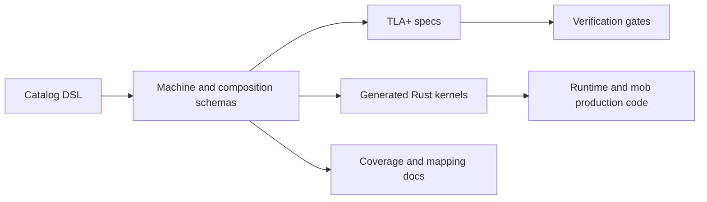

Meerkat uses executable machine definitions for state that must have one
semantic owner. The goal is simple: for any important lifecycle question, there
should be one authoritative answer to what state exists, which transitions are
legal, and what effects follow.

## Coordination Boundaries

- WorkGraph is the durable shared-work ledger. It owns dependency readiness,
  work claims and leases, evidence, and terminal work verdicts.
- Schedule is the time authority. It owns trigger calculation, recurrence,
  occurrence claims, delivery attempts, and occurrence outcomes. A scheduled
  wake does not decide whether WorkGraph work remains ready or complete.
- Detached Jobs own durable background execution, while Runtime Delivery owns
  delivery identity, sequence, replay, and application progress. A job terminal
  receipt does not by itself prove that the target runtime applied the result.
- Peer delivery accelerates discovery of durable work and wakes disposable
  execution shells. A peer send or handoff receipt is not a WorkGraph claim,
  Schedule occurrence verdict, or proof that shared work completed.
- Durable claims are authorized only by their owning machine and store
  contract. WorkGraph authorizes work claims, Schedule authorizes occurrence
  claims, and peer FIFO removal requires the exact runtime admission receipt
  bound to its claim. Queue snapshots, counters, ages, correlations, and
  projections are observability facts and cannot authorize mutation.

## Canonical Machines

The canonical registry is `canonical_machine_schemas()` in
`crates/meerkat-machine-schema/src/catalog/mod.rs`.

| Machine | Production owner | Scope |
| --- | --- | --- |
| `MeerkatMachine` | `meerkat-runtime::meerkat_machine::dsl` | Session runtime lifecycle, input admission, turn execution, tool visibility, comms drain, peer interaction, durable-tail recovery authorization. |
| `MobMachine` | `meerkat-mob::machines::mob_machine` | Mob lifecycle, roster, member runtime bindings, wiring, flows, tasks, and supervisor handoffs. |
| `ScheduleLifecycleMachine` | `meerkat-schedule::machines::schedule_lifecycle` | Schedule definition lifecycle, trigger state, and revision handling. |
| `OccurrenceLifecycleMachine` | `meerkat-schedule::machines::occurrence_lifecycle` | Claimed occurrence delivery and terminal outcomes. |
| `AuthMachine` | `meerkat-runtime::auth_machine::dsl` | Per-binding auth lease and OAuth flow lifecycle. |
| `GrantAuthorityMachine` | `meerkat-authorization::grants::dsl` | Process-local grant issuance, attenuation, revocation and current full-lineage resolution. Embeddings supply authenticated callers and controller mutation custody; this owner alone does not enable native operation enforcement or durable grant recovery. |
| `ApprovalLifecycleMachine` | `meerkat-core::generated::approval_lifecycle` | Approval request and decision lifecycle legality. `ApprovalService` and its configured store own records and optional persistence; this machine does not imply an automatic in-loop tool gate. |
| `DetachedJobMachine` | `meerkat-jobs::machines::detached_job` | Durable job lifecycle, fenced attempts, leases, retry/loss classification, cancellation, terminality, and delivery acknowledgement. |
| `RuntimeDeliveryMachine` | `meerkat-runtime::delivery_inbox::dsl` | Stable durable-inbox identity, monotonic delivery/feed sequence assignment, exact replay, and ordered application cursor. |
| `SessionDocumentMachine` | `meerkat-core::generated::session_document` | Session document, transcript, pending-continuation lifecycle, the session lifecycle terminal fact for all profiles, cold-read source disposition, and durable-tail recovery classification. |
| `SessionTurnAdmissionMachine` | `meerkat-session::generated::session_turn_admission` | Per-turn input admission and classification lifecycle. |
| `WorkGraphLifecycleMachine` | `meerkat-workgraph::machines::workgraph_lifecycle` | Work item lifecycle, readiness, dependency eligibility, claim leases, terminal state, and evidence revision handling. |
| `WorkItemAdmissionMachine` | `meerkat-workgraph::machines::work_item_admission` | Exact keyed admission identity of one work item: binds the key and request digest carried by the lifecycle `Created` route, and decides replay versus conflict for a keyed create that found an existing item. |
| `WorkAttentionLifecycleMachine` | `meerkat-workgraph::machines::work_attention_lifecycle` | Goal attention binding lifecycle, pause/resume/supersession/stop state, and binding revision handling. |
| `WorkExecutionLifecycleMachine` | `meerkat-workgraph::execution_machine` | Durable WorkGraph-to-executor binding lifecycle, launch uncertainty, terminal evidence projection, closure feedback, and retry eligibility. |
| `ForkedParticipantLifecycleMachine` | `meerkat-mob::machines::forked_participant_lifecycle` | One source-owned forked-participant capability record: reservation identity, durable fork activation identity, bounded single-holder attachment admission, revocation, expiry, and cleanup debt. Record-scoped (one machine state per capability), clock-free (expiry arrives as an observation), and credential-free (authentication arrives as an observation). |
| `TemporaryCouncilLifecycleMachine` | `meerkat-mob::machines::temporary_council_lifecycle` | One temporary-council record: request-identity binding, discussion/merge advance, immutable result sealing (executed versus coordinator-interrupted), cleanup settlement versus retained debt, and the recovery-sweep verdict. Record-scoped (one machine state per council) and clock-free. |

`MeerkatMachine` and `MobMachine` are the two runtime kernels. The other
canonical machines protect narrower domain facts: auth and approval, schedules
and occurrences, detached jobs and runtime delivery, session document and turn
admission, and WorkGraph lifecycle, attention, and execution. WorkGraph is an
optional subsystem authority for durable agent commitments, dependency-aware
claim state, and goal attention bindings. `WorkExecutionLifecycleMachine` owns
the cross-system obligation for one execution attempt without absorbing either
WorkGraph item truth or Mob Flow run truth. Its effects are realized
mechanically by the Mob composition facade, and every launch, evidence, or
closure outcome returns through a typed machine input before the binding
advances.

Two scoped authorities sit outside the canonical registry.

`SessionPersistenceVersionAuthority` owns admission of released session
envelope and metadata schema versions. Its catalog DSL lives at
`crates/meerkat-machine-schema/src/catalog/dsl/session_persistence_version_authority.rs`,
and its production expansion lives at
`crates/meerkat-core/src/generated/session_persistence_version_authority.rs`. It is a
small restore-time authority, not a persistence-currentness or recovery
authority, and it has no entry in `canonical_machine_schemas()`.

`MobHostBindingAuthority` (catalog DSL source
`crates/meerkat-machine-schema/src/catalog/dsl/mob_host_binding_authority.rs`,
production expansion `crates/meerkat-mob/src/machines/mob_host_binding_authority.rs`).
It is the member host's process-scoped, mob-keyed admission and dedup
authority for host-addressed mob commands: supervisor bind/rebind/revoke,
host-command admission, materialize admission/preflight with success-only
dedup memory, release admission with recorded-disposal replay, and the remote
turn-outcome journal. It follows the `session_persistence_version_authority`
precedent — one shared DSL body expanded into both crates, pinned by a
dedicated production-schema parity test
(`crates/meerkat-mob/tests/mob_host_binding_authority.rs`) and by kernel tests
instead of TLC — so it carries seam-inventory dispositions like any machine
but has no poster, no generated kernel, and no entry in
`canonical_machine_schemas()`.

Principal control-scope grants (multi-host mobs §8) follow the
`ToolExecutionPolicy` split. The `MobMachine` owns the grant lifecycle — the
`operator_grant_scopes` / `operator_grant_expiries` facts, the
`GrantOperatorScopes` / `RevokeOperatorScopes` transitions, and the in-machine
revalidation of caller-proposed revoke partitions — while scope *resolution*
lives shell-side in the sealed `ResolvedControlPolicy`
(`crates/meerkat-mob/src/control_policy.rs`): private shape, one `resolve()` mint
path, no serde, fail-closed to the empty scope set. Expiry is data: the
machine never reads a clock; the enforcement chokepoint reads the wall clock
once per decision and passes `now_ms` in as a parameter, so a restored mob's
expired grants stay expired with zero persisted derived state. Grant
durability is a runtime-metadata record (`MobOperatorGrantRecord`) written
only under `GrantRecorded`/`GrantRevoked` transition witnesses and replayed
on resume through the machine's own `GrantOperatorScopes` input — never a
second enforcement source.

Identity entries (a host's own durable identities, as opposed to worker
members; see [Mob Architecture](/reference/mob-architecture#identity-entries))
are `MobMachine` facts too. The machine owns which members are entries
(`identity_entry_origins`) and which open spawn ladders act for one
(`spawn_exec_entry_custody`): a `BeginSpawnExec` that carries entry custody
records the entry in the membership commit or the dormant seat that closes its
ladder, in the same step that seats the member. The legacy adoption
(`AdoptLegacyIdentityEntry`) decides from the shell's raw observation of the
member's spawn row, and the shell journals an adoption before it commits. The
replay of either row records the entry again (`RecoverIdentityEntry`, before
the boot plan is sealed). The admission probe answers an entry's name without
custody `IdentityMemberRejected`, the worker reconcile helpers range over
workers only, and the agent lane's member admission
(`ResolveAgentLaneMemberAdmission`) is a pure verdict the actor's command
admission realizes. The handle's entry reads project the published machine
state. A respawn of an entry's member is a same-session rotation (below): the
identity stays seated and an entry from its retirement's start to its next
incarnation's seat, each one machine step, so a respawned entry no longer
passes through a window in which it is neither seated nor an entry. The
machine owns the respawn's route: its fresh-life respawn arm (`RespawnRunning`,
whose input `Respawn` names the identity) admits no entry
(`not_an_identity_entry`), and its refusal twin
(`RespawnIdentityEntryRefused`, in Running, Stopped and Completed) answers
`RespawnRefused` with the reason `IdentityEntryKeepsSession`, so no
fresh-life step runs for an entry in any phase an entry lives in. The
fresh-life respawn's committed archive (the topology-preserving
`ObserveMemberRetirementArchived` arms) refuses an entry too, whatever the
shell previewed. The actor previews the verdict and routes on its reason: an
entry's respawn is that rotation, a successor spec for one is answered typed,
and the retire-then-spawn path previews it again before it retires anything
(its successor never takes entry custody). One shell step still decides from
the machine's entry facts until the machine owns it: a seat with entry
custody of a name a worker holds is refused `MemberAlreadyExists` over the
published facts. No other shell code records, removes or derives an entry.
The ci profile has no identities, so the hand-written audit
`specs/machines/mob_machine/identity_entry_audit.sh` drives the entry arms in
its runs: one records, refuses and replays entries, one takes an entry
through the dormant seat, the live retirement, the rotation, the fresh-life
respawn's refusal (in Running and Stopped) and the destroy, and the others
drive the declared apply below.

The declared apply (`MobHandle::apply_declared_roster`; see
[Mob Architecture](/reference/mob-architecture#the-declared-apply)) is
`MobMachine`'s too. `DeclareIdentityEntry` answers one verdict per declared
identity (`IdentityEntryVerdict`), one arm per verdict, each guarded by the
pure helper `identity_entry_verdict` over the declaration and the member's
facts, and each guarded to act only on an identity that is no entry or a
`Declared` one, by an explicit check: an entry of another origin is taken by
no arm. The declaration carries the shell's raw observations: the identity
store's intent rows, the session service's durability, the role the session
an unseated identity's seat would resume was last built under
(`resume_session_role`, so a seat under another role takes the migration
declared from that role or is held), and the kind of the host's first-boot
request (`first_boot`), whose preparation the declaration's own step ends
when it carries the request out. Its facts are the unseated entries with
their typed cause (`identity_entry_unseated`: `SeatOwed`,
`HostedOnFirstUse`, `HeldCreation`), the role hold
(`member_host_preparation_causes`, cause `RoleMigrationUndeclared`, which
refuses every wake as a first-boot preparation does, holds a Live local
member's run starts through `MeerkatMachine`'s `HostPreparation` hold reason
and refuses the explicit resume of the member (answered held while the
mob is still Stopped, before the resume prepares any member, and again at
its rebuild), and which ends at a verdict
that restores the role or in the step that commits the declared one, never
at the verdict that declares the move, and with its entry wherever the
entry ends, `role_hold_belongs_to_an_entry`) and the archived session of an
entry's retired member (`identity_entry_archived_sessions`). None of them has a
journal row of its own: the replay derives an entry's unseated standing and
its archived session from its member's retirement rows (the terminal row
records whether the retirement archived the session, `session_archived`, and
the replay passes whether the incarnation was hosted elsewhere,
`hosted_incarnation`), and the next apply declares the rest again. The seal
of a complete roster (`SealDeclaredRoster`) marks the seated Declared entries
it does not list (`identity_entry_retiring`) and removes the unseated ones;
a declaration that lists a marked entry again before its retirement started
drops the mark. The shell retires each marked member, its start row records
the cause, and its replay passes every such row
(`RecoverIdentityEntryRetiring`, which marks only the identity's seated
Declared incarnation and takes a no-op arm for any other row). The end of an
entry's retirement records the session it archived, and removes the entry
only when the seal marked it; any other end keeps the entry unseated, owed
its seat (hosted on its first use when placed or externally bound). The
dormant seat passes its raw observation that the session is archived and
revivable, and its guard binds an archived session only when it is the
entry's record; it takes a fresh session only once the record is let go
(`ForgetArchivedSession`: the session was observed absent, or the host asked
for a fresh life), and it never seats an entry hosted on its first use or
awaiting its held creation. A seat ends a first-boot preparation only: a
role hold survives it. A placed spawn holds an entry's custody only for an
entry hosted on its first use
(`placed_entry_custody_is_hosted_on_first_use`). Applies are serialized by
the apply-open fact (`declared_apply_open`): `OpenDeclaredApply` answers
`Opened`, or `Busy` while an apply is open, and `CloseDeclaredApply` closes
it in every phase. The shell closes it through the lease the opening step
made, on the internal lane: no grant and no Shutdown step refuses the close.
A mob reset ends every identity entry, and it commits
only on an empty roster (`ResetToRunning`'s `roster_empty` guard): its
preflight, `AdmitReset`, answers the reset's other guards, changing nothing,
before the retirement batch that empties the roster. The audit's apply runs
(`apply`, `legacy`, `resume`, `roles`, `hold`, `held` and `placed`) drive
the declare arms, the seal, the legacy adoption before an unlisted
retirement, the dormant seat with and without an archived record, the
retirement to its terminals, the reset over an emptied roster, the role
hold against the wakes of every cause and the explicit resume, held
creation, and a placed identity's custody, remote commit, retirement and
replay, with witnesses and mutants.

Created identity entries (`IdentityEntryOrigin::Created`, since 0.9.9) are
entries of the same map, recovered from the identity store at a start. After
the journal replay and before the boot plan is sealed, the shell sends one
`RecoverCreatedIdentityEntry` per created entry row, with the row's presence
(`RecoveredPresence`: `Present`, `PresentUnseated`, `Tombstone`,
`Unreadable`) and the session the identity's member was last bound to in the
replayed journal, and MobMachine decides from them and its replayed facts, in
Running or Stopped. A present row records a seated local member a `Created`
entry, or, when the replay left the identity without a member, records the
entry unseated (`SeatOwed`) with that session as its revival record; a
pending row records it unseated for its host's preparation
(`TemplatePreparation`); a removed row records the name's tombstone
(`identity_entry_tombstones`); and an unreadable row, or one the replay
contradicts (a tombstone of the name, or a spawn ladder open for it,
included), reserves the name
(`identity_entry_unreadable`). No arm records an entry for a tombstoned
name, and no replay seats a member under one. The replay
reserves the name of a member row whose origin token this build does not
know the same way. A removed entry's name is never an entry or a member
again; an unreadable name keeps what the replay recorded for it (a
`Declared` entry, a member) and takes nothing new: the admission probe
answers `IdentityNameReserved` (no spawn ladder opens, and every ladder
close, the membership commits, the remote commit and the dormant seat,
refuses a reserved name: a ladder opened before the reservation seats no
member, and the shell aborts it with the name's admission answer,
`MobError::IdentityMember`), the worker reconcile helpers
skip it, the declared apply refuses it typed (`RefusedNameTombstoned`,
`RefusedNameUnreadable`), the legacy adoption answers `NotAdoptable` and the
agent lane's admission `UnreadableName`. Custody of one origin never takes
an entry of the other (`IdentityMemberOfAnotherOrigin`): entry custody takes
a `Declared` entry's name only, and created custody (`BeginSpawnExec`'s and
`ProbeMemberAdmission`'s `created_custody`, recorded in
`spawn_exec_created_custody`) a `Created` entry owed its seat only, never
both; the dormant seat that closes a created ladder takes the entry's revival
record and keeps the member a `Created` entry. The declared apply never
declares over a `Created` entry (`RefusedNameOwnedByCreated`), and its seal
unlists readable `Declared` entries only. A reset keeps the reserved names,
which the identity store holds, and drops created custody; the destroy
clears both. The invariants `unseated_created_entry_is_preparing_or_owed`,
`tombstone_is_never_an_entry` and `entry_custodies_are_disjoint` hold these
facts. The shell re-seats an entry owed its seat once the mob runs, as the
handle's own command through that created custody, and MobMachine's guards
decide each seat.

The ci profile has no identities, so the hand-written audit
`specs/machines/mob_machine/created_identity_audit.sh` drives the created
entries' arms in four runs:

- The scan run scans a row of every presence, with and without a revival
  record, in Running and Stopped, until the boot plan's seal. The rows are
  for a replayed seated member (with or without its `Declared` entry's row)
  and for an identity without a member. The run reaches every outcome, the
  contradicted rows included, and exactly one arm answers every row.
- The reseat run opens, aborts and seats spawn ladders with every pair of
  custodies over the scanned rows, alongside the worker reconcile and the
  destroy. It checks that no ladder opens for a reserved name, that a
  ladder's custody matches its name's origin, that a seat under created
  custody binds the entry's revival record, and that a row of a name an
  open ladder acts for reserves it.
- The names run drives the declared apply, its seal, the legacy adoption,
  the agent lane's admission and the admission probe over `Created`,
  removed and unreadable names. Exactly one arm answers each, and the seal
  never touches a `Created` entry.
- The placed run scans the row of a member seated on a member host.

The audit seeds defects, one per invariant above, per action property and
per guard a reachable state needs, and refuses each.

Member rotations are `MobMachine` facts. A pending rotation records its
identity's next session (`member_rotation_session_ids`), the endpoint it
seats (`member_rotation_peer_endpoints`) and its target
(`member_rotation_targets`): `FreshSession` (a reset, a deletion) seats the
next incarnation on a new session, `SameSession` (a respawn, a declared role
migration) on the member's own. A same-session rotation starts the
incarnation's retirement in its own step (`BeginMemberRotation`, target
`SameSession`) and keeps the binding; its retirement releases the runtime
registration and keeps the session (disposal `KeptForSuccessor`, which no
plain archive takes), and its terminal (the `SameSession` arms of
`CommitMemberRotation`) retires the old incarnation and seats the next one on
that session in one step, so the identity is never unseated. A releasing
retirement of a member whose same-session rotation stands is refused: its
re-drive preserves the binding. A same-session start takes the shell's
observation of the kept session (`session_archived`), which its
`session_not_archived` guard refuses. The retirement's start row journals the
rotation, and its replay records the rotation again
(`RecoverMemberRotationIntent`), so a mob restarted mid-rotation finishes it
with the rotation's own terminal and no host record, while the plain archive
waits; an admitted destroy beats it. The start does not re-drive the
FreshSession rotation of a member its host marked host-pending: the host's
re-issue finishes it. The start, the actor's own re-drive and the re-drive of
a caller other than the host (`redrive_retirement_unless_held_for_host`)
decide that hold by one shell predicate over the machine's facts, in the
actor's own step: host-pending and a FreshSession target. A same-session
terminal keeps a host's first-boot preparation
(`member_host_preparation_causes`, cause `FirstBootRow`): only the host's seat
step ends it, so the successor of a host-pending member is seated Dormant and
every wake of it is refused until then. The same-session terminal keeps the
member's wiring and external peer edges, which the replay of its
`MemberRetired` row ends, so
its journal batch records them again after the next incarnation's row. The
release verdict (`ClassifyMemberRelease`) takes the incarnation a scoped
release names and answers `Stale` for any other. The hand-written
`specs/machines/mob_machine/member_residency_audit.sh` drives these arms in
its `rotate-same` and `recover-rotation` runs, and replays a committed
same-session terminal's rows, its kept edges among them, in its
`replay-same` run.

## Consumed Checkpoint Completion Recovery

A live steer checkpoint can durably consume an input before its completion
receipt is finalized. Its `CompletedWithoutResult` candidate is not a new
`RunResult`, and a pending completion does not make the input abandoned.

`MeerkatMachine` owns checkpoint correlation through the consumed input's
existing run association, independently of the latest run-result slot.
`ClassifyTerminalCompletionCorrelation` identifies the exact checkpoint
shape; `ResolveCheckpointCompletionResult` emits authority bound to its
session, run, owner input, candidate digest, complete recipient set and digest,
and checkpoint requirement. Every recipient must be consumed by that exact
run. A same-boundary Steer batch can have multiple recipients while retaining
one canonical owner. Neither command replaces a newer active run or changes
its terminal facts.

The boundary is the **committed receipt's** boundary, not merely the input's
requested steer mode. Live realization records it with `RecordBoundarySeq`;
cold recovery rehydrates it through `RecoverInputCompletionBoundary` only
after checking the existing receipt's run, sequence, and contributors against
the consumed input. This uses the existing durable format. An idle steer
request can execute a full turn at either `RunStart` or `RunCheckpoint`.
Its `RunResult` remains an ordinary run completion: the apply boundary is not
a terminal verdict. Only the exact consumed `CompletedWithoutResult` shape
uses independent checkpoint completion authority.

The runtime validates the complete durable owner/recipient batch before
requesting that authority, then finalizes the genuine receipt through the
existing atomic input-row compare-and-swap. A stale row, changed candidate,
wrong owner/run, or inconsistent recipient set refuses without rewriting
the evidence. Multiple checkpoint batches in one run remain distinguished
by their canonical owner inputs.

The owner-held candidate and its digest are the durable candidate authority.
The boundary receipt does not independently attest the candidate variant;
replacing both a candidate and its digest coherently before recovery cannot
be detected as historical tampering from that receipt alone. Existing row
fences still reject changes made after a completion witness was captured.

Only a successful receipt commit retires the pending obligation. The
`runtime_pending_terminal_owners` table is an index over those obligations,
not an operator lock table. Clearing it, rewriting an input as abandoned,
or fabricating a publication receipt is not a recovery operation. Ordinary
run results and directed interaction publication retain their separate
generated authority and exact EventStore receipt requirements.

## Durable-Tail Recovery Ownership

A `Session` is domain state, not a portable proof of persistence. It carries
the conversation, metadata, usage, and compact transcript-rewrite graph, but
no embedded persistence authority. Physical currentness belongs to the store:

- **WholeBlob** authority is the exact `{session_id, store_revision,
  blob_sha256}` issued with the serialized row.
- **HeadCanonical** authority is the exact `{session_id, store_revision,
  boundary_head, committed_head_token}`. The small boundary head binds its
  message-row, rewrite, graph, component, and metadata prefixes.

The intra-turn persistence hook may write a physical successor before the
runtime boundary transaction. Each successful write returns an explicit
`RunCheckpointReceipt` naming the store profile, committed base, run, exact
candidate identity, and a contiguous `candidate_sequence`. A later write in
the same run must present the preceding receipt; a retry must match it exactly.
The final boundary promotes the latest exact receipt rather than serializing
or applying the accumulated state again.

A shutdown race can still leave the latest candidate durable while its
runtime boundary is uncommitted. Durable is not the same as
runtime-committed, and recovery of that tail is machine-owned end to end.
Ownership splits three ways:

- **The runtime store retains; `SessionDocumentMachine` classifies.**
  Store-issued committed authority and provisional-tail authority decide what
  a reader may be served; a recovery candidate is never returned as an
  ordinary session. `ClassifyDurableTail` consumes the mechanically extracted tail
  shape (head relation, run-id cardinality, terminal stop reason,
  dangling/orphan tool counts) and emits `DurableTailClassified` with a
  `DurableTailRecoveryClass`: `CompletedCandidate`,
  `InterruptedRepairableCandidate`, or `Ambiguous`. The classification
  transitions are total and disjoint over the observation. A tail carrying
  any dangling tool call classifies `Ambiguous`: the call proves intent, not
  execution, so the tail is held for reconciliation rather than repaired.
  Only a store-proven descendant of the committed authority can classify as
  recoverable, and the relation comes from the store-loaded recovery source,
  never from a caller. `VerifiedStrictDescendant`: the physical head extends
  the authority's exact message prefix. `VerifiedRewriteDescendant`: a
  compaction rewrote the transcript after the authority, and the store proves
  the descent from its persisted rewrite rows (they bridge both rewrite
  prefixes, and the authority's exact row prefix chains into the first rewrite
  after it). Both relations pass the same shape checks, and neither stands in
  for the other: a descent the store cannot prove reaches the classifier as
  `Unverifiable` and classifies `Ambiguous`. Rewrite rows carry no run
  identity, so a rewrite descendant is observed from its last rewrite onward;
  when that live tail holds no message of the run it has no run id and
  classifies `Ambiguous`.
  The candidate id binds the exact store-issued base and candidate identities,
  run id, and candidate sequence, so classifying one physical tail can never
  authorize mutating a later one.
- **`MeerkatMachine` authorizes.** `AuthorizeDurableTailRecovery` consumes
  the exact classified candidate together with typed projections of the
  durable evidence: the persisted machine-lifecycle row and its current-run
  fact (`DurableRecoveryObservedLifecycle`, `DurableRecoveryObservedRun` — a
  cold recovery drives a freshly registered authority whose in-process facts
  are vacuously quiescent, so the persisted row is the real evidence), the
  highest durably committed receipt compared against the candidate's own
  content (`DurableRecoveryPriorCommit` — a candidate the receipts already
  cover refuses instead of committing a phantom duplicate boundary), and the
  attributability of the input rows the commit would terminalize
  (`DurableRecoveryInputEvidence`). Recovery is admissible only when both
  the in-process and the persisted facts are quiescent (`Idle`, `Retired`,
  or a missing row) with no current run and no recorded terminal for the
  candidate's run; every other shape refuses. The one exception is the
  drive's store-proven ownership (`DurableRecoveryOwnership`): when typed
  store facts prove that the drive holds the session's exclusive write
  authority (on the built-in SQLite realm the session's cross-process
  hosting claim; on a host store the realm fence this process holds after
  its open waited out any superseded lease), an earlier incarnation's
  non-quiescent row, or its current-run fact naming the candidate's run, no
  longer gates. A row naming another run, or one that does not decode,
  still refuses; the proof is never inferred from timing, and it covers
  earlier holders only (a drive offered another runtime owner's claim, or
  whose own runtime owner has the session registered, proves nothing). A
  drive that
  hosts the session (`ExclusiveHost`) then decides as a restart does; a
  store-only writer (`ExclusiveWriter`) cannot run the run, so it takes the
  retired cuts and never continues it. The bounded TLC audit
  `specs/machines/meerkat_machine/durable_tail_recovery_ownership_audit.sh`
  checks the partition of the arms and these rules over the whole
  observation product. Commit verdicts arrive as
  `DurableTailRecoveryCommitAuthorized` (`CommitCompleted`,
  `RepairAndCommitInterrupted`, or `CommitCompletedRetainInputs`), carry the
  machine-minted boundary sequence — one past the last committed receipt for
  the run — and record the candidate run as the turn terminal. Hold and refusal
  verdicts arrive as `DurableTailRecoveryAuthorized` (`HoldIntact`,
  `RefuseRecovery`) and mutate nothing.
  `CommitCompletedRetainInputs` lets a completed candidate commit while
  retaining a separate unbound content input for ordinary redelivery. Only
  inputs durably proven bound to the recovered run are terminalized, including
  under this disposition.
  Unbound content inputs still hold interrupted candidates; unfenceable
  input evidence holds regardless of completed/interrupted shape. The
  observation decides which rows are bound: beside a run cursor the
  classifier judges to agree with the tail, the rows the cursor binds and
  those a committed receipt names, and a content row the cursor does not
  bind counts as unbound only when it names another run (one naming no run,
  or the candidate's run, is not in the tail and stays queued); without an
  agreeing cursor, every content row not bound to the candidate run
  counts. These holds
  and the ambiguous-classification hold are machine-minted: no shell predicate
  may downgrade a commit authorization to a hold. Authorization never changes
  the lifecycle phase.
- **`RuntimeStore` realizes.** Only the machine's commit-authorizing effect
  may drive the recovery commit. Recovery seals a profile-aware
  `PreparedRuntimeSessionCommit` and submits it through
  `RuntimeStore::commit_prepared_session_boundary` as one boundary: the exact
  store candidate is promoted, the run-boundary receipt, input lifecycle transitions, terminal
  outcome, catalog projection, and outbox rows commit together. WholeBlob
  promotion reuses the candidate bytes already written; HeadCanonical
  promotion advances the committed authority to the exact physical head.
  Both are fenced on the observed store, lifecycle-row, and input-row
  identities, so a concurrent writer fails the whole boundary typed instead
  of being overwritten. No shell promotes or discards the tail.
  `recover_durable_tail(&dyn RuntimeStore, &SessionId)` is the only public
  preparation seam. The store loads an opaque
  `PreparedDurableTailRecoverySource`; recovery derives the classification,
  receipt facts, candidate identity, and physical CAS before sealing
  crate-owned `PreparedRecoveryEvidence`. There is no public request
  constructor or caller-mintable recovery capability.

The recovery rule is never-discard: every store-proven durable descendant is
preserved. Recovery commits a completed tail as a recovered run boundary,
closes an interrupted tail as interrupted (content preserved, a typed
recovery notice appended, the original run terminalized — never requeued), or
holds ambiguous evidence intact with autonomous execution blocked. Current
stores expose only store-issued committed or provisional-tail authority; the
former embedded-checkpoint projection-conflict vocabulary is not part of the
live authority path.

## Canonical Compositions

The canonical registry is `canonical_composition_schemas()` in
`crates/meerkat-machine-schema/src/catalog/mod.rs`.

| Composition | Purpose |
| --- | --- |
| `meerkat_mob_seam` | Session-runtime and mob-runtime handoffs. |
| `job_runtime_delivery` | Durable job terminal and notification outbox transfer into runtime-owned delivery identity, sequence, and application-cursor authority. |
| `schedule_bundle` | Schedule and occurrence lifecycle coordination. |
| `schedule_runtime_bundle` | Occurrence delivery into runtime sessions. |
| `schedule_mob_bundle` | Occurrence delivery into mob runs. |
| `adaptive_mob_bundle` | Adaptive control/layer mob composition, including generated layer-terminal feedback into the control kernel. |
| `auth_lease_bundle` | Auth authority publication into runtime credential consumers. |
| `workgraph_attention_bundle` | WorkGraph lifecycle and attention binding coordination. |
| `workgraph_flow_bundle` | Work execution launch, run observation, terminal evidence, uncertain-launch resolution, and WorkGraph closure handoffs through the shared Mob runtime bridge. |

These compositions are not marketing concepts or public APIs. They are
contributor-facing guardrails for the runtime implementation.

## Generated Artifacts



Generated and checked artifacts live in:

| Artifact | Path |
| --- | --- |
| Catalog DSL | `crates/meerkat-machine-schema/src/catalog/dsl/` |
| Generated kernels | `crates/meerkat-machine-kernels/src/generated/` |
| Machine specs | `specs/machines/` |
| Composition specs | `specs/compositions/` |
| Code generation | `crates/meerkat-machine-codegen/` |

## Contribution Rules

When a change affects lifecycle, routing, admission, credential state, mob
membership, or scheduling, treat it as a machine-authority change until proven
otherwise.

Use this checklist:

1. Identify the semantic owner.
2. Add or update the catalog DSL if the legal states or transitions changed.
3. Regenerate machine artifacts.
4. Update production bridge code to call the generated authority path.
5. Run the machine verification gates.

Do not add a side map, status enum, or handwritten reducer that decides the
same fact in parallel with a machine.

## Validation

Use the Make surface:

```bash
make machine-codegen
make machine-check-drift
make machine-verify
make seam-inventory
make rmat-audit
```

`make agent-gate` and CI run the relevant gates for normal development. Use the
direct targets when you are touching the catalog, generated kernels, composition
routes, or runtime bridge code.

## See Also

- [Runtime Architecture](/reference/runtime-architecture)
- [Mob Architecture](/reference/mob-architecture)
- [Capability matrix](/reference/capability-matrix)
