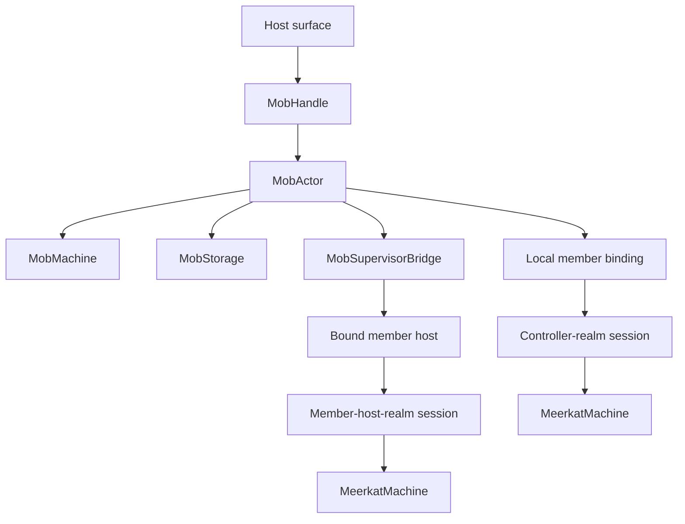

Mobs are Meerkat's multi-agent runtime. There is no separate sub-agent
substrate: delegation, helper agents, flows, and reusable profiles all compile
to mob members managed by `meerkat-mob`.

## Core Model



`MobActor` serializes mob commands, persists mob state, and projects public
status from `MobMachine` authority. Member sessions are still ordinary Meerkat
sessions, so they inherit provider, tool, auth, memory, and live-channel
behavior from the session runtime.

## Identity

Mob member identity has two layers:

| Identity | Meaning |
| --- | --- |
| `AgentIdentity` | Stable member identity. Public mob APIs, wiring, delegation, status, and profiles use this. |
| `AgentRuntimeId` | Runtime binding identity. It can rotate on respawn or binding replacement. |
| `FenceToken` | Monotonic binding epoch used to reject stale runtime effects. |
| `Generation` | Member generation counter, incremented on respawn. Since 0.9.4 a spawn never reuses a generation for an identity, across mob resets and restarts too. |
| `HostId` | Canonical bound-host identity used for placement. It is not member identity. |

Use `AgentIdentity` for facts that survive respawn. Use `AgentRuntimeId` only
for per-binding runtime facts.

Since 0.9.4 resume recovers each identity's highest generation from the whole
event log, every reset epoch included, before it replays the events after the
last `MobReset`, and every spawn takes its generation from the MobMachine. A
member re-spawned after a reset and a restart therefore never reuses its
pre-reset runtime id or member address. A store written before 0.9.4 whose
last epoch already reused a generation still resumes, and that identity's
next spawn goes above the recovered high-water.

### Member binding history

Since 0.9.4 a Rust host can read which member incarnation held which session.
`MobHandle::member_binding_history()` folds the mob's durable member journal
and Core's identity intent rows, read in one store transaction, into a
`MemberBindingHistory`. `MobReadHandle` (`read_handle()`) has the same reads.
It is not `mob/member_history`, which pages a member's transcript.

| Read | Answers |
|------|---------|
| `member_binding_for_session(session_id)` | The latest binding that named the session, across mob resets. A resume keeps a session across generations. |
| `last_member_binding(identity)` | The identity's latest incarnation since the latest mob reset, live or retired. A retired identity's session is the one `ensure_member` with `MemberLaunchMode::Resume` can restore. |
| `durable_identity_members()` | The live members spawned with `SpawnContinuityIntent::DurableIdentity`. |
| `identity_management(identity)` | Whether Core holds an identity intent row for the identity, spawned or not. |

The history value answers the same questions (`binding_for_session`,
`last_binding`, `durable_identity_members`, `identity_management`), and
`durable_identity_bindings` lists every durable identity's last binding since
the latest mob reset, live or retired.

Each `MemberBinding` carries its identity, generation, session (none for a
peer-only member), role, continuity intent and a `MemberBindingState`: `Live`,
`Moved` (a binding recovery moved the membership to another session) or
`Retired` (retired, or ended by a mob reset). `MemberIdentityManagement` is
`CommandDriven` (lifecycle commands alone drive the identity), `IntentManaged`
(Core's identity reconciler drives it, so lifecycle commands from another
caller would make a second driver) or `IntentUnreadable` (an intent row this
build cannot read; do not drive the identity).

The reads are store reads: they never wait behind the mob actor, need
`ControlScope::List` (`MobError::ScopeDenied` otherwise), and a failed read is
an error, never an empty history. A handle and its clones keep the fold
between reads, so a read reads only the journal events appended since the
previous one (with the identity intent rows, in one store transaction) instead
of reading or decoding the whole journal: it costs those events plus the size
of the history it answers (its members and sessions). A journal that a destroy
cleared is read whole again. A storage composition without the built-in
identity and member store refuses them with
`MobStoreError::IdentityMemberAtomicPersistenceUnavailable`. Pruning never
removes the events the history reads. Destroying the mob clears its journal,
so a mob created again under the same id starts a new history.

With no running mob, `MobStorage::read_member_binding_history(path)` (native
builds) reads the same history from a persistent store. It opens the file
read-only and never creates or migrates it. A missing file is
`MemberBindingHistoryReadError::StoreMissing`, and a file that is not a mob
store this build reads is `ForeignSchema`; a store that holds no mob answers
an empty history.

A binding can name a session no store holds yet. A seat, or a rotation's next
life, builds nothing: the member's first wake creates its session under the id
the seat named, so until then the session is unborn, not lost. The history's
`session_unborn(session_id)` answers it, read from the journal rows the mob's
own restart restores the fact from, and `MobHandle::session_unborn(session_id)`
answers it on a running mob. A host that checks a stopped store for bindings
whose sessions are missing leaves unborn sessions out. A member retired before
its first wake leaves its session unborn. `MobHandle::member_history` of a
member whose session is unborn answers an empty page and does not wake it.
Core's reads by session id (RPC `session/history`, REST
`GET /sessions/{id}/history`) answer not found for an unborn session, since no
store holds it; a host that serves its own reads of member sessions by id
checks `session_unborn` first. `session_bindings_since_reset()` lists the
latest binding of each session named since the latest mob reset, so a host can
tell whether an identity had a created session before its last binding: a
member reset seats the next life on a new, unborn session, while the session
of the life before it stays in that list.

A seated member that is not materialized in this process (dormant, or waking
while its wake runs) is not served yet: a dormant member has no session
actor, and a waking one may or may not have one before its wake ends. A
subscription to its agent events opens anyway, without waking it and with no
command to the mob while it waits: `MobHandle::subscribe_agent_events`,
`subscribe_agent_events_from`, `subscribe_agent_events_observation` and
`subscribe_all_agent_events` attach the member's stream at its wake, from the
woken actor's earliest retained event, so the run its next delivery starts is
read from its first event (the subscription's `attached_epoch` is set at the
attach, to the sequence space the woken actor's stream names). The mob event
router (`subscribe_mob_events`) carries such a member from its wake, and a
member released and woken again from its new actor. A member the machine holds
live whose session actor is gone is refused `MobError::MemberSessionNotLive`.
`MobHandle::member_unmaterialized(identity)` reads the residency fact from the
published machine state, with no command and without waking the member, and
stays true until the wake ends. The answer can be stale by the time the host
acts on it, and the read is never a write path: only the machine's own
transitions move a member's residency, and a host that needs a member live
wakes it with a delivery or `ensure_member_live`.

### Identity entries

Since 0.9.8 a Rust host can tell its own durable identities from worker
members. An identity entry is a MobMachine fact (`identity_entry_origins`): the
entry's member is a member like any other, and the entry adds custody of its
name.

- A spawn or a dormant seat whose `SpawnMemberSpec::entry_custody` is set
  (`with_entry_custody(true)`) seats an entry: MobMachine records the member
  an entry in the step that seats it, and the member's `MemberSpawned` row
  records the entry, so a restart restores it from the journal alone.
- No spawn or seat without entry custody takes an entry's name: it is refused
  `MobError::IdentityMember` (structured kind `identity_member`) before
  anything is created. A spawn with entry custody of a seated member's name is
  a duplicate (`MemberAlreadyExists`), and so is a seat with entry custody of
  a worker's name.
- A worker reconcile (`reconcile`, `ensure_member`) never spawns or retires an
  entry: an entry is neither desired nor stale for it. It refuses a spec that
  carries entry custody with `MobError::WiringError` before anything is
  created; a host declares an entry with `spawn_spec` or
  `seat_dormant_members`.
- The agent lane (the handle the member tools act through) does not act on an
  entry as a member: its retire, respawn, rotation, release, reload,
  cancellation (`cancel_all_work` included), run-start release and wiring
  commands addressed to an entry are refused `MobError::IdentityMember` before
  anything runs, even beside a host retirement of the same member in flight,
  and its requests carry no entry custody. It cannot adopt a legacy entry
  (`MobError::ScopeDenied`). `CommandAuthority::principal_for_agent` applies
  the same rules on top of a principal's grants, for a surface whose tools an
  agent calls: the agent mob tools of `meerkat-mob-mcp` (`mob_retire_member`,
  `mob_wire`, `mob_unwire` and the others) use it. The host acts on its own
  entries.
- A respawn of an entry's member rotates it onto its own session (see
  [Respawn, rotation and scoped release](#respawn-rotation-and-scoped-release)):
  the identity stays seated and an entry throughout, and a rotation
  (`rotate_member`) keeps the identity's standing too. A retirement keeps the
  entry: the end of its member's retirement leaves it unseated, owed its seat,
  with the session the retirement archived recorded, and the next declared
  apply seats it again there (see [The declared apply](#the-declared-apply)).
  Only the end of a retirement the apply's seal started (the host's roster
  unlisted the identity), the destroy and the mob's reset end an entry.
- A placed member is an entry only when the declared apply hosts the entry on
  its first use: a placed spawn with entry custody of any other name is
  refused `MobError::WiringError` before anything is created.

`MobHandle::adopt_legacy_identity_entry(identity)` adopts, once, a member a
host seated before identity entries existed: one whose spawn row carries the
durable-identity continuity marker or the legacy `agent_identity` label naming
its own id. MobMachine decides the adoption from that observation of the
member's current incarnation, read from the member binding history. The
adoption is journaled on a session-binding row that carries the member's
binding unchanged, with its stored peer endpoint when the machine holds one, a
restart restores the entry from it, and the label is never read for the member
again. The answer is a
`LegacyIdentityEntryAdoption`: `Adopted`, `AlreadyAnEntry`, `NameHeldByWorker`
(no marker), `NotAdoptable` (a placed member, one bound to no session, or a
retiring one), `NotSeated` or `NonAuthoritative`. A mob that is not running
refuses it (an entry answers `AlreadyAnEntry` in any phase), and it needs
`ControlScope::Retire`, checked before any answer. A member whose incarnation
keeps changing while its binding history is read answers the retryable
`MobError::LifecycleOperationPending`.

The reads need no actor command and never wake a member:

| Read | Answers |
|------|---------|
| `identity_entry(identity)` | `IdentityEntryRead::Entry` with the entry's origin, its member's standing (seated or retiring, with its generation, session, profile and runtime mode, or unseated, with its `UnseatedEntryCause`), whether it is Broken, the host preparation it owes (`HostPreparationCause`), if any, and the target of a rotation of it in flight (`RotationTarget`), if any; or `NotAnEntry` with the worker that holds the identity, if any. |
| `identity_entries(after, limit)` | One page of the entries in identity order, at most `IDENTITY_ENTRY_PAGE_MAX`, and the identity to read the next page after. |
| `identity_census()` | The entries declared, seated, retiring, unseated by cause (`UnseatedEntryCounts`), Broken, with host preparation pending and with a rotation in flight. |
| `member_lifecycle_events(after, limit)` | One page of the journal's member lifecycle facts after a `MobJournalCursor`: spawns and seats (with the entry a row records, and the `HistoryUnavailable` notice of a seat on a fresh session whose archived session was gone), legacy adoptions, retirement starts (with the target of the rotation a start belongs to, and the cause `Unlisted` when the declared apply's seal started it), retirements, member resets and mob resets. |
| `members_holding_run_starts(reason)` | The members whose run starts the host holds for `reason`, as `release_member_run_starts` releases them. |

All but the journal read answer from the machine state the actor last
published, as `member_unmaterialized` does: the answer can be stale by the time
the host acts on it, and it never says whether a member is materialized. The
journal read is a store read. They need `ControlScope::List`, and the journal
read `ControlScope::SubscribeEvents`. An entry read whose machine facts are
incomplete answers `MobError::Internal` rather than a default. An entry's
fields are internal to the stored event codec, so an older release reads an
entry's rows as an ordinary member's.

### The declared apply

Since 0.9.9 a Rust host declares its identity entries as data, and Core
applies them: `MobHandle::apply_declared_roster(DeclaredRoster)`. The host's
roster is the authority. A `DeclaredRoster` holds the identities it declares
(`DeclaredEntry`: a `SpawnMemberSpec`, and whether the host holds the
identity's creation for its held protocol), whether it is the host's complete
roster, the role migrations it declares (`with_role_migration(identity,
from)`) and the host's one-shot first-boot requests (`FirstBootRequest`).
MobMachine decides each identity's verdict from its declaration and its member
facts (`DeclareIdentityEntry`), in memory, in chunks of
`DECLARED_APPLY_CHUNK` identities, each one machine step, and the handle
realizes the verdict with the mob's own steps. Each identity is answered on
its own (`DeclaredRosterOutcome::entries`, a `DeclaredEntryOutcome`): one
identity's refusal or failure never fails the pass. The call fails as a whole
only for a mob that is not running, an identity store whose intent rows
cannot be read now (retryable), or another apply of the mob that is running:
applies of one mob run one at a time, and a call while another runs is
refused `MobError::LifecycleOperationPending`, retryable, and writes nothing.
It needs `ControlScope::Retire` (and `ControlScope::SendCommand` for its
seats); the agent lane is refused `MobError::ScopeDenied`.

| Identity | Verdict and answer |
|----------|--------------------|
| No member holds it | Seated Dormant (`Seated`): on the session its retirement archived, on a first-boot request's session, or on a fresh session. No wake. A fresh seat of an identity that owes a kickoff is spawned live (`Embodied`). When the session the seat resumes was last built under another role, the seat declares the migration the roster declares from that role, and the session's next build moves it; with none declared the identity is held (`RoleMigrationHeld`) and not seated. |
| Seated, role and runtime mode as declared | Kept (`Kept`): nothing is written. A change of display name, labels, context or instructions alone is no lifecycle fact: the facets are the host's and the apply stores none of them, so the member's next build applies the host's current ones only through the host's build preparer or spawn customizer (the build inputs a seat recorded stay as recorded). A change of placement alone is kept too: placement is read only for an identity no member holds. |
| Seated, another runtime mode | Restamped on its own session at its next generation (`Restamped`), once it is idle. |
| Seated, another role, the migration declared from its current role | Restamped under the new role on its own session (`RoleMigrated`), once it is idle. |
| Seated, another role or mode, on a session that lives in memory only | Rotated onto a fresh session (`RoleRotated`). |
| Seated, another role, no migration declared | Held (`RoleMigrationHeld`): every wake refused `HostPreparationPending` (a host's, a peer's, the boot plan's), and a Live member's run starts held (`HostRunStartHoldReason::HostPreparation`): its run in flight finishes, never preempted, no new run starts under its previous role, and the mob releases it when idle. The explicit resume leaves it alone. An apply that restores the role ends the hold; one that declares the move ends it in the step that commits the new role, so a deferred or refused restamp keeps it. The entry reads name `HostPreparationCause::RoleMigrationUndeclared`, and `members_holding_run_starts(HostPreparation)` lists a held member. A hold never blocks a retirement. |
| Placed or externally bound, no member | Hosted on its first use (`HostedOnFirstUse`): its host creates the member, a placed spawn holding the entry's custody. |
| Held creation, never created | Awaits its held creation (`AwaitingHeldCreation`): the host's held protocol creates it. The host's current hold policy decides on every apply; nothing is kept of an earlier one. |
| Spawn, wake or retirement in flight | Deferred to the next apply (`Deferred`). |
| A worker holds the name, the identity store manages it (a host adoption), declared twice, or a first-boot request for an undeclared identity | Refused for that identity alone (`Refused`, `DeclaredEntryRefusal`). |
| Any, in a candidate composition | Refused `NonAuthoritative`: a candidate declares nothing and writes nothing. |

A legacy member listed under its own name is adopted first
(`adopt_legacy_identity_entry`) and then declared as the entry it is. A
dormant seat never takes an identity hosted on its first use or awaiting its
held creation (`MobError::WiringError`).

A complete roster is sealed after its last chunk (`SealDeclaredRoster`):
every Declared entry it does not list is unlisted. Its member, when one is
seated, is retired; the retirement's start row records the cause `Unlisted`
(`MemberLifecycleEvent::RetirementStarted::cause`), and the end of the
retirement ends the entry. An unlisted entry no member holds is removed at
once. A worker is never unlisted. The answer names each unlisted entry
(`DeclaredRosterOutcome::unlisted`: `Retired`, `Removed`, or `Failed`, which
the next complete apply retries). Any other retirement keeps the entry: a
host's `retire` of a declared identity that stays listed ends its member, and
the next apply seats the identity again. To remove a declared identity, unlist
it.

An unlisted identity listed again comes back as the same identity. The end of
its retirement recorded the session it archived (MobMachine's
`identity_entry_archived_sessions`, also on the replay of the retirement's
row, which records whether the retirement archived the session: one it only
released, such as a session another host owns, is not recorded), and the
apply seats it Dormant on that session at its next generation; its first
wake revives the session, with its history. When that session is gone from
the store (its retention purged it), the identity is seated on a fresh
session, and its answer and its seat's journal row carry the typed notice
`HistoryUnavailable`, naming the lost session (an identity that owes a
kickoff is embodied with the same notice). When the store cannot read the
session now, the identity is deferred, retryable, and never seated on a
fresh session. A lost session never leaves a declared identity unseatable,
but an intact one can: an archived session whose runtime refuses revival
(its runtime was destroyed) is answered `Failed`
(`MobError::SessionUnavailableForResume`, `ArchivedNotRevivable`) on every
apply, since a fresh session would lose its history, until the host sends
the identity's `Fresh` first-boot request, which starts its fresh life. A
session no build created holds no history, and the identity is seated on it
again. An identity retired before 0.9.9 has no record and is seated on a
fresh session, and so is one whose record a member seated under its name
ended (a worker spawned while it was unlisted), with no notice.

A first-boot request is carried out once: `Resume { session_id }` seats the
identity on that session (a member already seated carries it out in its
declaration's own step), and `Fresh` starts its fresh life on a new session,
letting its archived session record go. The answer names the requests the
apply carried out (`DeclaredRosterOutcome::first_boot_requests_carried_out`),
and the host consumes exactly those: a deferred, refused or failed answer
leaves its request with the host for the next apply, and the host's own
creation carries out the request of an identity hosted on its first use or
awaiting its held creation.

The verdicts write no journal row of their own: an unseated entry, a role
hold and a held creation are MobMachine facts in memory, and the next apply
declares them again. An unchanged roster writes nothing and wakes no member.
Between a restart and the first apply after it, MobMachine knows only the
entries its journal rows record: the seated ones, and those whose member a
retirement other than the seal's ended (unseated, with the session the
retirement archived). An entry no member ever held and a role hold are not
restored: until that apply, a member whose role the host moved while the
process was down is not held, and a peer delivery can wake it under its
previous role. So a host applies its roster once after every start, before
it wakes or seats its identities: a role moved while the process was down is
held only from that apply on.

The roster vocabulary keeps the residency words: a seated member is Dormant
until its first delivery wakes it, whether the apply or a seat seated it; a
held member is Dormant and refuses its wakes; an unseated entry is no member
at all (`EntryStanding::Unseated`, with its `UnseatedEntryCause`: `SeatOwed`,
`HostedOnFirstUse` or `HeldCreation`) and is listed by the entry reads only.

The apply's types are `#[non_exhaustive]`, and the apply is Rust-only: the
wire contracts do not carry it.

### One-shot durable role migration

Role is durable context, but it is not member identity. `MemberLaunchMode::Resume`
can carry `resume_from_role` on one exact trusted-host request. The declaration
must name the role stored on the exact cold session. The mob id,
`AgentIdentity`, and session id remain unchanged.

When the stored and requested roles differ, an absent declaration fails with
`MemberRoleMigrationRequired`; incorrect, inapplicable, and live-session attempts fail with
`MemberRoleMigrationRejected`. Success retains the transcript and restamps the
current comms name, typed member binding, role/profile labels, callback
context, and explicitly configured tooling. The declaration is not persisted,
so a `SpawnMemberCustomizer` must re-supply it at `SpawnSource::Resume` after
process restart. A same-session respawn that names another profile is the one
exception: its next incarnation's spawn row records the declaration (see
[Respawn, rotation and scoped release](#respawn-rotation-and-scoped-release)).

This seam exists on trusted in-process `SpawnMemberSpec` and private
`MaterializeLaunchMode::Resume` only. Agent tools, standing profiles, CLI,
public RPC/REST/MCP/SDK spawn contracts, and Web do not expose it.

### Respawn, rotation and scoped release

Since 0.9.8 a member can be respawned on its own session, a rotation finishes
after a crash on its own, and a release can name the incarnation it means.

`MobHandle::respawn_member(identity, MemberRespawn)` rotates a member onto its
own session. One MobMachine step starts the current incarnation's retirement
and records the rotation while the member stays seated on its session. The
retirement cancels the member's running turn, releases its runtime
registration and keeps the session. A second step retires the incarnation and
seats the next one Dormant at the next generation on the same session, so the
identity is never unseated, and the next incarnation keeps the member's
conversation, comms identity, wiring edges and external peer edges. The
second step's journal batch records the kept edges again after the next
incarnation's row, so a restart (under an older release too) restores them.
When the member's session
commits each round, its queued inputs that may cross a stop (durable prompts
not bound to an objective) stay queued: their waiters are answered
`RequeuedAcrossStop`, and the next incarnation, woken by the work the handover
leaves it, runs each of them once. Every other input ends stopped, typed.
`MemberRespawn` can name an initial message (run once as the next
incarnation's first turn), a profile (a declared role migration: the next
incarnation's spawn row records the role its session was last built under, so
its first build restamps the session, after a restart too), a runtime mode,
and `with_wake(true)` to wake the next incarnation before answering. The answer
is the successor's `MemberRespawnReceipt`. A wake that fails after the
successor is committed does not fail the call: the member stays seated
Dormant and the receipt reports the wake's error
(`MemberRespawnReceipt::wake_error`), since calling again would respawn the
member again. A member a same-session successor cannot serve is refused
`MobError::UnsupportedForMode` before anything starts. MobMachine's facts
refuse a placed member and one bound to no session of its own, and its start
refuses one whose session the plan observed lost or archived. The shell's own
facts, which no machine holds, refuse one that is not runtime-backed or whose
service keeps no durable sessions, a fork-derived member and one holding a
forked participant attachment (the lineage belongs to the incarnation that
holds it), and one whose session's creation record, spawn continuity or (for
a role migration) last role cannot be read. A member whose retirement is in
flight is refused retryable (`LifecycleOperationPending`), unless that
retirement is this rotation, which the call re-drives. MobMachine decides the
route of an identity entry's member: its fresh-life respawn (`Respawn`) admits
no entry and answers `RespawnRefused` for one, in every phase an entry lives
in (Running, Stopped and Completed), and the archive of a fresh-life respawn
refuses an entry too. So `MobHandle::respawn` respawns an identity entry's
member this way, and
`MobHandle::respawn_with_successor_spec` refuses an entry's member
(`UnsupportedForMode`) before anything starts; a worker's respawn keeps its
fresh-session successor.

A rotation is durable from its start. Its retirement's start row records it:
its target (`RotationTarget::FreshSession` for `rotate_member`, `SameSession`
for a respawn), its next session and endpoint, and what its next incarnation
is seated with. A mob restarted at any point of the rotation records it again
from that row and finishes it itself; no host record is needed. A host that
keeps its own record of a `rotate_member` passes the identity host-pending
(`MobBuilder::with_host_pending_members`) and calls `rotate_member` again
with the same spec after the restart: the restarted mob does not re-drive
that FreshSession rotation, logs that it holds it, and records its retirement
stuck at admission with a cause that names the wait
(`MobHandle::retirement_settlement`; `MobHandle::rotation_held_for_host`
reads the hold), and the call finishes it once (`redrive_retirement`
re-drives it too). A plain retire by any caller answers
`MemberRetirementStuck` with that cause and leaves the rotation held, and so
does `redrive_retirement_unless_held_for_host`, the re-drive of a caller
other than the host, which a session archive through `meerkat-mob-mcp` uses:
the actor decides the hold in the re-drive's own step, by the one predicate
the start and its own re-drives use. A same-session rotation is the mob's
own: the restart finishes it whatever the host-pending set says, and a
host-pending member keeps its mark through it. Its successor is seated
Dormant, and its wakes are refused `HostPreparationPending` until the host's
seat step for it (a `seat_dormant_members` of the identity on its kept
session, which answers `AlreadySeated`) ends the mark: the host wakes first.
Re-issued while its rotation stands, `rotate_member` re-drives that rotation;
re-issued after it finished, it rotates the member again. So a host that does
not mark the member host-pending reads the member once after a restart (the
replay is done before the handle is returned) before it re-issues an
unanswered call: a higher generation means the rotation finished; a Retiring
member (`list_members_including_retiring`) means it stands, and the mob
finishes it; the generation the call saw, not Retiring, means it never
started, and the call is made again. While a rotation of the member stands,
`redrive_retirement` re-drives the rotation and any other retirement of the
member is refused retryable. A recorded rotation whose next incarnation cannot
be planned again (its profile left the definition) stays recorded and stuck
until a call plans the same next session: `rotate_member` with a spec the
definition plans, for a FreshSession rotation, and `respawn_member` naming a
profile the definition has, for a same-session one, which `rotate_member`
cannot end (it plans a fresh session, refused while that rotation stands).
The mob's destroy ends either. A rotation never takes over a retirement of
the member that started without it, whose start row records no rotation:
`rotate_member` is refused retryable while that retirement stands, unless the
member is host-pending, and a retry alone does not succeed until that
retirement finishes or is re-driven. The record is internal to the stored
event codec: an older Meerkat release replays the start row as a plain
retirement's, and a record this release cannot read fails the resume typed.

`MobHandle::release_member_at_scope(scope)` releases a member's
materialization only when its `MemberDeliveryScope` (from
`capture_member_delivery_scope`: the mob's incarnation and the member's
runtime id, fence and session) names the member's current incarnation on its
current session, and answers `ReleaseOutcome::Released`. Any other scope answers
`ReleaseOutcome::Stale` and releases nothing, so a release meant for an
incarnation a respawn replaced never reaches its successor. MobMachine decides
the verdict. `release_member` stays unscoped.

## Runtime Bindings

Member construction and member placement are separate facts. Members can be
local session-backed agents, explicitly bound external peers, or session-backed
agents materialized on a bound member host.

| Form | Contract |
| --- | --- |
| `RuntimeBinding::Session` | Meerkat provisions and owns a local session for the member. |
| `RuntimeBinding::External` | The host declares the external runtime address, Ed25519 public identity, and typed bootstrap token. The mob derives the real peer id and routes through that runtime. |
| `SpawnMemberSpec.placement = Some(HostId)` | The controlling mob compiles a portable member spec and a bound member host materializes a realm-local session. Placement is not a third `RuntimeBinding` variant. |

External members require an explicit runtime binding. A bare `External` backend
tag is not enough because the runtime needs a concrete process identity before
it can route work or trust peer messages. For a remote `rkat` member, generate
the current binding with `rkat run --comms-listen-tcp ... --comms-binding-out <path>`.

### Placed-member portability

The remote spawn lane accepts only a digest-covered `PortableMemberSpec`.
Machine admission rejects, rather than drops, all controller-local executable
or secret-bearing fields:

| Typed category | Rejected input |
| --- | --- |
| Non-portable executable objects | Rust bundles, per-spawn external tools, mob-default external tools, default LLM client override, in-process compaction curator override |
| Controller-local policy | Host-surface MCP allow-list, inherited tool filter, WorkGraph tools |
| Secret-bearing fields | Shell environment, MCP stdio environment, MCP HTTP headers |

Placement also cannot be combined with an explicit backend or
`RuntimeBinding`; the member must have exactly one execution transport story.

WorkGraph tools are controller-local because the WorkGraph store and execution
binding remain on the controlling host. Schedule tools are portable. Memory
and declarative MCP servers require matching member-host capabilities and must
not carry the rejected secret fields. Host capability admission also checks
autonomous members, durable sessions, tracked input cancel, bridge protocol
v4, memory store, and MCP when the resolved member requires them.

## Host-designated conversational input

Trusted Rust hosts can submit authenticated human input with
`MobHandle::submit_host_human_input_bounded(runtime_id, fence_token, spec,
handling_mode, delivery_identity, deadline)`. It returns `WorkDeliveryReceipt`
after runtime admission, not after an LLM response.
`start_host_human_input_bounded` takes the same arguments and returns a
`WorkTurnHandle` for separate runtime-owned completion observation.
`submit_host_human_input_for_identity_bounded` resolves an identity once before
the same fenced admission. A host already holding a delivery lease should pass
its exact runtime and fence instead of resolving a replacement.
`submit_host_human_input_with_options_bounded` and
`start_host_human_input_with_options_bounded` add host-owned
`MemberTurnOptions` to the same fenced admission. Selected skills
(`MemberTurnOptions::with_skill_references`) resolve natively on that exact
member, with typed `SkillsResolved` / `SkillResolutionFailed` events and a
durable `SkillContext`. The options are part of the runtime's exact replay
identity, so a retry with the same delivery identity and options returns the
original admission and a changed selection is
`MobError::WorkInputIdempotencyConflict`. The selection is order-sensitive:
a replay must repeat the same keys in the same order. An empty selection is
treated as no selection. An interaction id that differs from the delivery
correlation is refused with `MobError::DeliveryInteractionConflict`.

This is a Rust-only designation, not a serializable `WorkSpec` role or an
agent-tool flag. The host must authenticate the human before opting in.
`WorkOrigin` still governs addressability. Existing generic work APIs retain
their behavior, including autonomous `SystemNotice::ExternalEvent` delivery.
Only the explicit human seam delivers the work content as canonical
conversational `Message::User`. System and injected-context slots keep their
own roles. Installed shared Live context receives conversational input and
assistant text from the normal store-sealed commit path; platform notices
are not promoted.

| Local runtime-backed member input | Queue | Steer |
| --- | --- | --- |
| Human text or multimodal content | Supported | Supported through runtime boundary admission |
| `WorkSpec.injected_context` | Supported in its separate role | `InjectedContextUndeliverable` |
| `WorkSpec.transient_turn_context` | `UnsupportedForMode` | `UnsupportedForMode` |
| `WorkSpec.system_prompt` | Supported as System | `UnsupportedForMode` |
| Unresolved kickoff requiring a mode change | Ordinary Queue admission | `UnsupportedForMode`, never silently Queue |
| Remote or peer-only member | `UnsupportedForMode` | `UnsupportedForMode` |

Use `MobDeliveryIdentity::new(stable_key, interaction_uuid.to_string())`, retain
both values across retries, and keep any `WorkSpec.interaction_id` identical to
that UUID. The deadline is `meerkat_core::time_compat::Instant`
(`std::time::Instant` on native hosts).
`ActorCommandTimedOut` reports unknown execution fate: an already-started
admission may finish after the observation deadline. Retry only with the same
delivery identity. Dropping a completion handle does not cancel work.
On replay, the receipt refers to the original admission, even if that work
already terminalized. Completion-bearing replay reads the original runtime
terminal result; an unavailable result is an explicit
`WorkInputCompletionUnavailable`, never synthesized success.

Human admission requests exact prompt replay from the runtime owner. A compact
prompt witness is persisted atomically with the input row and survives terminal
payload retirement. A repeated strict request must match the original prompt,
typed context slots, handling mode, and correlation; a prior external event,
changed body, or legacy row without a provable prompt witness returns
`WorkInputIdempotencyConflict`. Generic callers keep their existing key-only
deduplication contract. Stale runtime/fence pairs remain machine-refused.

## Multi-Host Authority

Realms are not distributed. The controlling host and each member host retain
one local realm and one set of local session authorities.

| Owner | Durable authority |
| --- | --- |
| Controlling `MobActor` / `MobMachine` | Mob identity, roster, topology, placement, route-install obligations, grants, member generation/fence, merged observation, flow/work lifecycle, teardown |
| Member host | Host binding admission, materialization, realm-local session execution, history/events, provider credentials, compaction, memory, and live media endpoint |
| `meerkat-comms` | Signed transport, peer trust and routing mechanics, inbox delivery |
| Meta or another console | Projection and operator UX only; no shadow roster, host directory, or lifecycle authority |

One host acceptor serves many placed members and demultiplexes signed envelopes
by recipient public key. The peer envelope stays identity-addressed. The
private `supervisor.bridge` protocol shares that transport but has separate
machine admission and is never promoted to ordinary agent authority.

Remote observation is controller-proxied. Member history is read from the
owning host, and remote event pages feed the controlling mob's merged stream.
The public identity-routed operations remain placement-transparent. Host
reachability, route-install convergence, generation, fence, and provenance
remain visible as typed evidence. Hosts advertise
`runtime.capabilities.features.multi_host_mobs`; clients must treat `false` as
an unsupported capability, not infer support from method presence.

The placed session id remains realm-local to its owning member host. A client
cannot feed it to the controller's generic `session/*` methods. Use mob
identity operations and `mob/member_history`; remote transcript revision and
edit methods are not part of the v1 bridge.

## Public Surfaces

| Surface | Mob role |
| --- | --- |
| Trusted in-process Rust host | `MobHandle` and typed builders expose the full local authority seam, including principal-scoped `hard_cancel_member`, process-local compaction curator overrides, and one-request role migration on `SpawnMemberSpec`. |
| CLI `rkat mob ...` | Helper/run resources plus host bind/revoke/list, grants, remote observations, and live control. Cooperative `force-cancel` is not hard cancel. |
| JSON-RPC `mob/*` | Full host control plane, including placement, host/grant families, remote observation, `mob/hard_cancel_member`, and member live control. |
| REST | Remote-transparent ordinary routes plus read-only hosts, route installs, and member history. No host/grant/live/hard-cancel administration. |
| Public MCP `meerkat_mob_*` | Same intentional multi-host operator restriction as REST. |
| Agent tools `mob_*` / `delegate` | Agent-facing orchestration. Spawn/delegate may name a bound placement, but agents cannot administer hosts, grants, live channels, observations, or hard cancel. |
| Python / TypeScript SDKs | Typed wrappers over the full RPC mob surface. |
| Web SDK | In-browser single-host runtime. Non-local placement is rejected by the typed capability boundary. |

## Flows

Flows are declarative work graphs. They support one-to-one, fan-out, fan-in,
branching, and frame/loop nodes. Flow status is persisted, so a host can check
live state first and fall back to the terminal snapshot.

### WorkGraph Bridge

WorkGraph commitments and Flow runs remain separate authorities. A durable
`WorkExecutionBinding` records the exact effective Flow run configuration and
deterministic run identity before execution. The generated execution lifecycle requests the
launch, observes Mob-owned terminal state, requests evidence projection, and
feeds the WorkGraph closure result back into the binding lifecycle.

The external-delivery ledger is not a second run machine. Its `realizing`
phase is a custody fence, crossed by the Mob actor only after the deterministic
pending `MobRun` is durable. Mob remains the sole owner of run lifecycle. The
ledger prevents blind target reinvocation across an unobserved reply boundary.

Flow success is evidence, not completion authority. WorkGraph's completion
policy remains the only path that can terminalize the commitment. Failed and
canceled runs remain terminal execution attempts and may be superseded by a
new binding while the WorkGraph item stays open.

For multi-host mobs, the binding and WorkGraph store remain on the controlling
host. Remotely placed members execute Flow steps through normal Mob routing;
they do not independently claim or mutate the controlling WorkGraph. Terminal
run observation and evidence projection return to the controlling host, so
distributed execution does not create replicated WorkGraph authority.

## Persistence

Persistent mob state is SQLite/WAL-backed through `SqliteMobStores`.
In-memory storage is used for tests and WASM. The previous exclusive-handle mob
store is gone.

### Admission and actor exit

Every exit of a mob actor closes the mob's admission first, with a typed
`MobAdmissionCloseReason`: `Shutdown` (an admitted Shutdown), `Destroyed` (an
admitted destroy; a mob restored with an unfinished destroy starts closed),
`DurabilityFailStop`, `ActorLost` and `DispatchFailed`, besides `IdleClose`,
`LastOwnerReleased` and `StandDown`. An earlier close keeps its reason. While a
Shutdown drains, requests the close does not refuse get the retryable
`MobError::ShutdownInProgress` (wire `SESSION_BUSY`), and
`ActorCommandChannelClosed` means the actor has exited or is exiting. The mobs
guide's Persistence section has the full rules.

### Durable definition updates

The structural event log owns the durable definition. `MobCreated` establishes
definition epoch 1; each `MobDefinitionUpdated` is a strict MobMachine-authorized
successor. The mob spec store is only a projection and its revision must equal
the authoritative epoch.

Trusted Rust hosts update a cold process-local mob before resume:

```rust
let revision = storage
    .update_definition(expected_revision, updated_definition)
    .await?;
let snapshot = storage
    .created_definition_snapshot()
    .await?
    .ok_or_else(|| anyhow!("mob definition is missing"))?;
let mob = MobBuilder::for_resume_verified(storage, snapshot)
    .with_session_service(session_service)
    .resume()
    .await?;
```

The event authority commits first under an atomic CAS. If the process fails
before the projection write, exact retry or resume repairs the stale projection.
`MobStorage::definition_projection_health()` exposes missing, stale, healthy,
and diverged states. A same-revision content mismatch or projection-ahead state
fails resume with `MobDefinitionProjectionMismatch`; consumers must not append
raw events, write only the spec projection, or weaken this refusal.
Hosts that inspect a definition before resume use the storage-minted
`MobDefinitionSnapshot`. Verified resume compares its full definition, epoch,
and authoritative `MobCreated`/`MobDefinitionUpdated` event cursor against the
actual replay before repair or actuation; a concurrent update returns
`MobDefinitionAuthorityChanged`. The verified resume claim holds the
database's shared cross-process fence through runtime construction;
`update_definition` takes the matching exclusive fence, so an external SQLite
writer cannot cross the replay-to-actuation interval.

Multi-host persistence is deliberately split. The controlling realm stores
the mob, host bindings, placement, grants, route obligations, flow/work state,
and merged event position. The owning member-host realm stores each placed
session and its history. Restart recovery replays these authorities and
re-establishes routes; it does not copy member realms into the controller.

Mobpacks are portable mob artifacts. They package definitions, optional runtime
assets, capability declarations, and optional signature metadata. Verifier
trust policy and trusted-signer enrollment remain host-owned. Deploy through:

```bash
rkat mob pack ./mob -o ./dist/mob.mobpack
rkat mob inspect ./dist/mob.mobpack
rkat mob validate ./dist/mob.mobpack --trust-policy permissive
rkat mob run ./dist/mob.mobpack --prompt "run this mob" --trust-policy permissive
rkat mob web build ./dist/mob.mobpack -o ./dist/web --wasm ./meerkat-web-runtime/pkg --trust-policy permissive
```

`mob web build` copies the required prebuilt wasm-pack output into the browser
bundle; it does not compile wasm32.

## Live Channels

Live channels execute in the owning session. For a mob member, use the
identity-routed `mob/member_live_open`, close, status, and control family. It
is placement-transparent: after the mob's member checks, the member's own live
host serves the requested transport (the owning host's WebSocket endpoint, or
a WebRTC bootstrap answered with `live/webrtc/answer` on the same JSON-RPC
server) or refuses it with `LiveTransportUnsupported`. A channel-scoped
`execution_identity` (gpt-live-1) is served for a member local to the
JSON-RPC server; a placed member refuses it with `Unsupported`. Session-scoped
`live/open` refuses a mob member's session.

The old realtime attachment/status plane has been removed. Live channel
lifecycle is caller-initiated through the `live/*` method family.

## Source Pointers

| Area | Source |
| --- | --- |
| Mob actor | `crates/meerkat-mob/src/runtime/actor.rs` |
| Mob handle | `crates/meerkat-mob/src/runtime/handle.rs` |
| Member identity | `crates/meerkat-mob/src/ids.rs` |
| Storage | `crates/meerkat-mob/src/store/` |
| Agent-facing tools | `crates/meerkat-mob-mcp/src/agent_tools.rs` |
| Supervisor bridge | `crates/meerkat-mob/src/runtime/supervisor_bridge.rs` |
| Member-host materialization | `crates/meerkat-mob/src/runtime/host_materialize.rs` |
| Host binding authority | `crates/meerkat-mob/src/machines/mob_host_binding_authority.rs` |
| Shared host acceptor | `crates/meerkat-comms/src/host_acceptor.rs` |
| Mobpack | `crates/meerkat-mob-pack/` |

## See Also

- [Mobs concept](/concepts/mobs)
- [Mobs guide](/guides/mobs)
- [Mobpack and Web Deployment](/guides/mobpack)
- [Runtime Architecture](/reference/runtime-architecture)
